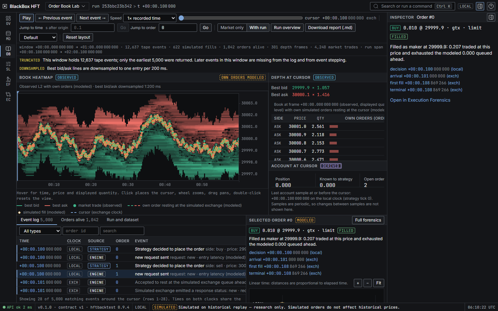
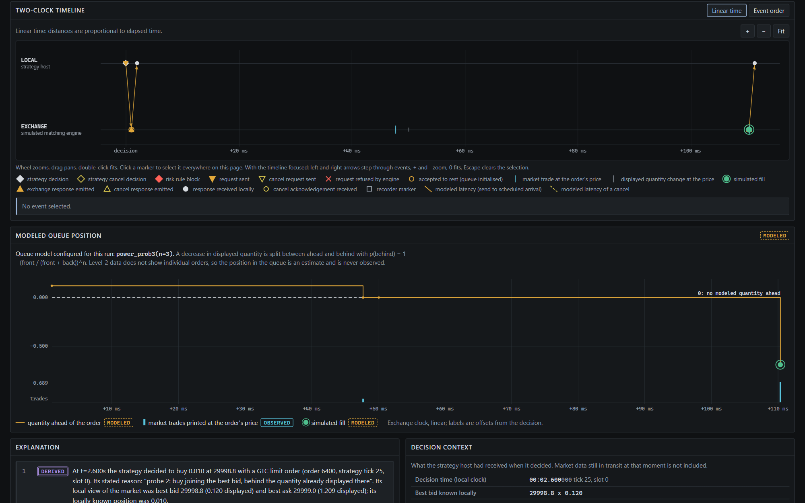
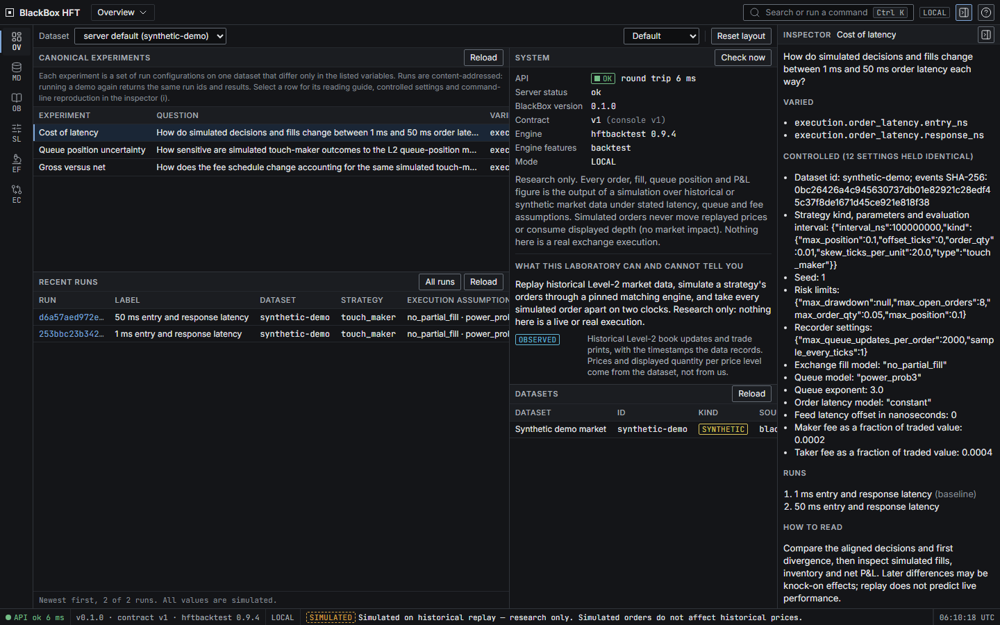
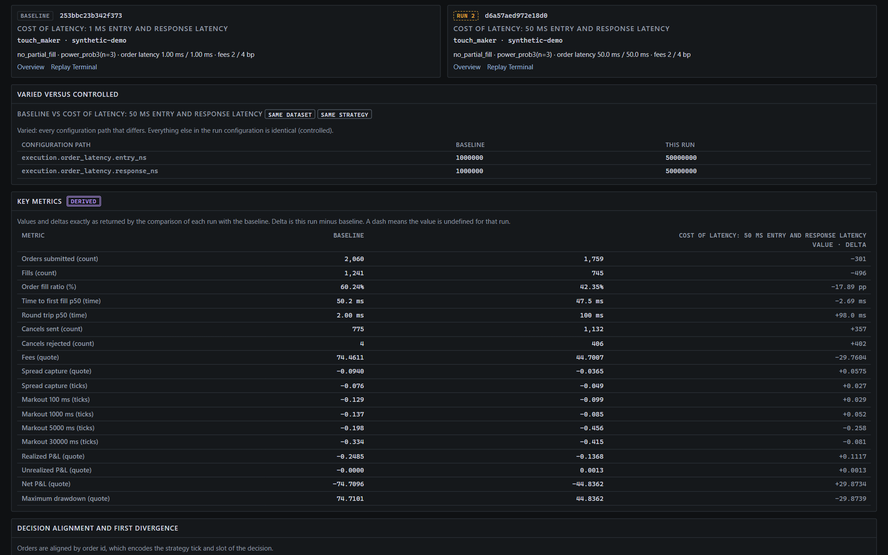
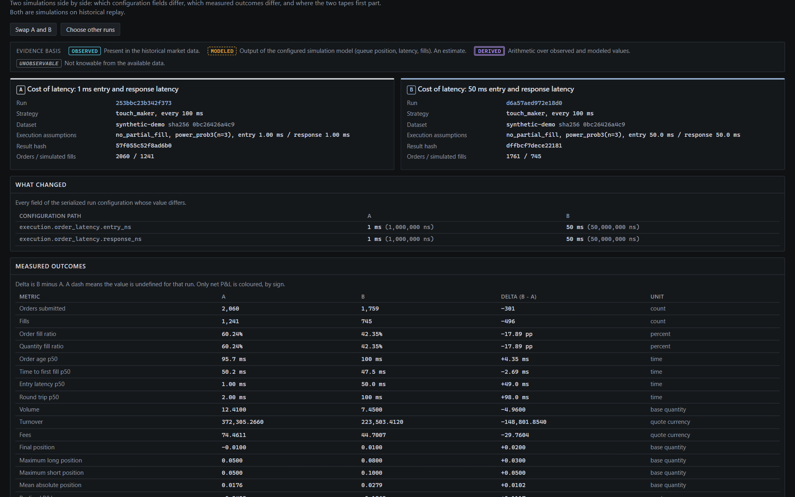
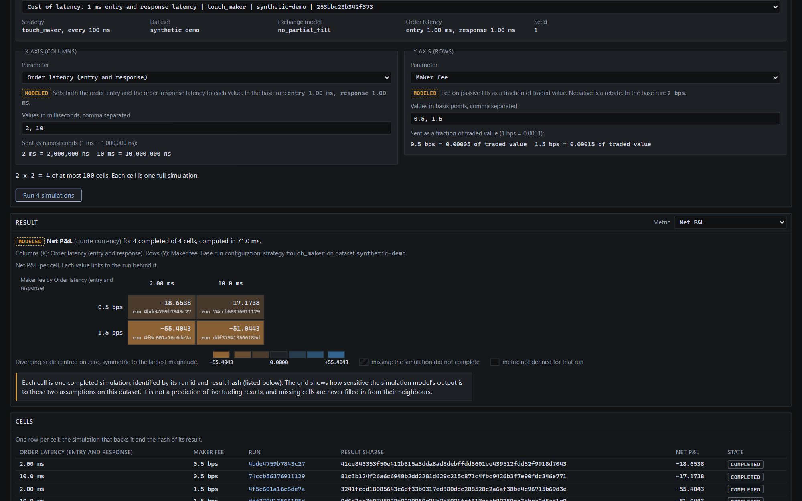
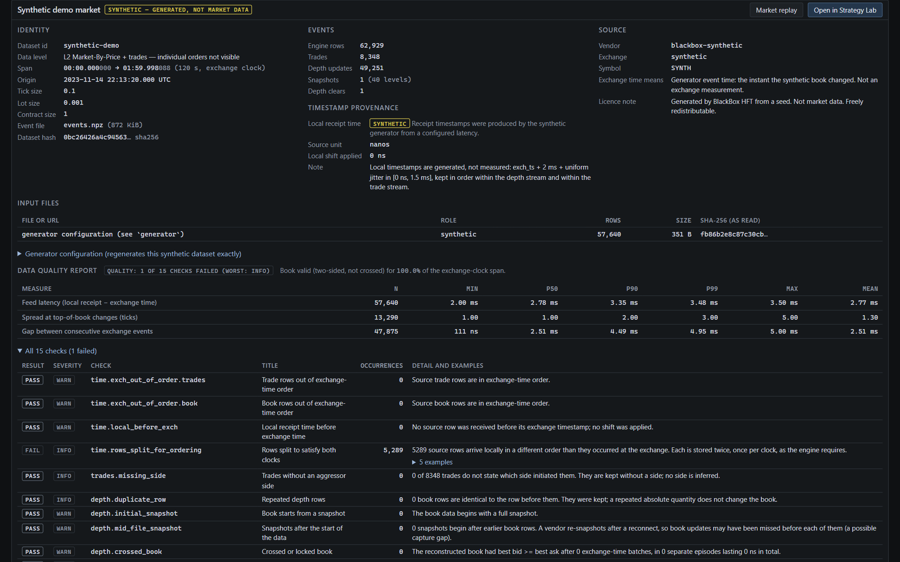
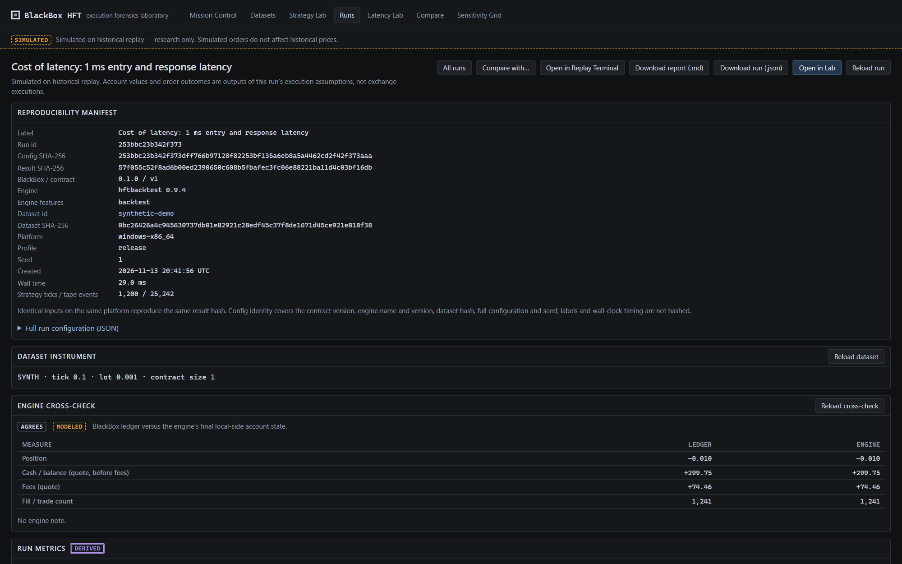
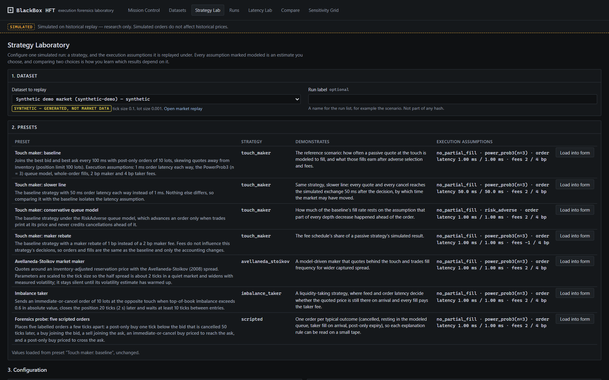

# BlackBox HFT

An execution-forensics and simulation platform for high-frequency trading research.

Most backtesters answer "how much would this strategy have made?". BlackBox is built to answer
the question underneath it:

> **Why did the strategy behave differently when latency, queue position, fees or risk limits
> changed?**

It replays historical Level-2 market data through the [HftBacktest](https://github.com/nkaz001/hftbacktest)
engine, records the complete lifecycle of every simulated order, explains each outcome with
deterministic rules that cite their evidence, and compares scenarios decision by decision.

**Research and simulation only.** BlackBox cannot connect to an exchange account, stores no
trading credentials and cannot place an order. Everything it reports is simulated on historical
replay; simulated orders do not affect historical prices. See [docs/LIMITATIONS.md](docs/LIMITATIONS.md).

**Live viewer: https://blackbox-hft.vercel.app** shows precomputed simulations on synthetic data
and is read-only. To run your own simulations, see Quick start below. How the viewer is built:
[docs/DEPLOYMENT.md](docs/DEPLOYMENT.md#hosted-viewer-static).

## What it does

| Area | What you get |
|---|---|
| **Market Replay** | Order-book heatmap reconstructed from L2 updates, best bid/ask, trades, a depth ladder at the cursor, and a data-quality report per dataset. |
| **Strategy Laboratory** | Pick a dataset and a strategy, set every execution assumption (exchange model, queue model, order and feed latency, fees, risk limits, seed), run. |
| **Execution Forensics** | Click any order and ask *why did this fill?* or *why did this not fill?* A two-clock timeline (strategy host and exchange), the modeled queue trajectory, and a step-by-step explanation in which every statement is tagged Observed, Modeled, Derived or Unobservable and linked to the recorded events it rests on. |
| **Scenario Comparison** | Run the same strategy under two sets of assumptions. Orders are aligned by stable decision id; the first divergence is identified exactly; P&L differences are attributed to a cause only when that is arithmetically certain. |
| **Sensitivity Grid** | A bounded two-parameter sweep. Every heatmap cell is one completed simulation with its own run id and result hash. |

## Screens

All screenshots show the generated **synthetic** dataset; vendor market data is never published.

| | |
|---|---|
|  **Replay Terminal**: the book reconstructed from L2 updates, with the run's own orders (dashed) and simulated fills on one playback clock. |  **Execution Forensics**: why one order filled, on the strategy and exchange clocks, with its modeled queue position. |
|  **Mission Control**: three controlled experiments, each listing what varies and what is held identical. |  **Latency Lab**: the same strategy at 1 ms and 50 ms order latency, aligned decision by decision. |
|  **Compare** |  **Sensitivity Grid**: every cell is one stored simulation. |
|  **Market Replay** |  **Data quality** |
|  **Run overview** |  **Strategy Lab** |

## The flight recorder

The engine exposes no event hooks, so each engine model (queue, latency, fees, order responses) is
wrapped in a recording type that delegates the decision to the real model and reports what
happened. No simulation logic is re-implemented. For each order the tape holds:

```
order_intent      strategy   local     what the strategy knew, and its stated reason
request_sent      engine     local     modeled entry latency, scheduled exchange arrival
exch_queued       engine     exchange  displayed quantity at the price, modeled quantity ahead
queue_update      engine     exchange  the trade or depth change that moved the estimate
exch_fill         engine     exchange  price, quantity, maker/taker, fee
exch_response     engine     exchange  status, modeled response latency
local_response    engine     local     when the strategy host learned of it
```

Every event names its clock and its source, so engine-generated facts are never confused with
BlackBox annotations or post-run derivations.

## Engine findings

Building the recorder meant reading the pinned engine closely. Five defects in hftbacktest 0.9.4
were found, each pinned by a test against the unwrapped engine, and each handled without forking
it: non-reproducible ordering of simultaneous fills, an abort after an exactly-completing partial
fill, an under-counting local account under partial fills, `submit_order` ignoring the order
side, and market orders that can execute at a sentinel price or stop sweeping after 100 ticks.
Details and evidence: [docs/EXECUTION_MODEL.md](docs/EXECUTION_MODEL.md).

## Quick start

Prerequisites and platform notes are in [docs/BUILDING.md](docs/BUILDING.md).

```
cargo build --release
cd web && npm install && npm run build && cd ..

# Generates a synthetic dataset if none exists, then serves the UI and API.
cargo run --release --bin blackbox -- demo
```

Open the printed address. The default demo needs no market-data subscription, no account and no
network access.

### Command line

```
blackbox synth                      generate the deterministic synthetic dataset
blackbox ingest-tardis ...          convert Tardis.dev CSV files into a dataset
blackbox datasets                   list datasets
blackbox quality <dataset>          print a dataset's quality report
blackbox presets                    list curated demonstrations
blackbox run --preset <id>          run a simulation
blackbox explain <run> <order>      explain one order
blackbox compare <run_a> <run_b>    compare two runs
blackbox grid --spec grid.json      run a sensitivity grid
blackbox serve                      serve the API and web UI
```

### Real market data (optional)

```
scripts/fetch-tardis-sample.sh      # Tardis.dev sample day; run from Git Bash on Windows
blackbox ingest-tardis --trades ... --book ... --id ... --symbol BTCUSDT \
    --exchange binance-futures --tick-size 0.01 --lot-size 0.001 --max-duration-s 600
```

Vendor data is never committed or redistributed by this repository; `data/` is git-ignored.

Read the vendor's terms before using their data. As read on the survey date, the Tardis.dev terms
apply to the free samples too: they do not allow sharing the files, or files converted from them,
with others, and they do not allow using the data to offer others a backtesting or charting
service. Running BlackBox locally on files you downloaded yourself is research use; hosting a
public instance over vendor data is a different matter that needs the vendor's agreement. The
bundled demo and every test fixture use synthetic data only. Quotes and links:
[docs/OPEN_SOURCE_RESEARCH.md](docs/OPEN_SOURCE_RESEARCH.md). This is a summary, not legal advice.

## Reproducibility

A run is identified by a hash of the dataset bytes, the engine version, BlackBox's simulation
revision and the full configuration including the seed. On the same platform, running the same
experiment again returns the same `run_id` and the same `result_sha256` over the tape, fills and
equity series (verified across fresh processes and in CI). Across operating systems results are
identical only where the result path uses exact arithmetic: the engine's probability queue models
call the platform math library, and one configuration was observed to differ between Windows and
Linux. Details and evidence: [docs/EXPERIMENT_REPRODUCIBILITY.md](docs/EXPERIMENT_REPRODUCIBILITY.md).

## Repository layout

```
crates/bb-core        shared type contract: configs, flight events, results, manifests
crates/bb-data        ingestion, validation, book reconstruction, synthetic generator
crates/bb-strategies  deterministic strategies (touch maker, Avellaneda-Stoikov, imbalance taker, scripted)
crates/bb-sim         engine adapter, flight recorder, ledger, risk harness
crates/bb-forensics   order records, explanations, metrics, scenario comparison
crates/bb-app         pipeline, run store, HTTP API, CLI (binary: blackbox)
web/                  React + TypeScript UI
docs/                 design, models, data, testing, sources and licences (list below)
```

## Documentation

Start with [docs/ARCHITECTURE.md](docs/ARCHITECTURE.md); [docs/INTERVIEW_GUIDE.md](docs/INTERVIEW_GUIDE.md)
explains the concepts from scratch and has a five-minute demo script.

| Document | What it covers |
|---|---|
| [ARCHITECTURE.md](docs/ARCHITECTURE.md) | Layers, crates, data flow, determinism design, storage, why Rust/axum |
| [MARKET_DATA.md](docs/MARKET_DATA.md) | Sources, Tardis schema and units, normalization, quality checks, synthetic generator, provenance |
| [EXECUTION_MODEL.md](docs/EXECUTION_MODEL.md) | How the engine is used and observed, its five defects, the workarounds |
| [QUEUE_MODELS.md](docs/QUEUE_MODELS.md) | Every queue-position model's formula, a worked example, what L2 cannot reveal |
| [LATENCY_MODEL.md](docs/LATENCY_MODEL.md) | Feed, entry and response latency, the two clocks, jitter, the order bus |
| [STRATEGIES.md](docs/STRATEGIES.md) | The bundled strategies, Avellaneda-Stoikov derivation and scaling, no look-ahead |
| [PNL_ACCOUNTING.md](docs/PNL_ACCOUNTING.md) | Ledger, fees, markouts, spread capture, engine cross-check, reconciliation |
| [EXPERIMENT_REPRODUCIBILITY.md](docs/EXPERIMENT_REPRODUCIBILITY.md) | Run identity, result hash, manifests, how to reproduce a run |
| [TESTING.md](docs/TESTING.md) | Test inventory, what each suite proves, what is not tested |
| [LIMITATIONS.md](docs/LIMITATIONS.md) | What the simulation assumes and cannot know |
| [OPEN_SOURCE_RESEARCH.md](docs/OPEN_SOURCE_RESEARCH.md) | Prior art, inspected versions, licences, reuse decisions, data terms |
| [PERFORMANCE.md](docs/PERFORMANCE.md) | Measured replay cost versus the stock engine, resource use, API latency, scaling |
| [SECURITY.md](docs/SECURITY.md) | Threat model, controls with their tests, review findings, residual risks |
| [API.md](docs/API.md) | HTTP API |
| [BUILDING.md](docs/BUILDING.md) | Build requirements and Windows notes |
| [INTERVIEW_GUIDE.md](docs/INTERVIEW_GUIDE.md) | Concepts explained from scratch, and a demo script |

## Acknowledgements

Simulation engine: [HftBacktest](https://github.com/nkaz001/hftbacktest) by nkaz001 (MIT). The
Tardis CSV conversion and event-ordering algorithms are ports of its Python reference
implementation. Charts: [TradingView Lightweight Charts](https://github.com/tradingview/lightweight-charts)
(Apache-2.0).
