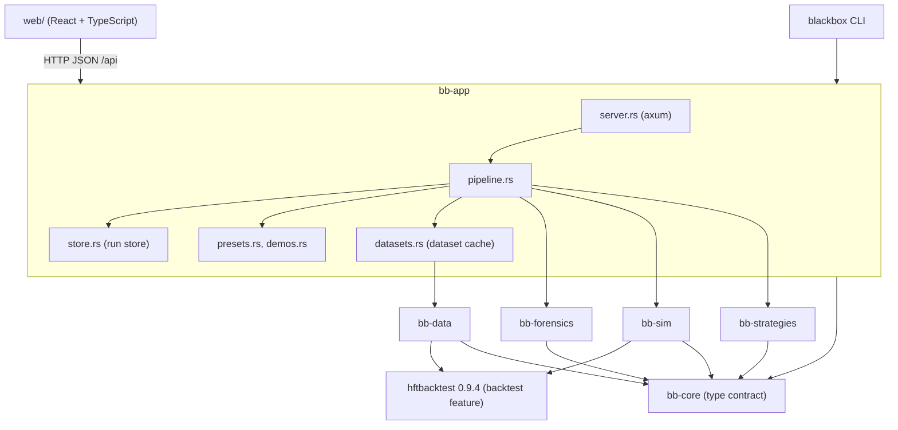

# Architecture

BlackBox HFT replays recorded or synthetic Level-2 market data through the pinned
`hftbacktest =0.9.4` engine, records every simulated order's lifecycle, and explains and compares
the outcomes. This page describes how the code is split, how a run flows through it, and why it is
built this way. Engine internals are in [EXECUTION_MODEL.md](EXECUTION_MODEL.md); the models are
in [QUEUE_MODELS.md](QUEUE_MODELS.md) and [LATENCY_MODEL.md](LATENCY_MODEL.md).

## Layers



| Crate | Responsibility | Depends on | Start reading at |
|---|---|---|---|
| `bb-core` | The shared type contract: configurations, flight events, results, manifests, explanations, comparisons, hashing, PRNG, time units. No engine dependency, so strategies and forensics stay engine-agnostic. | `serde`, `sha2` | `src/lib.rs` (conventions), `src/flight.rs`, `src/config.rs` |
| `bb-data` | Tardis CSV ingestion, normalization (ported from py-hftbacktest), data-quality checks, synthetic generator, `.npz` store, book reconstruction for replay views. | `bb-core`, `hftbacktest` (event type and `.npz` format) | `src/lib.rs`, `src/tardis.rs`, `src/quality.rs` |
| `bb-strategies` | Deterministic strategies: touch maker, Avellaneda-Stoikov, imbalance taker, scripted. Pure state machines over a `LocalView`. | `bb-core` only | `src/lib.rs`, [STRATEGIES.md](STRATEGIES.md) |
| `bb-sim` | Assembles the engine with recording wrappers, runs the strategy on a fixed tick grid, applies pre-trade risk rules, keeps the ledger, emits the tape. | `bb-core`, `hftbacktest` | `src/lib.rs` (`simulate`), `src/engine.rs`, `src/taps.rs`, `src/tape.rs` |
| `bb-forensics` | Pure functions over a finished tape: order records, metrics, markouts, rule-based explanations, scenario comparison. | `bb-core` only | `src/lib.rs`, `src/explain.rs`, `src/compare.rs` |
| `bb-app` | Run pipeline, content-addressed run store, presets and demos, sensitivity grids, axum HTTP API, the `blackbox` CLI. | all of the above | `src/pipeline.rs`, `src/server.rs`, `src/main.rs` |
| `web/` | Console: Mission Control, datasets and market replay, strategy lab, runs, replay terminal, order forensics, latency lab, compare, grid. | the HTTP API ([API.md](API.md)) | `web/src/App.tsx` |

The dependency rule is visible in the `Cargo.toml` files: only `bb-sim` and `bb-data` link the
engine, and `bb-forensics` and `bb-strategies` depend on nothing but `bb-core`. A forensics bug can
therefore never change a fill, and a strategy cannot call the engine.

## The flow of one run

```mermaid
sequenceDiagram
  participant C as Client (web or CLI)
  participant P as bb-app pipeline
  participant S as Run store
  participant E as bb-sim + engine
  participant F as bb-forensics
  C->>P: RunConfig (POST /api/runs or blackbox run)
  P->>P: validate config; run_identity = sha256(contract, engine, dataset sha256, config)
  P->>S: stored run with this run_id and config_sha256?
  alt already simulated
    S-->>C: stored RunSummary (same run_id, same result_sha256)
  else new experiment
    P->>E: simulate(dataset events, instrument, config, strategy)
    E-->>P: tape, fills, equity samples, engine cross-check
    P->>F: build_orders, enrich_fills (mid, markouts), compute_metrics
    P->>P: result_sha256 = sha256(tape, fills, equity)
    P->>S: put(RunResult)
    S-->>C: RunSummary
  end
```

The code path is `bb_app::pipeline::find_or_execute` → `execute` → `bb_sim::simulate`
(`crates/bb-app/src/pipeline.rs`). Inside `simulate` (`crates/bb-sim/src/lib.rs`) the loop is:
`elapse(interval)` on the engine; read the local depth, own orders and trades received since the
last tick; build a `LocalView`; call `Strategy::on_tick`; check each intent against the risk rules;
submit survivors with `submit_buy_order` / `submit_sell_order` / `cancel`; sample equity. Every
engine callback that matters writes to the shared `Tape` through a wrapper
([EXECUTION_MODEL.md](EXECUTION_MODEL.md#how-the-flight-recorder-observes-the-engine)).

After the run, every view is computed from stored data: an order's explanation
(`bb_forensics::explain_order`), a comparison of two runs (`compare_runs`), the replay terminal's
timeline. None of them re-runs the engine.

## Why Rust and axum rather than Python and FastAPI

The brief preferred a Python/FastAPI backend. BlackBox deliberately deviates (recorded in
`TODO.md`, "Deliberate deviations"):

- **The engine is a Rust crate.** The recording wrappers have to implement the engine's Rust
  traits (`QueueModel`, `LatencyModel`, `FeeModel`, `Processor`, `LocalProcessor`) and sit inside
  the engine's own call stack ([EXECUTION_MODEL.md](EXECUTION_MODEL.md#how-the-flight-recorder-observes-the-engine)).
  A Python backend would still need this Rust layer and would only add a boundary around it.
- **One process, no serialisation boundary.** With a Python service the tape would be produced in
  Rust and serialised across a process or FFI boundary before the ledger, forensics and metrics
  could see it. Keeping everything in Rust means the ledger is updated at the exact engine step
  where the fill happens ([PNL_ACCOUNTING.md](PNL_ACCOUNTING.md)) and the types the UI receives are
  the types the simulator produced (`crates/bb-core`, serialized by serde).
- **Correctness checks are cheap to keep on.** Determinism, invariants and reconciliation tests
  run the real engine in the normal `cargo test` ([TESTING.md](TESTING.md)).
- **axum** is a thin async HTTP layer. Handlers never run a simulation on the async runtime: all
  dataset reads, run loads and simulations go to `tokio::task::spawn_blocking`
  (`crates/bb-app/src/server.rs`).

What is given up: Python's notebook ecosystem. A run can still be exported as JSON
(`GET /api/runs/{id}/export`) and the dataset event file is the engine's own `.npz` format, which
py-hftbacktest reads (`crates/bb-data/src/store.rs`).

## Determinism by design

Reproducibility is a property of the design, not of luck. The mechanisms, each explained where it
lives:

| Source of nondeterminism | Design answer | Where |
|---|---|---|
| Engine iterates its order `HashMap` when one event fills several orders | Recorder buffers each engine step and commits it sorted by order id | `crates/bb-sim/src/tape.rs`; [EXECUTION_MODEL.md](EXECUTION_MODEL.md) defect 1 |
| Random latency drawn from a stream in engine-dependent order | Jitter is a pure function of `(seed, order id, time)` | `crates/bb-sim/src/taps.rs`; [LATENCY_MODEL.md](LATENCY_MODEL.md) |
| Strategy decisions timed by execution speed | Fixed local-time tick grid anchored to the dataset; order id = `(tick << 8) \| slot` | `crates/bb-core/src/strategy.rs` |
| Hash-map ordering in serialized output | Hashed types use structs, `Vec` and `BTreeMap` only; JSON field order is declaration order | `crates/bb-core/src/hash.rs` |
| Float parsing drift when a stored run is reloaded | `serde_json` with `float_roundtrip` | `crates/bb-app/Cargo.toml` |
| Platform math libraries | The PRNG uses integer and IEEE `+ - * /` only; `ln`/`exp` in Avellaneda-Stoikov is the one known cross-platform caveat | `crates/bb-core/src/rng.rs`; [BUILDING.md](BUILDING.md) |

How identity and result hashes are formed and what evidence exists is in
[EXPERIMENT_REPRODUCIBILITY.md](EXPERIMENT_REPRODUCIBILITY.md).

## Storage layout

Everything is under the data directory (`--data-dir`, default `data/`), which is git-ignored
because recorded vendor data must never be committed ([MARKET_DATA.md](MARKET_DATA.md#redistribution-rules)).

```
data/
  raw/<exchange>/<symbol>/<day>/     downloaded vendor files (scripts/fetch-tardis-sample.sh)
  datasets/<id>/dataset.json         DatasetManifest: provenance, instrument, quality report, hashes
  datasets/<id>/events.npz           engine event array (zip with one data.npy); its SHA-256 is the dataset hash
  runs/<run_id>/summary.json         RunSummary: manifest, metrics, counts, label
  runs/<run_id>/run.json             RunResult: everything, including the tape
```

The run store is behind the `RunStore` trait (`crates/bb-app/src/store.rs`); `FsRunStore` keeps one
directory per run and decodes at most 16 full runs in memory. Run ids are validated as 16 lowercase
hex characters before they touch the filesystem. Datasets are loaded once, hash-verified, and shared
by every run, replay request and grid cell (`crates/bb-app/src/datasets.rs`).

## What runs where

- **Everything runs locally in one process.** `blackbox serve` (and `blackbox demo`) binds
  `127.0.0.1:8787` by default, serves the API under `/api` and, if built, the web UI from
  `web/dist` with a single-page-app fallback. The CLI commands (`run`, `explain`, `compare`, `grid`,
  ...) call the same library functions without a server.
- **No outbound network.** The binary makes no network request; only `scripts/fetch-tardis-sample.sh`
  downloads, and only when the user runs it. The engine's `live` feature is not compiled in, so
  there is no exchange connectivity code in the binary.
- **Threads.** One simulation is single-threaded (the engine is `Rc`-based). A sensitivity grid
  runs independent cells on worker threads pulling indices from a shared counter, so the result does
  not depend on scheduling (`crates/bb-app/src/pipeline.rs`, `run_grid`).
- **Browser.** The UI only renders what the API returns; it computes no fills, P&L or explanations.

The hosted, synthetic-only public viewer and the Docker image are planned work (`TODO.md`, M7);
SECURITY, DEPLOYMENT and PERFORMANCE documents will cover them.

## Conventions that cross every boundary

Defined once in `crates/bb-core/src/lib.rs` and summarised for API users in [API.md](API.md):
timestamps are nanoseconds relative to the dataset's `origin_ns` (absolute epoch nanoseconds do not
fit a JavaScript number); every event names its clock (exchange or local) and its source (engine,
strategy, recorder, derived); prices are integer ticks; quantities are multiples of the lot size;
nothing in these types represents a real exchange execution.
