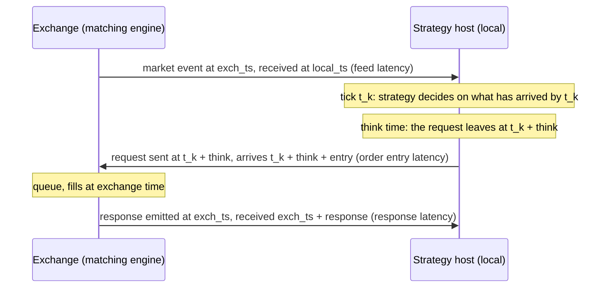

# Latency model

Latency decides what a strategy knew when it decided, and what the market had already done by the
time its order arrived. BlackBox separates four delays on two clocks and records each one on the
tape. Engine call sites are in [EXECUTION_MODEL.md](EXECUTION_MODEL.md); limitations in
[LIMITATIONS.md](LIMITATIONS.md#latency).

## Two clocks

| Clock | Meaning | Tape events on it |
|---|---|---|
| **Exchange** | when something happened at the (simulated) matching engine: the dataset's `exch_ts` for market events, the modeled arrival time for our requests | `exch_queued`, `queue_update`, `exch_fill`, `exch_response`, `queue_truncated` |
| **Local** | when the strategy host saw or did something: the dataset's `local_ts` for market events, the tick grid for decisions | `order_intent`, `cancel_intent`, `risk_blocked`, `risk_halt`, `request_sent`, `request_refused`, `local_response` |

Every `FlightEvent` names its clock, derived from its body so the two cannot disagree
(`crates/bb-core/src/flight.rs`, `FlightEvent::new`). The two clocks meet only through the latencies
below: a market event's feed latency (receipt minus exchange time), a request's scheduled arrival
(send time plus entry latency) and a response's scheduled receipt (exchange time plus response
latency).

## Four delays



| Delay | Formula | Where it comes from | Status |
|---|---|---|---|
| Feed | `local_ts - exch_ts` per market event, plus `feed_latency_offset_ns` | the dataset; the offset is the engine's `FeedLatencyAdjustment` | **measured** at the vendor's capture host (recorded data), **generated** (synthetic), or **assumed** (sources without receipt times), per `timestamps.local_ts` in the dataset manifest; the offset is always an assumption |
| Think time | `t_send = t_k + think_time_ns` | `execution.think_time_ns` (default 0) | assumed |
| Order entry | `exch_arrival = t_send + entry` | the configured order-latency model; cancels may have their own distribution | assumed |
| Order response | `local_arrival = exch_ts + response` | the configured order-latency model | assumed |

`constant` and `jitter` apply one entry latency to new orders and cancels alike; `log_normal` and
`heavy_tail` take an optional separate `cancel` distribution (below). hftbacktest's convention that
a negative entry latency means "rejected before reaching the matching engine" exists in the engine
(`LocalToExch::request`); BlackBox's models never produce one (`RunConfig::validate` requires
non-negative latencies), but the tape can represent it (`request_sent.exch_arrival_ts = null`).

## Think time (decision latency)

ABIDES advances an agent's clock by its computation delay after each wake-up and sends its messages
only after it ([OSS_TECHNOLOGY_EVALUATION.md](research/OSS_TECHNOLOGY_EVALUATION.md#5-what-nautilustrader-and-abides-teach-about-ordering-and-latency)).
BlackBox's `execution.think_time_ns` is the same idea on the strategy grid
(`crates/bb-sim/src/lib.rs`, `simulate_with` and `Harness::flush`):

1. At tick `t_k` the harness builds the view from what had arrived by `t_k`, runs the strategy and
   the pre-trade risk rules, and records `order_intent` / `cancel_intent` / `risk_blocked` at
   `t_k`. Requests that pass are held, and count against this tick's later risk checks as if sent.
2. The engine runs on for `think_time_ns`: market data, responses and fills in `(t_k, t_k + think]`
   are processed and recorded, but the decision is already made and nothing is re-evaluated.
3. The held requests are sent, in decision order, at `t_k + think`; `request_sent.ts` is that time
   and entry latency starts there. A request the engine refuses then (a cancel while another
   request is in flight) is recorded as `request_refused` at `t_k + think`.
4. The engine advances `interval − think` to the next tick, so the decision grid, the order ids
   and the equity sampling times do not move.

`think_time_ns` must be in `[0, interval_ns)`. Zero is the default, is omitted from the
configuration JSON (so every earlier configuration keeps its run identity), and runs exactly the
code path that existed before. Think time is constant; ABIDES' default computation delay is
constant too. A cancel decided before a fill notice arrives is still sent after it, which exposes
an engine accounting defect the cross-check names
([EXECUTION_MODEL.md](EXECUTION_MODEL.md#6-a-rejected-cancel-of-a-filled-order-is-counted-as-a-second-fill)).
Tests: `crates/bb-sim/tests/latency_lab.rs` (`think_time_delays_the_request_not_the_decision`:
with a trade-through 5 ms after the tick and 1 ms entry, 2 ms of think time still fills and 6 ms
does not; `think_time_applies_to_cancels`) and the causality property below.

## Feed latency

The strategy sees the local book: every market event whose `local_ts` is at or before the tick.
`MarketView` carries the exchange and local timestamps of the last event received
(`feed_exch_ts`, `feed_local_ts`), so each decision records how old its information was. An
order's explanation reports `feed_staleness_ns` (decision time minus that receipt time) and
`feed_latency_ns` (that event's receipt minus its exchange time, offset included) in its
`LatencyBreakdown` (`crates/bb-core/src/explain.rs`).

On recorded data the feed latency was measured where the vendor captured the stream, not where a
strategy would run. For the Tardis sample that is London in early 2020: 116.2 ms minimum, 128.9 ms
median, 910.8 ms p99 ([MARKET_DATA.md](MARKET_DATA.md#measured-findings-on-the-real-sample)). A
strategy co-located with the exchange would see far less. BlackBox can only add latency to the
recorded figure, never remove it: `feed_latency_offset_ns` must be non-negative, because a negative
offset would let the strategy see events before the dataset says they were received, and the
engine rejects any row where the offset makes `local_ts <= exch_ts`.

The offset delays what the strategy knows without moving anything on the exchange clock, and the
tick grid does not move (test `feed_latency_offset_delays_the_strategys_view_only`: with a 20 ms
offset, a best-bid change received at 5.1 ms is not yet visible at the 10 ms tick). The run's end
moves with it: a run ends at the first tick after the last feed event's local receipt time plus
the offset (`crates/bb-sim/src/lib.rs`).

## Order latency models

### `constant` — engine `ConstantLatency`

`entry = entry_ns`, `response = response_ns`, for every request.

### `jitter` — BlackBox `JitterLatency`

A BlackBox model implementing the engine's `LatencyModel` trait (`crates/bb-sim/src/taps.rs`):

```text
entry(order, t)     = entry_ns    + U(seed_entry,    order.order_id, t)
response(order, t)  = response_ns + U(seed_response, t,              0)
U(s, a, b)          = Rng(s XOR a*0x9E3779B97F4A7C15 XOR rotl(b*0xC2B2AE3D27D4EB4F, 31)).below(jitter_ns + 1)
seed_entry          = derive_seed(seed, "latency.entry")
seed_response       = derive_seed(seed, "latency.response")
```

`U` is uniform on the integers `[0, jitter_ns]` (`Rng::below` uses rejection, so it is unbiased;
`crates/bb-core/src/rng.rs`). `t` is the request's local send time for entry and the exchange
timestamp of the response.

**Why a pure function and not a random stream.** Within one engine step, hftbacktest 0.9.4 emits
responses for several orders in `HashMap` iteration order, which differs between runs
([EXECUTION_MODEL.md](EXECUTION_MODEL.md#1-simultaneous-fills-are-emitted-in-a-non-reproducible-order)).
A sequential stream would hand the "first" draw to a different order each run. Keying each draw on
what is being delayed makes the latency of a request independent of when it is asked for. Response
jitter is keyed on the exchange timestamp only, so every response emitted at one instant gets the
same latency; with the FIFO bus below, arrival order therefore cannot depend on emission order
either. Named sub-seeds mean that adding a new consumer of randomness never shifts the numbers
another consumer receives.

The seed affects nothing else (`RunConfig.seed` doc comment; test
`seed_changes_jittered_latency_and_nothing_else_is_hidden`); stored real-data runs that differ only
in the seed share one result hash
([EXPERIMENT_REPRODUCIBILITY.md](EXPERIMENT_REPRODUCIBILITY.md#evidence)).

### `log_normal` — BlackBox `StochasticLatency`

Each leg (entry for new orders, entry for cancels, response) is an independent log-normal draw
(`crates/bb-sim/src/latency.rs`):

```text
latency = round(median_ns × exp(sigma × Z)),   Z ~ N(0, 1),   capped at 60 s
```

so `ln(latency)` is normal with mean `ln(median_ns)` and standard deviation `sigma`; the mean is
`median × exp(sigma²/2)` and the `p`-quantile `median × exp(sigma × Φ⁻¹(p))`. Configuration:

```json
{ "type": "log_normal",
  "entry":    { "median_ns": 1000000, "sigma": 0.5 },
  "response": { "median_ns": 1000000, "sigma": 0.5 },
  "cancel":   { "median_ns": 500000,  "sigma": 0.3 } }
```

`cancel` is optional; omitted (or `null`), cancels draw from the `entry` parameters on their own
sub-stream. Bounds: `1 ≤ median_ns ≤ 60 s`, `0 ≤ sigma ≤ 3`. At `sigma = 0` a leg is constant at its
median. Test `log_normal_leg_matches_its_analytic_quantiles_and_mean` checks, on 100,000 seeded
draws with median 1 ms and sigma 0.5, the mean (1.1331 ms), the median and the 10th and 90th
percentiles (0.5269 ms, 1.8980 ms) within 1 to 1.5%.

### `heavy_tail` — ABIDES cubic model

ABIDES' default latency model (`abides-core/abides_core/latency_model.py`, "Cubic Model", read
2026-11-14), per leg:

```text
latency = min_ns + (jitter / x³) × (min_ns / unit),   x ~ U(clip, 1]
```

`jitter`, `clip` and `unit` are ABIDES' `jitter`, `jitter_clip` and `jitter_unit` (defaults 0.5,
0.1, 10). The extra delay has a power-law tail, `P(extra > y) ∝ y^(−1/3)`, cut off by the clip at
`min + jitter × min / (unit × clip³)`; ABIDES draws `x` with `numpy.uniform(clip, 1)`, BlackBox as
`1 − u × (1 − clip)` with `u` uniform on `[0, 1)`, and rounds to whole nanoseconds. Configuration:

```json
{ "type": "heavy_tail",
  "entry":    { "min_ns": 1000000, "jitter": 0.5, "clip": 0.1, "unit": 10.0 },
  "response": { "min_ns": 1000000, "jitter": 0.5, "clip": 0.1, "unit": 10.0 },
  "cancel":   null }
```

Bounds: `jitter` in `[0, 1]`, `clip` in `(0, 1)` (ABIDES allows 0, which makes the latency
unbounded), `unit > 0`, and the largest possible latency at most 60 s. With the defaults on a 1 ms
minimum, latencies run from 1.05 ms to 51 ms: median `1 + 0.05/0.55³ = 1.3005 ms`, mean
`1 + 0.05 × (0.1⁻² − 1)/(2 × 0.9) = 3.75 ms`, 90th percentile `1 + 0.05/0.19³ = 8.2897 ms`. Test
`cubic_leg_matches_the_abides_formula_and_its_analytic_moments` checks these on 200,000 draws and one
draw against the ABIDES arithmetic on the same uniform. ABIDES' per-pair matrices and its
`connected` flag have no counterpart: BlackBox has one strategy host and one venue.

### Seeding and platform independence of `log_normal` and `heavy_tail`

Draws are keyed exactly like `jitter`: a new order's entry on `(order id, send time)` in
`latency.entry`, a cancel's on the same pair in `latency.cancel`, a response on the exchange
timestamp in `latency.response`, each sub-stream `derive_seed(seed, name)`. So the same seed gives
the same run, a different seed different draws, and simultaneous responses share one latency
(tests `seeded_models_are_deterministic_and_seed_sensitive`,
`draws_are_pure_functions_and_cancels_have_their_own_leg_and_stream`).

The normal draw is Marsaglia's polar method. `exp` and `ln` are BlackBox's own, built from IEEE
`+ − × ÷` and bit manipulation (range reduction plus a fixed-degree series); `sqrt` is correctly
rounded by IEEE 754. None comes from the platform math library, so these models never make a
result platform-dependent: the golden entries `log_normal_asymmetric` and `heavy_tail_think_time`
(risk-adverse queue model) carry one pin for every platform
([EXPERIMENT_REPRODUCIBILITY.md](EXPERIMENT_REPRODUCIBILITY.md#platform-policy)). The functions
agree with the platform's to within a few units in the last place (test
`portable_exp_and_ln_agree_with_the_platform_to_the_last_bits`); exactness is not the point,
reproducibility is.

### What the engine's trait can and cannot distinguish

`LatencyModel::entry(timestamp, order)` is called by `LocalToExch::request` with the order as the
local side just set it: `req == New` for a new order (`Local::submit_order`), `req == Canceled` for a
cancel (`Local::cancel`). The cancel leg is chosen on that field. `LatencyModel::response` is
called by `ExchToLocal::respond` with the order as the exchange left it, where a fill or an
acknowledgement overwrites `req`, so a response cannot reliably be attributed to the request it
answers; the response leg is therefore the same for every response. Modify requests are not used
by BlackBox.

The engine's `IntpOrderLatency` (interpolating recorded order latencies) is not offered: no dataset
BlackBox reads contains order-latency measurements.

## The order bus never lets a message overtake

hftbacktest's order bus appends each message at `max(scheduled time, latest time already in the
bus)` (`src/backtest/order.rs`, `OrderBus::append`). Requests and responses are therefore
delivered in send order even when a later message was assigned a shorter latency. Consequences:

- Jitter changes *when* messages arrive, never their order. With a heavy tail this is head-of-line
  blocking: one slow message also delays every message sent after it on the same path (the
  `latency_heavy_tail` preset's description says so).
- `request_sent.exch_arrival_ts` and `exch_response.local_arrival_ts` on the tape are the
  *scheduled* times; the exchange-clock and local-clock events that follow show when processing
  actually happened.
- A cancel sent while a fill is on its way back can reach the exchange after the order is gone; the
  exchange rejects it and the tape shows the rejection (test
  `cancel_that_loses_the_race_against_a_fill_is_rejected`).

### Causality

For every order, in tape order (`crates/bb-sim/tests/common/mod.rs`, `check_causality`): every
`request_sent` is exactly `think_time_ns` after the decision that made it; no exchange-clock event
of the order precedes the new-order request's send time plus its drawn entry latency; no cancel
outcome (accepted or rejected) precedes that cancel's send time plus its entry latency, cancels
being answered in send order. It runs in `latency_lab.rs`, in `invariants.rs` over every bundled
strategy × exchange model × queue model × latency model (including `log_normal` and `heavy_tail`
with think time), and in the property tests of `properties.rs`, whose generated configurations now
cover all four latency models, separate cancel legs and think times.

## Why entry latency changes outcomes

From `entry_latency_decides_which_market_events_the_order_sees`
(`crates/bb-sim/tests/engine_adapter.rs`): a buy decided at the 10 ms tick, with a trade-through at
15 ms. With 1 ms entry latency the order arrives at 11 ms, rests, and is filled by the trade. With
8 ms it arrives at 18 ms, after the trade, and does not fill. Nothing else differs.

In a strategy, slower entry also means quotes are cancelled and replaced later, so they spend longer
at stale prices; the `maker_slow` preset (50 ms each way against the 1 ms baseline) and the
`cost_of_latency` demo isolate exactly that assumption. The comparison view aligns the two runs by
decision and reports where they first diverge; it does not attribute the P&L difference to latency
alone unless the arithmetic proves it ([PNL_ACCOUNTING.md](PNL_ACCOUNTING.md#attribution-between-scenarios)).

## What is measured and what is assumed

| Quantity | Measured? |
|---|---|
| Feed latency on recorded data | Measured, at the vendor's capture location only |
| Feed latency on synthetic data | Generated by the configured synthetic model |
| Feed latency offset | Assumption |
| Order entry and response latency, every model | Assumption; not calibrated to any venue |
| Think time | Assumption |
| Round trip, time to first fill, resting time in metrics | Derived from the modeled values and the replay |
| What a real order would have experienced | Unknowable from replay |
