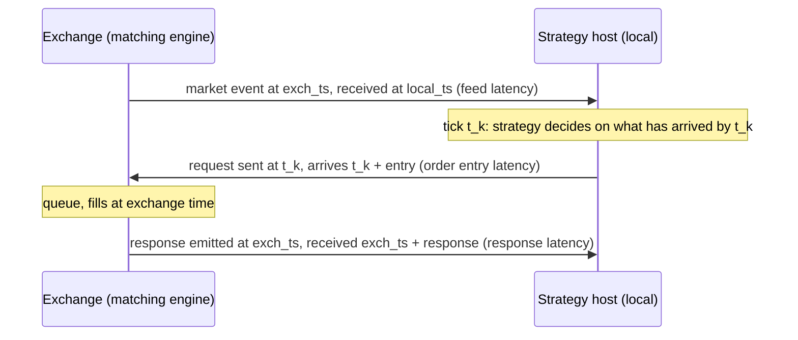

# Latency model

Latency decides what a strategy knew when it decided, and what the market had already done by the
time its order arrived. BlackBox separates three latencies on two clocks and records each one on the
tape. Engine call sites are in [EXECUTION_MODEL.md](EXECUTION_MODEL.md); limitations in
[LIMITATIONS.md](LIMITATIONS.md#latency).

## Two clocks

| Clock | Meaning | Tape events on it |
|---|---|---|
| **Exchange** | when something happened at the (simulated) matching engine: the dataset's `exch_ts` for market events, the modeled arrival time for our requests | `exch_queued`, `queue_update`, `exch_fill`, `exch_response`, `queue_truncated` |
| **Local** | when the strategy host saw or did something: the dataset's `local_ts` for market events, the tick grid for decisions | `order_intent`, `cancel_intent`, `risk_blocked`, `risk_halt`, `request_sent`, `request_refused`, `local_response` |

Every `FlightEvent` names its clock, derived from its body so the two cannot disagree
(`crates/bb-core/src/flight.rs`, `FlightEvent::new`). The two clocks meet only through the latencies
below: a market event's feed latency (receipt minus exchange time), a request's scheduled arrival
(send time plus entry latency) and a response's scheduled receipt (exchange time plus response
latency).

## Three latencies



| Latency | Formula | Where it comes from | Status |
|---|---|---|---|
| Feed | `local_ts - exch_ts` per market event, plus `feed_latency_offset_ns` | the dataset; the offset is the engine's `FeedLatencyAdjustment` | **measured** at the vendor's capture host (recorded data), **generated** (synthetic), or **assumed** (sources without receipt times), per `timestamps.local_ts` in the dataset manifest; the offset is always an assumption |
| Order entry | `exch_arrival = t_send + entry` | the configured order-latency model | assumed |
| Order response | `local_arrival = exch_ts + response` | the configured order-latency model | assumed |

Entry latency applies to new orders and cancels alike. hftbacktest's convention that a negative
entry latency means "rejected before reaching the matching engine" exists in the engine
(`LocalToExch::request`); BlackBox's models never produce one (`RunConfig::validate` requires
non-negative latencies), but the tape can represent it (`request_sent.exch_arrival_ts = null`).

## Feed latency

The strategy sees the local book: every market event whose `local_ts` is at or before the tick.
`MarketView` carries the exchange and local timestamps of the last event received
(`feed_exch_ts`, `feed_local_ts`), so each decision records how old its information was. An
order's explanation reports `feed_staleness_ns` (decision time minus that receipt time) and
`feed_latency_ns` (that event's receipt minus its exchange time, offset included) in its
`LatencyBreakdown` (`crates/bb-core/src/explain.rs`).

On recorded data the feed latency was measured where the vendor captured the stream, not where a
strategy would run. For the Tardis sample that is London in early 2020: 116.2 ms minimum, 128.9 ms
median, 910.8 ms p99 ([MARKET_DATA.md](MARKET_DATA.md#measured-findings-on-the-real-sample)). A
strategy co-located with the exchange would see far less. BlackBox can only add latency to the
recorded figure, never remove it: `feed_latency_offset_ns` must be non-negative, because a negative
offset would let the strategy see events before the dataset says they were received, and the
engine rejects any row where the offset makes `local_ts <= exch_ts`.

The offset delays what the strategy knows without moving anything on the exchange clock, and the
tick grid does not move (test `feed_latency_offset_delays_the_strategys_view_only`: with a 20 ms
offset, a best-bid change received at 5.1 ms is not yet visible at the 10 ms tick). The run's end
moves with it: a run ends at the first tick after the last feed event's local receipt time plus
the offset (`crates/bb-sim/src/lib.rs`).

## Order latency models

### `constant` — engine `ConstantLatency`

`entry = entry_ns`, `response = response_ns`, for every request.

### `jitter` — BlackBox `JitterLatency`

A BlackBox model implementing the engine's `LatencyModel` trait (`crates/bb-sim/src/taps.rs`):

```text
entry(order, t)     = entry_ns    + U(seed_entry,    order.order_id, t)
response(order, t)  = response_ns + U(seed_response, t,              0)
U(s, a, b)          = Rng(s XOR a*0x9E3779B97F4A7C15 XOR rotl(b*0xC2B2AE3D27D4EB4F, 31)).below(jitter_ns + 1)
seed_entry          = derive_seed(seed, "latency.entry")
seed_response       = derive_seed(seed, "latency.response")
```

`U` is uniform on the integers `[0, jitter_ns]` (`Rng::below` uses rejection, so it is unbiased;
`crates/bb-core/src/rng.rs`). `t` is the request's local send time for entry and the exchange
timestamp of the response.

**Why a pure function and not a random stream.** Within one engine step, hftbacktest 0.9.4 emits
responses for several orders in `HashMap` iteration order, which differs between runs
([EXECUTION_MODEL.md](EXECUTION_MODEL.md#1-simultaneous-fills-are-emitted-in-a-non-reproducible-order)).
A sequential stream would hand the "first" draw to a different order each run. Keying each draw on
what is being delayed makes the latency of a request independent of when it is asked for. Response
jitter is keyed on the exchange timestamp only, so every response emitted at one instant gets the
same latency; with the FIFO bus below, arrival order therefore cannot depend on emission order
either. Named sub-seeds mean that adding a new consumer of randomness never shifts the numbers
another consumer receives.

The seed affects nothing else (`RunConfig.seed` doc comment; test
`seed_changes_jittered_latency_and_nothing_else_is_hidden`); stored real-data runs that differ only
in the seed share one result hash
([EXPERIMENT_REPRODUCIBILITY.md](EXPERIMENT_REPRODUCIBILITY.md#evidence)).

The engine's `IntpOrderLatency` (interpolating recorded order latencies) is not offered: no dataset
BlackBox reads contains order-latency measurements.

## The order bus never lets a message overtake

hftbacktest's order bus appends each message at `max(scheduled time, latest time already in the
bus)` (`src/backtest/order.rs`, `OrderBus::append`). Requests and responses are therefore
delivered in send order even when a later message was assigned a shorter latency. Consequences:

- Jitter changes *when* messages arrive, never their order.
- `request_sent.exch_arrival_ts` and `exch_response.local_arrival_ts` on the tape are the
  *scheduled* times; the exchange-clock and local-clock events that follow show when processing
  actually happened.
- A cancel sent while a fill is on its way back can reach the exchange after the order is gone; the
  exchange rejects it and the tape shows the rejection (test
  `cancel_that_loses_the_race_against_a_fill_is_rejected`).

## Why entry latency changes outcomes

From `entry_latency_decides_which_market_events_the_order_sees`
(`crates/bb-sim/tests/engine_adapter.rs`): a buy decided at the 10 ms tick, with a trade-through at
15 ms. With 1 ms entry latency the order arrives at 11 ms, rests, and is filled by the trade. With
8 ms it arrives at 18 ms, after the trade, and does not fill. Nothing else differs.

In a strategy, slower entry also means quotes are cancelled and replaced later, so they spend longer
at stale prices; the `maker_slow` preset (50 ms each way against the 1 ms baseline) and the
`cost_of_latency` demo isolate exactly that assumption. The comparison view aligns the two runs by
decision and reports where they first diverge; it does not attribute the P&L difference to latency
alone unless the arithmetic proves it ([PNL_ACCOUNTING.md](PNL_ACCOUNTING.md#attribution-between-scenarios)).

## What is measured and what is assumed

| Quantity | Measured? |
|---|---|
| Feed latency on recorded data | Measured, at the vendor's capture location only |
| Feed latency on synthetic data | Generated by the configured synthetic model |
| Feed latency offset | Assumption |
| Order entry and response latency, constant or jittered | Assumption; not calibrated to any venue |
| Round trip, time to first fill, resting time in metrics | Derived from the modeled values and the replay |
| What a real order would have experienced | Unknowable from replay |
