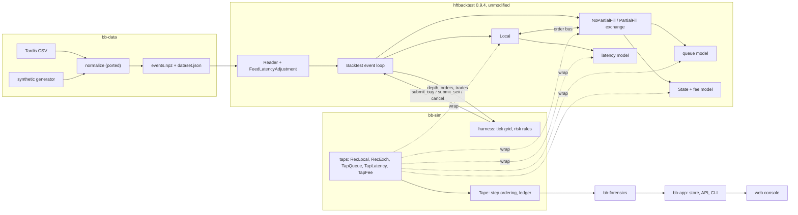

# Open-source research, sources and licences

Source-and-licence record for BlackBox HFT (research-only execution forensics; never trades real money): what exists, what was inspected at which version, what BlackBox reuses, what it must not copy, and what it adds.

**Survey date:** 2026-11-13. All GitHub license API calls, HTTP status checks and page reads below were made on that date unless stated otherwise. The [inspected versions](#inspected-versions) table and the crates.io / npm registry facts were queried on 2026-11-14.

**Evidence conventions**

- `API` = response of `https://api.github.com/repos/<owner>/<repo>/license` (fields `license.spdx_id`, `path`). `NOASSERTION` means GitHub's detector found a license file but could not match it to one SPDX id; it is not a statement that there is no license.
- `File` = the license / notice / README file in the repository was read directly.
- `Lead-verified` = fact established by the project lead before this survey and recorded here as given; not re-checked in this survey.
- `UNVERIFIED` = could not be confirmed from a page, file or API response; what was tried is stated. See [Unverified or open items](#unverified-or-open-items).
- Nothing in this document is legal advice. Quotes are verbatim from the linked page.

## Summary

| # | Source | URL | Purpose for BlackBox | License (evidence) | Status |
|---|--------|-----|----------------------|--------------------|--------|
| 1 | HftBacktest | <https://github.com/nkaz001/hftbacktest> | Simulation engine; two data-prep algorithms ported | MIT (API: `MIT`, `LICENSE`; crate metadata lead-verified) | **Reused** (dependency `=0.9.4` + two ported algorithms) |
| 2 | NautilusTrader | <https://github.com/nautechsystems/nautilus_trader> | Architectural reference | LGPL-3.0 (API: `LGPL-3.0`, `LICENSE`; README) | Reference-only, no code copied |
| 3 | HFTENGINE | <https://github.com/mirkovicdev/HFTENGINE> | Prior-art replay console; differentiation baseline | MIT text in `LICENSE` plus two extra lines (File); API: `NOASSERTION` | Reference-only, no code copied |
| 4 | market-maker-rs | <https://github.com/joaquinbejar/market-maker-rs> | Reference for market-making model catalogue | MIT (API: `MIT`, `LICENSE`; File) | Reference-only, no code copied |
| 5 | ABIDES | <https://github.com/abides-sim/abides> | Conceptual contrast (agent-based simulation) | BSD-3-Clause text in `LICENSE.txt` (File); API: `NOASSERTION` | Reference-only, no code copied |
| 6a | Apache Arrow / Parquet | <https://github.com/apache/arrow> | Evaluated as columnar storage | Apache-2.0 (API: `Apache-2.0`, `LICENSE.txt`) | Evaluated; not linked in this version |
| 6b | DuckDB | <https://github.com/duckdb/duckdb> | Evaluated as embedded analytics engine | MIT (API: `MIT`, `LICENSE`) | Evaluated; not linked in this version |
| 6c | Databento DBN | <https://github.com/databento/dbn> | Reference for normalized market-data encoding | Apache-2.0 (API: `Apache-2.0`, `LICENSE`; README) | Reference-only, no code copied |
| 7 | TradingView Lightweight Charts | <https://github.com/tradingview/lightweight-charts> | Charting in the web UI | Apache-2.0 with NOTICE attribution (API, File, npm registry) | **Reused** (npm dependency) |
| 8 | Tardis.dev | <https://docs.tardis.dev/> | Optional real-data input (user downloads free sample files) | Proprietary licence agreement; redistribution prohibited (Terms of Service read) | Data format supported; **no vendor data committed or redistributed** |
| 9 | Binance public data | <https://github.com/binance/binance-public-data>, <https://data.binance.vision/> | Evaluated as free data source | Datasets: CC BY-NC-SA 4.0 per `TERMS_AND_CONDITIONS.md` (File). Repo scripts: README says "MIT" but no license file (API: 404) | Reference-only; no data committed |
| 10 | collect-binancefutures | <https://github.com/nkaz001/collect-binancefutures> | Reference for raw-feed collection | **No license file** (API: 404; repo metadata `license: null`) | Reference-only, no code copied |
| 11 | Papers and articles | see [Papers](#papers) | Strategy formulas, queue-position model, PRNGs | n/a (cited, formulas implemented independently) | Cited |

No license fact found in this survey contradicts the lead's reuse decisions. Three facts differ from what the brief or a casual reading would suggest and are flagged in their sections: HFTENGINE does have a LICENSE file with MIT text (section 3); Binance's dataset terms are non-commercial share-alike, not MIT (section 9); the Tardis terms restrict more than redistribution of raw files (section 8).

## Inspected versions

Released artifacts BlackBox depends on are pinned exactly; repositories that were only read are identified by the default-branch commit.

| Source | Version or commit | Evidence |
|---|---|---|
| hftbacktest (Rust crate) | **0.9.4**, published 2025-12-10T16:15:47Z, `license` MIT, `rust_version` 1.91.1 | `https://crates.io/api/v1/crates/hftbacktest/0.9.4`; pinned `=0.9.4` in `Cargo.toml`; the source read for [EXECUTION_MODEL.md](EXECUTION_MODEL.md) and [QUEUE_MODELS.md](QUEUE_MODELS.md) is this crate as unpacked by cargo |
| hftbacktest (repository, Python reference converter) | `master` `5f3ec40b2afb764e0fea112f941ed85523ef4e88` (2025-12-23) | commits API; unchanged since the lead's survey |
| TradingView Lightweight Charts (npm) | **5.3.0**, `license` Apache-2.0 | `web/package-lock.json` (`node_modules/lightweight-charts`); also the registry's `latest` tag |
| NautilusTrader | `develop` `d930a10718fe99f36f663bc2dc6478ade83c3af2` (2026-11-13) | commits API |
| HFTENGINE | `main` `8d7e2904d86d40265b05a366d57e296ee0cd5d98` (2026-09-17) | commits API |
| market-maker-rs | `ae8cf040d3aa2f2fe9db1987f9e9f1a8a5763344` (2026-11-13) | commits API |
| ABIDES | `c4bf157678928934417aba6073eb0651aeaf6d15` (2020-11-19) | commits API (the repository's last *push* is 2023-07-06, section 5) |
| Apache Arrow | `b5dd104162f6c6a5e64a3f0c6ce8519349ea93fa` (2026-11-13) | commits API |
| DuckDB | `05627314afbd122f5e761169147c720e1b10e4ae` (2026-11-13) | commits API |
| Databento DBN | `a77693030595b8f29f6b4c58e63b1b1a9d899b3f` (2026-10-27) | commits API |
| Lightweight Charts (repository) | `aebdfc8f0d85b95e43467ae79516753158d60e61` (2026-11-13) | commits API |
| binance-public-data | `d571690eb66760763b0bd6e27e8cd35603c7e244` (2026-10-16) | commits API |
| collect-binancefutures | `27abefde5d6a42db125c59bd47332db58677ba4b` (2024-07-26) | commits API |
| tardis-node (normalizer read in section 8) | `master` `821adf5d227bda25227ca72f5819dceaab6c90a3` (2026-11-09) | commits API |

Commits come from `https://api.github.com/repos/<owner>/<repo>/commits?per_page=1` (default branch). For a repository whose latest commit is dated 2026-11-13, the survey that day may have read the commit before it; the files cited here (licences, READMEs, one mapper) are the ones quoted below.

---

## 1. HftBacktest

- **Source URL:** <https://github.com/nkaz001/hftbacktest>; docs <https://hftbacktest.readthedocs.io/en/latest/>
- **Purpose for BlackBox:** the simulation engine. BlackBox replays L2 data through it and layers recording, explanation and scenario comparison on top.
- **License:** MIT.
  - API: `{"spdx":"MIT","path":"LICENSE"}`.
  - crates.io API (2026-11-14): `hftbacktest` 0.9.4 declares license MIT.
- **Status:** **Reused.**
  - Rust crate pinned at exactly `=0.9.4` (crates.io, published 2025-12-10, declared `rust-version` 1.91.1; both confirmed through the crates.io API). Upstream `master` HEAD: commit `5f3ec40b2a` (2025-12-23), unchanged on 2026-11-14.
  - Only the `backtest` cargo feature is used; `live` and `s3` are disabled (`Cargo.toml`: `default-features = false, features = ["backtest"]`).
  - Two algorithms are **ported to Rust with attribution**, because the Rust crate has no Tardis CSV converter: the converter `py-hftbacktest/hftbacktest/data/utils/tardis.py` and the event-order correction `py-hftbacktest/hftbacktest/data/validation.py` exist only in the Python package (`crates/bb-data/src/tardis.rs`, `crates/bb-data/src/normalize.rs`, both naming their source and licence in the module header). (Lead-verified.)
- **Compatibility notes:** MIT is permissive; the obligation is to keep the copyright and permission notice with copies or substantial portions, which applies to the two ported algorithms as well as to the dependency. Replay data is stored as hftbacktest-compatible compressed `.npz`.
- **Engine internals:** the six defects found in 0.9.4 and how BlackBox handles them, which engine items are reused, and what is modeled are documented in [EXECUTION_MODEL.md](EXECUTION_MODEL.md) and are not repeated here.

### Relevant technical assumptions (quoted from the docs)

Pages read: [order_fill.html](https://hftbacktest.readthedocs.io/en/latest/order_fill.html), [latency_models.html](https://hftbacktest.readthedocs.io/en/latest/latency_models.html), [data.html](https://hftbacktest.readthedocs.io/en/latest/data.html), [Data Preparation tutorial](https://hftbacktest.readthedocs.io/en/latest/tutorials/Data%20Preparation.html). All four URLs returned HTTP 200 on the survey date.

**No market impact** ([order_fill.html](https://hftbacktest.readthedocs.io/en/latest/order_fill.html), "Exchange Models"):

> "HftBacktest is a market-data replay-based backtesting tool, which means your order cannot make any changes to the simulated market, no market impact is considered. Therefore, one of the most important assumptions is that your order is small enough not to make any market impact."

> "This is because even if your order takes market liquidity, the replayed market data's market depth and trades cannot change."

**Queue position for L2 (Market-By-Price) data** ([order_fill.html](https://hftbacktest.readthedocs.io/en/latest/order_fill.html), "Queue Models"):

> "If an exchange doesn't provide Market-By-Order, you have to guess it by modeling."

> "HftBacktest currently only supports Market-By-Price that is most crypto exchanges provide and it provides the following queue position models for order fill simulation."

Which events advance the queue position:

- `RiskAverseQueueModel` (the page's reference link spells it `RiskAdverseQueueModel`): "The decrease in quantity by cancellation or modification in the order book happens only at the tail of the queue so your order queue position doesn't change." and "The order queue position will be advanced only if a trade happens at the price."
- `ProbQueueModel`: "Based on a probability model according to your current queue position, the decrease in quantity happens at both before and after the queue position." and "So your queue position is also advanced according to the probability."
- Constraints on the probability function `f`: "The probability at 0 should be 0 because if the order is at the head of the queue, all decreases should happen after the order." and "The probability at 1 should be 1 because if the order is at the tail of the queue, all decreases should happen before the order."
- Provided functions listed on the page: `PowerProbQueueFunc`, `PowerProbQueueFunc2`, `PowerProbQueueFunc3`, `LogProbQueueFunc`, `LogProbQueueFunc2`.
- The page cites <https://quant.stackexchange.com/questions/3782/how-do-we-estimate-position-of-our-order-in-order-book> and <https://rigtorp.se/2013/06/08/estimating-order-queue-position.html> for the model (see [Papers](#papers)).

So, in short: trades at the order's price always advance the estimated position; depth decreases at that price advance it only under the probabilistic model, in proportion to `f` of the current position.

**Fill conditions, `NoPartialFillExchange`** ("the default exchange simulation where no partial fills occur"), section "Conditions for Full Execution", for a resting buy order:

> "Your order price >= the best ask price"
> "Your order price > sell trade price"
> "Your order is at the front of the queue && your order price == sell trade price"

Sell orders are the mirror image ("Your order price <= the best bid price", "Your order price < buy trade price", "Your order is at the front of the queue && your order price == buy trade price"). Liquidity-taking orders: "Regardless of the quantity at the best, liquidity-taking orders will be fully executed at the best."

**Fill conditions, `PartialFillExchange`**: full execution for a buy when "Your order price >= the best ask price" or "Your order price > sell trade price" (mirror for sells). Partial execution for a buy:

> "Filled by (remaining) sell trade quantity: your order is at the front of the queue && your order price == sell trade price"

Liquidity-taking orders: "Liquidity-taking orders will be executed based on the quantity of the order book, even though the best price and quantity do not change due to your execution." The page warns for both models: "Be aware that this may cause unrealistic fill simulations if you attempt to execute a large quantity."

**Latency definitions** ([latency_models.html](https://hftbacktest.readthedocs.io/en/latest/latency_models.html), "Overview"):

- Feed latency: "This is the latency between the time the exchange sends the feed events such as order book change or trade and the time it is received by the local." It "is dealt with through two different timestamps: local timestamp and exchange timestamp."
- Order entry latency: "This is the latency between the time you send an order request and the time it is processed by the exchange's matching engine."
- Order response latency: "This is the latency between the time the exchange's matching engine processes an order request and the time the order response is received by the local. The response to your order fill is also affected by this type of latency."
- Order latency models listed: `ConstantLatency` ("the most basic model that uses constant latencies"), `IntpOrderLatency` ("interpolates order latency based on the actual order latency data"), and, when live order latency data is unavailable, "you can generate artificial order latency using feed latency."

**Data format** ([data.html](https://hftbacktest.readthedocs.io/en/latest/data.html)): eight fields in order `ev`, `exch_ts`, `local_ts`, `px`, `qty`, `order_id`, `ival`, `fval`. "exch_ts (i64): Exchange timestamp, which is the time at which the event occurs on the exchange." and "local_ts (i64): Local timestamp, which is the time at which the event is received by the local." The tutorial states of the raw feed: "The timestamp is in nanoseconds."

**Trade data before depth data in conversion** ([Data Preparation tutorial](https://hftbacktest.readthedocs.io/en/latest/tutorials/Data%20Preparation.html), "Getting started from Tardis.dev data"):

> "It is recommended to input trade files before depth files. This is because if a depth event occurs due to a trade event, having the trade event before the depth event could provide a more realistic fill during backtesting. However, the sorting process will prioritize events from the first input file when both events have the same timestamp."

Note the docs word this as a recommendation ("It is recommended"), with the stated consequence that the first input file wins timestamp ties. BlackBox's port treats trades-first as the required ordering.

Other statements from the same tutorial that BlackBox relies on:

- "Note: Some data may have an issue with the exchange timestamp. Ideally, the exchange timestamp should reflect the moment the event occurs at the matching engine. However, some data uses the server's data sent timestamp instead of the matching engine timestamp." (See section 8 for which Binance field Tardis uses.)
- "Tardis.dev artificially inserts the SOD snapshot to the start of the daily file."
- "convert method also attempts to correct timestamps by reordering the rows." The converter log lines shown are "Correcting the latency" and "Correcting the event order".

---

## 2. NautilusTrader

- **Source URL:** <https://github.com/nautechsystems/nautilus_trader>
- **Purpose for BlackBox:** architectural reference only.
- **License:** LGPL-3.0.
  - API: `{"spdx":"LGPL-3.0","path":"LICENSE"}`.
  - File: `LICENSE` on branch `develop` begins "GNU LESSER GENERAL PUBLIC LICENSE / Version 3, 29 June 2007".
  - README, "License": "The source code for NautilusTrader is available on GitHub under the [GNU Lesser General Public License v3.0](https://www.gnu.org/licenses/lgpl-3.0.en.html)." The README's security section also says "`cargo-deny` enforces a license allow list compatible with `LGPL-3.0-only`."
- **Status:** Reference-only. No code copied, not a dependency.
- **Compatibility notes — what LGPL-3.0 would oblige** (from the license text at <https://www.gnu.org/licenses/lgpl-3.0.txt>, section 4 "Combined Works", read in this survey). If BlackBox linked NautilusTrader crates, distributing the result would require, among other things:
  - "Give prominent notice with each copy of the Combined Work that the Library is used in it and that the Library and its use are covered by this License."
  - "Accompany the Combined Work with a copy of the GNU GPL and this license document."
  - Either convey the application "in a form suitable for, and under terms that permit, the user to recombine or relink the Application with a modified version of the Linked Version", or "Use a suitable shared library mechanism for linking with the Library."
  - Terms overall must "effectively do not restrict modification of the portions of the Library contained in the Combined Work and reverse engineering for debugging such modifications".
  - Rust crates are normally linked statically, so the relink option (object files or equivalent) is the one that would apply in practice; this is the main practical burden and the reason linking was not chosen. Copying source into BlackBox would make the copied portions a modified version of the Library, which stays under the LGPL. Neither is done, so none of these obligations currently apply.
- **Relevant technical assumptions / architectural ideas** (all from the repository README):
  - Single event-driven core for simulation and live: "The system spans research, deterministic simulation, and live execution within a single event-driven architecture".
  - Deterministic runtime and one time model: "A Rust-native core provides a deterministic event-driven runtime for both research and live execution" and "The same architecture, execution semantics, and time model operate across both environments".
  - Typed data with nanosecond resolution: backtesting uses "historical quote tick, trade tick, bar, order book, and custom data with nanosecond resolution"; core value types are named `Price`, `Quantity`, `Money` with selectable precision modes.
  - Explicit acknowledgement of simulation limits: "Live execution still introduces venue, transport, timing, persistence, external-activity, and reconciliation behavior that a simulation may not reproduce."
  - Composition through a cache and message bus: "User-defined components, or assemble entire systems from scratch using the cache and message bus."
  - Risk engine: UNVERIFIED from the README. The README text read in this survey was searched for "risk" and contains no description of a risk engine; the component is documented elsewhere in the project and was not read. BlackBox's pre-trade checks are therefore not claimed to derive from it.

---

## 3. HFTENGINE

- **Source URL:** <https://github.com/mirkovicdev/HFTENGINE> (default branch `main`, last push 2026-09-17 per the repository API, not archived).
- **Purpose for BlackBox:** closest prior art; used only to understand what already exists so that BlackBox's scope is distinct.
- **License — what is actually true today:**
  - **A `LICENSE` file exists.** API: `{"spdx":"NOASSERTION","path":"LICENSE"}`; the repository API reports `license: {"key":"other","name":"Other","spdx_id":"NOASSERTION"}`.
  - **The file contains the MIT License text.** Its first lines, read from `https://raw.githubusercontent.com/mirkovicdev/HFTENGINE/HEAD/LICENSE` on the survey date:

    > MIT License
    >
    > Copyright (c) 2026 Antonije Mirkovic
    >
    > Permission is hereby granted, free of charge, to any person obtaining a copy of this software and associated documentation files (the "Software"), to deal in the Software without restriction, ...

  - After the standard MIT text the file has two additional lines: "The engine in hftbacktest/ is nkaz001/hftbacktest (MIT, see its own LICENSE). Fonts in dashboard/public/fonts/ carry their own licences (CC BY-SA 4.0 and SIL OFL)."
  - **Reconciliation with the project brief.** The brief assumed GitHub shows no recognized SPDX license. That is correct only in the narrow sense that GitHub's detector reports `NOASSERTION` ("Other"). It is **not** correct that the project is unlicensed: the license file is present and its body is the MIT License. The likely reason for `NOASSERTION` is the two appended lines, which make the file differ from the canonical MIT template; this cause is an inference, not something GitHub states.
- **Status:** **Reference-only. No code, assets, fonts, layouts or text copied.** The lead's decision stands regardless of the license being permissive.
- **Compatibility notes:** MIT would permit reuse with notice retention, so reference-only here is a product decision (independence and clear differentiation), not a legal constraint. The bundled fonts are under different licences (CC BY-SA 4.0 and SIL OFL per the LICENSE and README) and are not used by BlackBox.
- **Relevant technical facts** (from its `README.md`, `.gitmodules` and `patches/README.md`):
  - Self-description: "A replay console for hftbacktest market-making backtests."
  - The engine is a git submodule pointing at a fork, `https://github.com/mirkovicdev/hftbacktest.git`, branch `queue-position-getters`. The single change is "two read-only getters to `QueuePos`": `front_q_qty()` and `cum_trade_qty()`, re-appliable "on a fresh clone at commit `5f3ec40b`". "No modelling logic is changed."
  - Data: "Recorded Binance USDT-M Futures websocket streams (`depth@0ms`, `trade`, `bookTicker` + REST snapshots) written by hftbacktest's collector", converted with `hftbacktest.data.utils.binancefutures.convert`.
  - Models used: `ProbQueueModel` (`PowerProbQueueFunc3`, n=3), `IntpOrderLatency` "fed with order-latency data derived from the recorded feed latency", `NoPartialFillExchange` with GTX (post-only) limit orders.
  - Strategy: hftbacktest's "Queue-Based Market Making in Large Tick Size Assets" tutorial, with "High-Frequency Grid Trading" selectable.
  - "No P&L or equity is computed or shown."
  - What it visualizes and offers is listed in [Differentiation from HFTENGINE](#differentiation-from-hftengine).

---

## 4. market-maker-rs

- **Source URL:** <https://github.com/joaquinbejar/market-maker-rs>
- **Purpose for BlackBox:** reference for which market-making models a Rust library exposes and how their formulas are stated.
- **License:** MIT.
  - API: `{"spdx":"MIT","path":"LICENSE"}`.
  - File: `LICENSE` begins "MIT License / Copyright (c) 2025 Joaquin Bejar Garcia".
- **Status:** Reference-only. No code copied. BlackBox's Avellaneda-Stoikov strategy is an original implementation of the published formulas (see [Papers](#papers)).
- **Compatibility notes:** permissive; no obligations arise because nothing is copied or linked.
- **Models it implements** (README, "Strategy Models"):
  - "Avellaneda-Stoikov: Classic optimal market making with reservation price"
  - "GLFT: Guéant-Lehalle-Fernandez-Tapia optimal quotes with a bounded inventory (exact solution and closed form)"
  - Grid Trading, Adaptive Spread (order book imbalance), Depth-Based Offering, Signal Quotes, Walk-Forward Calibration, Joint Quotes for correlated assets.
  - Backtesting fill models listed as "Immediate, queue position, probabilistic, market impact"; a seedable queue-reactive order-flow simulator and a queue-reactive Hawkes model.
- **Relevant technical assumptions:** the README states the Avellaneda-Stoikov formulas as `r = s - q × γ × σ² × (T - t)` and `spread = γ × σ² × (T - t) + (2/γ) × ln(1 + γ/k)`, with `s` mid price, `q` inventory, `γ` risk aversion, `σ` volatility, `T - t` time remaining, `k` order arrival intensity. Its "Research Status" section says most of its studies are synthetic and that "no learned policy has been shown to beat the best classical comparator out of sample".

---

## 5. ABIDES

- **Source URL:** <https://github.com/abides-sim/abides> (last push 2023-07-06 per the repository API; not archived).
- **Purpose for BlackBox:** conceptual contrast only.
- **License:** BSD 3-Clause.
  - File: `LICENSE.txt` reads "BSD 3-Clause License / Copyright (c) 2019 Georgia Tech Research Corporation", preceded by "The authors of ABIDES are David Byrd and Dr. Tucker Balch of the Georgia Institute of Technology." The same file appends a funding acknowledgement (NSF Award No. 1741026) and the pandas and NumPy BSD license texts.
  - API: `{"spdx":"NOASSERTION","path":"LICENSE.txt"}`. GitHub's detector does not assign an SPDX id, presumably because of the extra content around the BSD text (inference). The SPDX id `BSD-3-Clause` is therefore taken from the file's own heading, not from the API.
- **Status:** Reference-only. No code copied.
- **Compatibility notes:** none arise. If code were ever copied, BSD-3-Clause requires retaining the copyright notice, conditions and disclaimer, and forbids using the holder's or contributors' names for endorsement.
- **Relevant technical assumptions:** ABIDES is a reactive agent-based simulator. Its README describes it as an "Agent-Based Interactive Discrete Event Simulation environment" that "currently enables the simulation of tens of thousands of trading agents interacting with an exchange agent to facilitate transactions" and "supports configurable pairwise network latencies between each individual agent as well as the exchange." This is conceptually different from BlackBox's historical replay: in ABIDES the market reacts to the strategy's orders because other agents respond; in BlackBox (via hftbacktest) the recorded market is fixed and cannot react (section 1, "no market impact is considered"). Paper referenced by the README: <https://arxiv.org/abs/1904.12066> (linked from the README; the paper itself was not read).

---

## 6. Apache Arrow / Parquet, DuckDB, Databento DBN

### 6a. Apache Arrow (includes the Parquet implementations)

- **Source URL:** <https://github.com/apache/arrow>
- **License:** Apache-2.0. API: `{"spdx":"Apache-2.0","path":"LICENSE.txt"}`.
- **Relevance:** evaluated as a columnar on-disk format for replay data and recorded order lifecycles.
- **Status:** Evaluated; **not linked into the binary in this version**. Replay data is stored as hftbacktest-compatible compressed `.npz`.
- **Compatibility notes:** Apache-2.0 would be compatible with BlackBox if adopted later; it requires shipping the license and any NOTICE content. UNVERIFIED: the license of the separate Rust implementation repository (`apache/arrow-rs`) was not checked, because nothing is linked.

### 6b. DuckDB

- **Source URL:** <https://github.com/duckdb/duckdb>
- **License:** MIT. API: `{"spdx":"MIT","path":"LICENSE"}`.
- **Relevance:** evaluated as an embedded SQL engine for querying recorded runs.
- **Status:** Evaluated; **not linked into the binary in this version**.

### 6c. Databento DBN

- **Source URL:** <https://github.com/databento/dbn>
- **License:** Apache-2.0. API: `{"spdx":"Apache-2.0","path":"LICENSE"}`. README, "License": "Distributed under the [Apache 2.0 License](https://www.apache.org/licenses/LICENSE-2.0.html)."
- **Relevance:** reference for a normalized market-data encoding. README: "Databento Binary Encoding (DBN) is an extremely fast message encoding and storage format for normalized market data", with "a simple, self-describing metadata header and a fixed set of struct definitions".
- **Status:** Reference-only. No code copied; BlackBox neither reads nor writes DBN.

---

## 7. TradingView Lightweight Charts

- **Source URL:** <https://github.com/tradingview/lightweight-charts>; npm package `lightweight-charts`.
- **Purpose for BlackBox:** charting library in the web UI.
- **License:** Apache-2.0.
  - API: `{"spdx":"Apache-2.0","path":"LICENSE"}`.
  - File: `LICENSE` is "Apache License / Version 2.0, January 2004"; its appendix line reads "Copyright 2023 TradingView, Inc."
  - npm registry (`https://registry.npmjs.org/lightweight-charts/latest`): `{"version":"5.3.0","license":"Apache-2.0"}`. BlackBox pins the same version: `web/package.json` requires `^5.3.0` and `web/package-lock.json` resolves `node_modules/lightweight-charts` to `5.3.0` (`license: Apache-2.0`).
- **Status:** **Reused** as an npm dependency.
- **Exact attribution requirement.**
  - `NOTICE` file, complete contents:

    > TradingView Lightweight Charts™
    > Copyright (с) 2025 TradingView, Inc. https://www.tradingview.com/

  - `README.md`, "License" section:

    > "This license requires specifying TradingView as the product creator. You shall add the "attribution notice" from the NOTICE file and a link to <https://www.tradingview.com/> to the page of your website or mobile application that is available to your users."

    > "You can use the [`attributionLogo`](https://tradingview.github.io/lightweight-charts/docs/api/interfaces/LayoutOptions#attributionLogo) chart option for displaying an appropriate link to <https://www.tradingview.com/> on the chart itself, which will satisfy the link requirement."

  - `LICENSE`, section 4(d): "If the Work includes a "NOTICE" text file as part of its distribution, then any Derivative Works that You distribute must include a readable copy of the attribution notices contained within such NOTICE file".
- **Compatibility notes:** compatible with reuse. Two obligations follow for BlackBox: (1) the web UI must show the NOTICE text and a link to <https://www.tradingview.com/> on a page available to users (the `attributionLogo` option satisfies the link part only; the NOTICE text still has to appear somewhere, for example an About or licenses panel); (2) a copy of the Apache-2.0 license and the NOTICE must accompany any distributed bundle. Source check on 2026-11-14: `web/src/features/runs/TimeSeriesChart.tsx` sets `attributionLogo: true`, and `web/src/App.tsx` renders "TradingView Lightweight Charts™, Copyright (c) 2025 TradingView, Inc." with a link to <https://www.tradingview.com/>; the repository `NOTICE` carries the same attribution. Whether a distributed web bundle ships the Apache-2.0 text is a packaging question for the deployment work.
- **Relevant technical assumptions:** the README also notes "This software incorporates several parts of tslib (<https://github.com/Microsoft/tslib>, (c) Microsoft Corporation) that are covered by BSD Zero Clause License."

---

## 8. Tardis.dev

- **Source URLs:** <https://docs.tardis.dev/historical-data-details/binance-futures>, <https://docs.tardis.dev/downloadable-csv-files> (sub-pages [overview](https://docs.tardis.dev/downloadable-csv-files/overview), [data-types](https://docs.tardis.dev/downloadable-csv-files/data-types), [api](https://docs.tardis.dev/downloadable-csv-files/api)), FAQ pages [data](https://docs.tardis.dev/faq/data), [order-books](https://docs.tardis.dev/faq/order-books), [billing-and-subscriptions](https://docs.tardis.dev/faq/billing-and-subscriptions), and the [Terms of Service](https://docs.tardis.dev/legal/terms-of-service).
- **Purpose for BlackBox:** optional real-data workflow. The user downloads the free sample files themselves and BlackBox converts them locally.
- **License / terms:** proprietary licence agreement contained in the Terms of Service (not an open-data license). Details under "Redistribution and sharing" below.
- **Status:** file format supported; **no vendor data is committed or redistributed**, neither raw CSV nor converted `.npz`.

### Timestamp semantics

From [data-types](https://docs.tardis.dev/downloadable-csv-files/data-types) (same wording in the `trades` and `incremental_book_L2` schemas):

- `timestamp`: "timestamp provided by exchange in **microseconds since epoch** - if exchange does not provide one `local_timestamp` value is used as a fallback"
- `local_timestamp`: "message arrival timestamp in **microseconds since epoch**"
- CSV format details: "date time format: **microseconds since epoch**", "date time timezone: **UTC**".
- `amount` in `incremental_book_L2`: "updated price level amount as provided by exchange, **not a delta** - an amount of `0` indicates that the price level can be removed".
- `side` in `trades`: "liquidity taker side (aggressor)".

From the [data FAQ](https://docs.tardis.dev/faq/data): "Each message received via WebSocket connection is timestamped with 100ns precision using synchronized clock when the recorder receives it and stored in ISO 8601 format. CSV files and normalized messages use microsecond precision."

Lead-verified from the sample files: trades columns `exchange,symbol,timestamp,local_timestamp,id,side,price,amount`; incremental_book_L2 columns `exchange,symbol,timestamp,local_timestamp,is_snapshot,side,price,amount`; both timestamps are microseconds since epoch. hftbacktest uses nanoseconds, so conversion multiplies by 1000.

Ordering caveats from the [data FAQ](https://docs.tardis.dev/faq/data):

- "Row order in both replay API responses and CSV files reflects the original capture order — the sequence in which messages were received from the exchange WebSocket connection. When multiple events share the same millisecond exchange timestamp, use the row position (or `localTimestamp` ordering) as the tie-breaker".
- "There is no cross-channel ordering guarantee from exchanges." and "This means a trade's exchange timestamp does not guarantee that the order book state at that exact timestamp reflects the pre- or post-trade book."
- The API page links a FAQ entry on "non-monotonically increasing exchange timestamps" (entry title read; entry body not read).

### `is_snapshot`

From [data-types](https://docs.tardis.dev/downloadable-csv-files/data-types): "`true` - if update was a part of initial order book snapshot / `false` - if update **was not** a part of initial order book snapshot / If last update was not a snapshot and current one is, then existing order book state must be discarded (all existing levels removed)".

When snapshots appear, from the [order-books FAQ](https://docs.tardis.dev/faq/order-books):

- "We provide initial L2 snapshots in the `incremental_book_L2` dataset at the beginning of each day (00:00 UTC ...), and also after every WebSocket reconnect".
- "Files may contain non-snapshot updates before the first snapshot — skip these rows until you encounter the first `is_snapshot=true` row." (data-types page)
- "Snapshot rows (`is_snapshot=true`) may contain price levels outside the nominal top-N depth advertised by the exchange (e.g., beyond top 1000 for Binance)."
- A new snapshot batch is recognised when a row has `is_snapshot` true "and previous one was not, or previous one was a part of a different snapshot (different `local_timestamp`)".

Binance Futures specifics, from [binance-futures](https://docs.tardis.dev/historical-data-details/binance-futures): "Binance USDS-M Futures real-time WebSocket API **does not provide initial order book snapshots**. To overcome this issue we fetch initial order book snapshots from REST API and store them together with the rest of the WebSocket messages — top 1000 levels." The depth channel was "until 2020-01-07 ... subscribed as `depth@100ms` (100ms updates), after that as `depth@0ms`". Collection moved to Tokyo on 2020-05-14; before that it was in London, and "Data collection before 2020-05-14 suffered some issues (missing data, latency spikes) during market volatility periods." The free 2020-02-01 BTCUSDT sample therefore predates the move and carries London-to-Tokyo feed latency.

### Which Binance Futures field is the exchange timestamp

- **The Tardis documentation pages read in this survey do not name the field.** The binance-futures page, data-types page and the three FAQ pages were searched for "transaction time", "event time", "exchange timestamp" and the field letters; none states it.
- **Evidence from Tardis's open-source normalizer** (`tardis-dev/tardis-node`, `src/mappers/binance.ts` on `master`, read on the survey date; repository license per API `MPL-2.0`, no code copied):
  - trades: `timestamp: fromMicroSecondsToDate(binanceTrade.T)` — field `T` of the `trade` message;
  - futures depth updates (`BinanceFuturesBookChangeMapper`): `timestamp: fromMicroSecondsToDate(binanceDepthUpdateData.E)` — field `E` of the `depthUpdate` message, not `T`;
  - depth snapshots: field `T` when present, otherwise the local timestamp.
- hftbacktest's raw-feed example (data.html) shows that on a Binance Futures `depthUpdate` both `E` and `T` exist and can differ by seconds (`'E': 1676419206974, 'T': 1676419205108`), and its own normalized row uses `T`. This matches the hftbacktest tutorial's warning quoted in section 1 that "some data uses the server's data sent timestamp instead of the matching engine timestamp."
- **Residual uncertainty:** that the server-side CSV export uses the same mapping as the open-source client mapper is an inference; the docs only say CSV datasets "are exported from exchanges' real-time WebSocket feeds data". Binance's own definition of `E` and `T` was not read in this survey. Practical consequence for BlackBox: depth-row feed latency computed from Tardis CSV `timestamp` may be understated relative to matching-engine time, and trade and depth rows are stamped from different fields.

### Free sample access

- [binance-futures](https://docs.tardis.dev/historical-data-details/binance-futures): "Historical CSV datasets for the first day of each month are **available to download without a Data API key**."
- [billing FAQ](https://docs.tardis.dev/faq/billing-and-subscriptions): "Data for the first day of each month is free for every exchange and data type, as CSV files and through the raw data replay API, without a Data API key." and "We don't provide samples for other dates."
- Sample links listed on the binance-futures page: `https://datasets.tardis.dev/v1/binance-futures/incremental_book_L2/2020/02/01/BTCUSDT.csv.gz` and `https://datasets.tardis.dev/v1/binance-futures/trades/2020/02/01/BTCUSDT.csv.gz`. Lead-verified: both download without an API key. Binance USDS-M Futures data is available "since **2019-11-17**".
- A separate free trial exists ("one month of access to 10 days of data from all exchanges"); it needs an account and API key and is not used by BlackBox.

### Redistribution and sharing (Terms of Service)

The [Terms of Service](https://docs.tardis.dev/legal/terms-of-service) address this explicitly, and they apply to the free samples:

- Scope: "By accessing, downloading or using Data or Services provided by Tardis.dev ("the Supplier"), including sample or trial Data, or purchasing a subscription, you agree to this Licence Agreement".
- Permitted Use: "use by Customer Users for the Customer's internal business, research, educational or personal purposes."
- Clause 9.1 grants "a non-exclusive, non-transferable licence for the Permitted Use only" to "access, download, view, store and copy the Data and Manipulated Data on the Customer System".
- Clause 9.2(1): the Customer shall not "redistribute, resell, sublicense or otherwise make available the Data or Manipulated Data, wholly or in part, to anyone other than Customer Users".
- Clause 9.2(2): nor "use the Data or Manipulated Data to provide a product or service that gives anyone other than Customer Users access to them or to functionality that uses them, such as a data feed, an API, a downloadable dataset or an analytics, charting or backtesting platform".
- Reformatted data is still restricted: "Derived Data does not include Data that has merely been reformatted, filtered, sampled or transmitted in a way that preserves raw or substantially similar market data."
- Clause 9.3 allows Derived Data to be shared with others only "in charts, statistics, research reports, academic papers and similar work ... but not in a dataset, data feed, API, analytics, charting or backtesting platform or other data product", or in any form if "aggregated over periods of at least 10 minutes".
- Clause 9.4: "The Licence is perpetual for Data downloaded in accordance with this Agreement during paid or free access, including sample and trial Data, and for Manipulated Data created from it."
- Schedule 1(d): "not extract, reutilise, use, exploit, redistribute, resell, redisseminate, copy or store the Data or the Materials for any purpose not expressly permitted by this Agreement".
- Clause 9.5 additionally restricts using the Data to train foundation models offered to others.

**Compatibility notes for BlackBox:**

- The lead's decision (user downloads samples themselves; nothing committed or redistributed) is consistent with clauses 9.1 and 9.2(1).
- A `.npz` file converted from Tardis CSV is event-level data that has "merely been reformatted", so it is Manipulated Data and not Derived Data: it must not be committed to the repository, attached to releases, or shared, exactly like the raw CSV.
- Per-order flight-recorder output and replay tapes that embed book levels or trades from a Tardis file expose event-level market data and should be treated the same way: local to the user, not published.
- Clause 9.2(2) reaches beyond file redistribution. Running BlackBox locally on one's own downloaded data is "internal ... research" use. Operating a BlackBox instance that lets people who are not the downloader's Customer Users run backtests over Tardis data would fall under the "backtesting platform" wording. BlackBox ships no such hosted service and no bundled Tardis data.
- Test fixtures and demo data in the repository must be synthetic or self-generated, not excerpts of Tardis files.

---

## 9. Binance public data

- **Source URLs:** <https://github.com/binance/binance-public-data>, <https://data.binance.vision/> (HTTP 200 on the survey date).
- **Purpose for BlackBox:** evaluated as a free, no-account data source.
- **Data types available.**
  - From the repository README: SPOT `aggTrades`, `klines`, `trades`; FUTURES (USD-M and COIN-M) `aggTrades`, `klines`, `trades`. Files are "aggregated into `daily` or `monthly` files". "The timestamp for SPOT Data from January 1st 2025 onwards will be in microseconds"; the futures examples in the README show millisecond timestamps.
  - From the public bucket listing behind data.binance.vision (`https://s3-ap-northeast-1.amazonaws.com/data.binance.vision?delimiter=/&prefix=data/futures/um/daily/`, read on the survey date), USD-M futures daily prefixes: `aggTrades`, `bookDepth`, `bookTicker`, `indexPriceKlines`, `klines`, `markPriceKlines`, `metrics`, `premiumIndexKlines`, `trades`. Monthly prefixes: `aggTrades`, `bookTicker`, `fundingRate`, `indexPriceKlines`, `klines`, `markPriceKlines`, `premiumIndexKlines`, `trades`. Spot daily prefixes: `aggTrades`, `klines`, `trades`.
  - **There is no incremental L2 depth-update (diff) dataset** among these prefixes. The available types are trades, aggregated trades, klines, best bid/offer (`bookTicker`) and `bookDepth`, so the archive cannot by itself drive a full L2 order-book replay with queue-position modelling. UNVERIFIED: the column schema and sampling interval of `bookDepth` and `bookTicker` files; the README does not document them and no file was downloaded.
- **License / terms.** Two different statements exist and they cover different things:
  - Datasets: `TERMS_AND_CONDITIONS.md` in the repository ("BINANCE VISION DATASET TERMS", Version 1.0, "Last Updated: August 26, 2026"), linked from the README's "Dataset Terms" section. Clause 3.1: "Datasets are provided to you under the Creative Commons Attribution-NonCommercial-ShareAlike 4.0 International Public License ("CC BY-NC-SA 4.0"), incorporated herein by reference, except where specifically designated otherwise." SPDX: `CC-BY-NC-SA-4.0`, with additional terms.
    - Clause 3.4: "Commercial licensing is strictly excluded under this agreement".
    - Clause 4.1: permitted uses "are limited to academic research, non-monetized open educational projects, algorithmic historical backtesting for purely personal non-production research, and non-commercial open-source data science evaluations."
    - Clause 4.3: "You shall not license, sub-license, sell, rent, lease, host, or commercially exploit the Datasets or any derivative real-time or historical data feeds."
    - Clause 4.5: "any redistributed derivative work based on the Datasets provides appropriate attribution to Binance Vision and remains licensed under the identical `CC BY-NC-SA 4.0` terms."
    - Clause 2.4 extends the terms to "any data derived from, calculated with, or extracted from the Datasets (including charts, models, and derivative analytical indicators)".
    - Clause 8.3: "You shall not use the name "Binance", "Binance Vision", or any associated trade dress to market commercial applications, trading signals, or consumer-facing software."
  - Repository (helper scripts): the README ends with "## Licence / MIT", but **there is no license file**. API: `404 Not Found`; repository API `license: null`; root listing is `.gitignore`, `README.md`, `TERMS_AND_CONDITIONS.md`, `python`, `shell`, `updates`. The MIT statement is therefore a one-word README claim without license text or copyright line.
- **Status:** Reference-only. No scripts copied, no data committed or redistributed.
- **Compatibility notes:** if a user feeds Binance Vision files into BlackBox, that is the user's own personal, non-commercial research use under clause 4.1. The share-alike and non-commercial conditions mean such data, and derivative data products, must not be bundled with BlackBox. The terms make the data unsuitable as committed fixtures for a project under a permissive license. Describing a format as "Binance" for interoperability should not be turned into marketing use of the name (clause 8.3).

---

## 10. collect-binancefutures

- **Source URL:** <https://github.com/nkaz001/collect-binancefutures>
- **Purpose for BlackBox:** reference for how raw Binance Futures feeds are collected and timestamped.
- **License:** **none found.** API: `404 Not Found`; repository API `license: null`; the root listing (`.gitignore`, `README.md`, `collect.sh`, `collect`, `convert.sh`, `convert`, `sample_data`) contains no license file, and the README has no license section. With no license granted, default copyright applies, so no code may be copied. It must not be assumed to be MIT merely because the successor project is.
- **Status:** Reference-only. No code copied.
- **Maintenance status:** last commit `2024-07-26T14:13:43Z` (commits API); last push 2024-07-26; not flagged archived. The README's first line is "This project moved to https://github.com/nkaz001/hftbacktest/tree/master/collector", so the project is superseded by the collector inside hftbacktest (MIT, section 1).
- **Relevant technical assumptions** (README): supports `binance` (spot), `binancefutures` (USD(S)-M) and `binancefuturescoin` (COIN-M); "AWS tokyo region is recommended to minimize latency."; the converter option `-c` exists to "correct exchange timestamp to be monotonically increased"; an initial market depth snapshot can be supplied from the previous day's end-of-day snapshot.

---

## Papers

Each DOI below was confirmed through the Crossref API (`https://api.crossref.org/works/<doi>`, metadata matched) and `https://doi.org/<doi>` returned an HTTP 302 redirect on the survey date. The papers' full texts were not read in this survey; only bibliographic metadata was verified.

1. **Avellaneda, M., & Stoikov, S. (2008).** High-frequency trading in a limit order book. *Quantitative Finance*, 8(3), 217–224. <https://doi.org/10.1080/14697680701381228>
   - Use: source of the reservation-price and optimal-spread formulas behind BlackBox's Avellaneda-Stoikov strategy, which is an original implementation of the published formulas (no third-party code).
2. **Guéant, O., Lehalle, C.-A., & Fernandez-Tapia, J. (2013).** Dealing with the inventory risk: a solution to the market making problem. *Mathematics and Financial Economics*, 7(4), 477–507. <https://doi.org/10.1007/s11579-012-0087-0> (Crossref records online publication on 2012-09-04; volume 7 issue 4 is the 2013 volume.) Preprint: <https://arxiv.org/abs/1105.3115> (page title confirmed: "Dealing with the Inventory Risk. A solution to the market making problem", submitted 2011-05-16).
   - Use: reference for inventory-bounded market-making quotes (the "GLFT" model).
3. **Rigtorp, E. (2013-06-08).** Estimating order queue position. <https://rigtorp.se/2013/06/08/estimating-order-queue-position.html> (HTTP 200; article read.)
   - Cited by hftbacktest's docs for `ProbQueueModel`. The article states the problem as: "For the market-by-level feeds it's necessary to devise a method to estimate the queue position."
4. **Quantitative Finance Stack Exchange, question 3782 (2012).** "how do we estimate position of our order in order book queue?" <https://quant.stackexchange.com/questions/3782/how-do-we-estimate-position-of-our-order-in-order-book>
   - Cited by hftbacktest's docs for `ProbQueueModel`. A direct `curl` of the URL returned HTTP 403 (bot protection), so existence was confirmed through the Stack Exchange API (`https://api.stackexchange.com/2.3/questions/3782?site=quant`), which returned that title, creation timestamp 1341945016 (July 2012) and the canonical link `https://quant.stackexchange.com/questions/3782/how-do-we-estimate-position-of-our-order-in-order-book-queue`. The answers were not read.
5. **Steele, G. L., Jr., Lea, D., & Flood, C. H. (2014).** Fast splittable pseudorandom number generators. In *Proceedings of the 2014 ACM International Conference on Object Oriented Programming Systems Languages & Applications (OOPSLA '14)*, pp. 453–472. ACM. <https://doi.org/10.1145/2660193.2660195>
   - Use: SplitMix64, implemented in BlackBox for seeding. (Author given names are from the task brief; Crossref confirmed family names, title, venue, pages and date.)
6. **Blackman, D., & Vigna, S. (2021).** Scrambled linear pseudorandom number generators. *ACM Transactions on Mathematical Software*, 47(4), 1–32. <https://doi.org/10.1145/3460772>. Preprint: <https://arxiv.org/abs/1805.01407> (page title confirmed). Authors' site: <https://prng.di.unimi.it/> (HTTP 200, page title "A PRNG shootout"; the page names `xoshiro256**` and recommends SplitMix for initialising state).
   - Use: xoshiro256\*\*, implemented in BlackBox as the reproducible random stream. UNVERIFIED: the license of the reference C sources on that site was not read; BlackBox's implementation is written from the published algorithm.

Additional references that appear on hftbacktest's order_fill page under "References" but were not opened in this survey: `http://www.math.ualberta.ca/~cfrei/PIMS/Almgren5.pdf`.

---

## Differentiation from HFTENGINE

Factual comparison, based on HFTENGINE's README as read on the survey date. HFTENGINE is a focused, well-documented replay console; BlackBox addresses a different question (why an order did or did not fill, and how that changes under different assumptions).

**What HFTENGINE has**

- A replay UI with nine panels, selectable by key: `book`, `queue`, `latency`, `fills`, `market`, `tape`, `log`, `engine`, `collector`.
- Frame-by-frame display of "the local order book, every resting order with its exchange-side queue estimate, feed and order latencies, market trades, executions, the raw feed the collector recorded, and the engine's own run statistics."
- The engine's own queue estimate per resting order, read through two added read-only getters on a fork of hftbacktest ("Queue ahead / level / hits").
- A "What is real and what is modelled" table naming the source of each on-screen quantity, and an upfront section on what the backtest leaves out (fees, latency, modelled fills).
- Its own data path: record Binance USDT-M Futures websocket data with hftbacktest's collector, convert, derive order latency from feed latency, run, and stage a session (`tools/collect.py`, `prepare.py`, `session.py`, `hbr.py`).
- One strategy at a time from hftbacktest's tutorials (queue-based market making, or grid trading), on `NoPartialFillExchange` with post-only orders, one configuration per recorded session.
- Reproducible views through URL parameters (session, time, speed, layout, zoom), portrait/landscape layouts for recording clips, and a utility that lists "replay times worth recording".
- A text-mode visual style with bitmap fonts.
- By design, "No P&L or equity is computed or shown."

**What BlackBox adds**

- A per-order flight recorder: every order's lifecycle is recorded, with provenance labels on the recorded values.
- Rule-based why-filled / why-not-filled explanations for each order.
- Counterfactual scenario alignment: the same strategy decisions are matched across scenarios by stable decision ids, so an order's outcome can be compared under different latency, queue-position and fee assumptions.
- Bounded sensitivity grids made of real engine runs (not interpolation) across those assumptions.
- Dataset quality reports for the input data (for example ordering, gaps and timestamp issues of the kind described in sections 1 and 8).
- Selectable fee assumptions and scenario comparison as first-class features, and an optional path for vendor-format CSV (Tardis) in addition to hftbacktest `.npz`.

**Implementation independence:** BlackBox uses the unmodified published `hftbacktest` crate `=0.9.4` rather than a patched fork, and copies no code, assets, fonts or layout from HFTENGINE.

---

## Reuse boundaries and licence obligations

| Source | What it implements | BlackBox reuses | Must not copy / use | Obligation that applies today |
|---|---|---|---|---|
| hftbacktest 0.9.4 | Replay backtester: event loop, order bus, L2 and L3 exchange models, queue models, latency and fee models, data reader | The crate, unmodified, `backtest` feature only; two Python data-prep algorithms ported | Nothing restricted (MIT) | Keep the MIT notice for the crate and the two ports (`NOTICE`, module headers) |
| NautilusTrader | Event-driven trading platform for research, simulation and live execution | Ideas only (one time model, typed values) | Any source or linked crate (LGPL-3.0 relinking duties, section 2) | None |
| HFTENGINE | Replay console for hftbacktest market-making backtests, on a patched fork | Nothing; differentiation baseline | Its code, layouts and text, and its bundled fonts (CC BY-SA 4.0 and SIL OFL, section 3) | None |
| market-maker-rs | Library of market-making models (Avellaneda-Stoikov, GLFT, grid, ...) | Nothing; the paper is the source of our formulas | Nothing restricted (MIT); none copied | None |
| ABIDES | Agent-based reactive market simulator | The conceptual contrast only | Nothing restricted (BSD-3-Clause); none copied | None |
| Arrow, DuckDB, DBN | Columnar storage, embedded SQL, market-data encoding | Nothing linked | n/a | None |
| Lightweight Charts 5.3.0 | Canvas financial charts | npm dependency, unmodified | n/a | Apache-2.0 licence text with distributions; NOTICE attribution and TradingView link in the UI (section 7) |
| Tardis.dev data | Recorded exchange feeds as CSV | The file format; users download their own files | The data itself and anything "merely reformatted" from it: never committed, published, or served to others (section 8) | Terms of Service clauses 9.1 to 9.5 |
| Binance Vision data | Trades, klines, top-of-book archives | Nothing | Data in the repository (CC BY-NC-SA 4.0 plus extra terms, section 9) | None |
| collect-binancefutures | Raw feed collector | Nothing | Any code (no licence granted, section 10) | None |

## BlackBox's original contributions

Everything in this list is BlackBox's own code; nothing was adapted from the projects above except the two ported data-prep algorithms.

- **Flight recorder over an unmodified engine.** Recording wrappers around the engine's public traits, with deterministic commit order per engine step and a bit-exact read of the private queue estimate ([EXECUTION_MODEL.md](EXECUTION_MODEL.md)).
- **Six upstream defects found, pinned by tests and worked around** without a fork ([EXECUTION_MODEL.md](EXECUTION_MODEL.md#defects-in-094-and-what-blackbox-does-about-each)).
- **Order-level forensics:** one lifecycle record per order and a rule-based why-filled / why-not-filled explanation in which every statement carries a basis tag and cites tape events.
- **Decision-aligned scenario comparison** by stable order id, with first-divergence detection and P&L attribution only where arithmetic proves it; bounded sensitivity grids made of real runs.
- **An independent ledger** that sees every execution and reconciles with the engine where the engine is right ([PNL_ACCOUNTING.md](PNL_ACCOUNTING.md)).
- **Strict ingestion and data-quality reports** ([MARKET_DATA.md](MARKET_DATA.md)), and a deterministic synthetic market so the whole system runs without vendor data.
- **Content-addressed, idempotent run store** ([EXPERIMENT_REPRODUCIBILITY.md](EXPERIMENT_REPRODUCIBILITY.md)).
- **The jitter latency model** as a pure function of seed and request ([LATENCY_MODEL.md](LATENCY_MODEL.md)), and the bundled strategies ([STRATEGIES.md](STRATEGIES.md)).

## Why this architecture

The survey settled three choices; the full reasoning is in [ARCHITECTURE.md](ARCHITECTURE.md).

- **Build on hftbacktest, not on a reactive simulator.** It models L2 queue position, feed latency from two recorded timestamps, and order entry and response latency (section 1), and it is a Rust crate under MIT whose source could be read wherever BlackBox depends on it, which is what made the defect findings possible. ABIDES answers a different question (how a market reacts), which BlackBox does not claim to answer. No feature-by-feature comparison with other engines was made.
- **Use the published crate, not a fork.** HFTENGINE patches the engine to read queue state; BlackBox reads it through the engine's own public traits instead, so an engine upgrade is a version bump plus the pinned defect tests, not a rebase.
- **Rust end to end.** The engine is a Rust crate; recording, ledger and forensics run in the same process with no serialisation boundary.

## How hftbacktest and BlackBox interact

Dashed edges are wrappers: each implements the same public engine trait as the model it wraps and delegates every decision to it. BlackBox drives the engine only through `Backtest`'s public API.

---

## Unverified or open items

| Item | Status | What was tried |
|------|--------|----------------|
| Which Binance field the Tardis **CSV export** uses for `timestamp` | Partly verified | Tardis docs do not state it. The open-source `tardis-node` mapper uses `T` for trades and `E` for futures depth updates. That the server-side CSV export uses the same mapping is inferred. Not checked empirically against a sample file. |
| Binance's definition of `E` (event time) vs `T` (transaction time) | UNVERIFIED | Binance API documentation was not read; only the raw-message example on hftbacktest's data page was. |
| NautilusTrader risk engine | UNVERIFIED | README searched for "risk"; no description there. Other project docs not read. |
| Schema and sampling interval of Binance Vision `bookDepth` / `bookTicker` files | UNVERIFIED | README does not document them; bucket prefixes were listed but no file was downloaded. |
| Binance Terms of Use (incorporated by the Vision Dataset Terms, clause 1.2) | UNVERIFIED | Not read; only `TERMS_AND_CONDITIONS.md` was. |
| CC BY-NC-SA 4.0 legal text | UNVERIFIED | Not read; only Binance's reference to it. |
| License of the `binance-public-data` helper scripts | Open | README says "MIT"; no license file exists (API 404). Not relied upon; nothing copied. |
| License of `collect-binancefutures` | Open (none granted) | API 404, no license file, no README license section. Nothing copied. |
| Why GitHub reports `NOASSERTION` for HFTENGINE and ABIDES | Inferred | Both files contain a standard license text plus extra content; GitHub does not state its reason. |
| Full texts of the four papers | Not read | Bibliographic metadata and URL resolution verified via Crossref, doi.org and arXiv only. Formula correctness against the papers is the responsibility of the strategy implementation and its tests. |
| Stack Exchange question 3782 content | Not read | Page returns 403 to `curl`; existence and title confirmed via the Stack Exchange API. |
| `Almgren5.pdf` reference on hftbacktest's order_fill page | Not checked | URL not requested. |
| License of the xoshiro / SplitMix reference C code at prng.di.unimi.it | UNVERIFIED | Only the index page was read. BlackBox does not copy that code. |
| `apache/arrow-rs` and Rust `duckdb` binding licenses | UNVERIFIED | Not checked because neither is linked in this version. Re-check before adopting. |
| Lightweight Charts attribution present in the BlackBox UI | Checked 2026-11-14 | `attributionLogo: true` in `TimeSeriesChart.tsx`; NOTICE text and link in `App.tsx` (section 7). Shipping the Apache-2.0 text with a distributed bundle is open. |
| Lightweight Charts version pinned by BlackBox | Checked 2026-11-14 | `5.3.0` in `web/package-lock.json`, Apache-2.0. |
| hftbacktest crate facts (`=0.9.4`, publish date, MSRV, features, HEAD commit, Python-only converter) | Verified 2026-11-14 except the converter | crates.io API (version, date, licence, `rust_version`), `Cargo.toml` (features), commits API (HEAD). That the Rust crate has no Tardis converter remains lead-verified. |
| Tardis sample downloads without an API key | Lead-verified | Documented by Tardis (section 8); the download itself was not repeated in this survey. |
| Build toolchain: portable WinLibs MinGW-w64 GCC 16.2.0 on the lead's Windows machine | Lead-provided, license UNVERIFIED | Recorded as given. It is not redistributed and is not a runtime dependency. Its license and those of the MinGW-w64 runtime libraries were not checked; if release binaries are distributed, whether the runtime is linked statically, and under which terms, should be confirmed. |
| Terms and licenses can change | Note | Tardis terms, Binance Vision terms (dated 2026-08-26) and repository licenses reflect the survey date only. |
