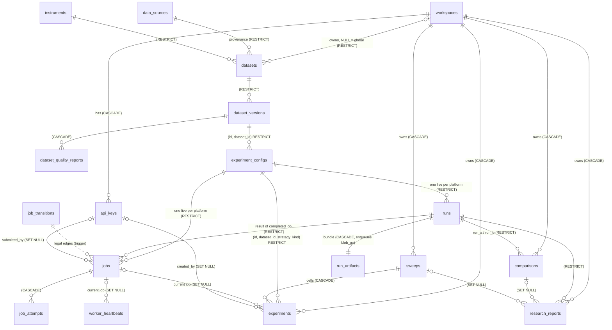

# Database design

Status: Phase 0 design, 2026-11-14. The DDL is [schema_draft.sql](schema_draft.sql). It was applied to, exercised
on and removed from the local PostgreSQL 18.7 cluster (§13). Architecture context: [TARGET_ARCHITECTURE.md](TARGET_ARCHITECTURE.md).
External claims cite the sources at the end ([N1]…). **[INFERENCE]** marks anything not read or measured.

Postgres is the **index and the trust root**. It holds identities, state, metadata, summaries and every hash.
Bulk run data (tape, fills, equity, orders) lives in one verified bundle per run in Vercel Blob. The database never
stores tapes.

---

## 1. Principles

1. **Science is global, content-addressed and immutable.** Dataset versions, experiment configs, runs and artefacts
   are keyed by content hashes and cannot be updated (§5.3). Workspaces own *metadata over* science (labels, sweeps,
   comparisons, saved reports), never copies of it.
2. **Idempotency is a unique constraint.** Every submission path ends in `INSERT … ON CONFLICT` against a unique
   index (§5.2). Application-level "check then insert" is never relied on.
3. **The database enforces the job state machine** (transition table + trigger) and its invariants (CHECKs). The
   worker code is the second line of defence, not the only one.
4. **One statement per queue operation**, valid through PgBouncer transaction mode [N3]: no session `SET`, no
   `LISTEN`, no session advisory locks, no temp tables. All SQL is schema-qualified (`bb.jobs`), so nothing depends
   on `search_path`.
5. **No traffic when idle.** Nothing in the schema needs periodic maintenance from the app while there is no work.
   Retention runs opportunistically when the reaper is already active (§8).

## 2. Conceptual model

| Area | Entities | Owned by |
|---|---|---|
| Identity & access | `workspaces`, `api_keys`, `audit_events` | – |
| Market data | `data_sources` (provenance/licence), `instruments`, `datasets`, `dataset_versions` (content hash + normalisation version), `dataset_quality_reports` | global (hosted: synthetic only) |
| Research: science | `experiment_configs` (fingerprint), `runs` (result per platform, metrics), `run_artifacts` (bundle + page index) | global |
| Research: workspace | `experiments` (+ view `sweep_cells`), `sweeps`, `comparisons`, `research_reports` | workspace |
| Operations | `jobs`, `job_transitions`, `job_attempts`, `worker_heartbeats`, `system_events`, `blob_gc`, `storage_usage_monthly` | system |



## 3. Table catalogue

| Table | Key / identity | Mutability | Notes |
|---|---|---|---|
| `workspaces` | `id` uuidv7; `slug` unique | mutable, `version` | `kind ∈ {demo, research, system}`; at most one `demo` (unique index on `(true) WHERE kind='demo'`); quotas per workspace |
| `api_keys` | `key_sha256` unique (32 bytes) | mutable (`revoked_at`, `last_used_at`), `version` | `scopes ⊆ {read, run, admin}`; only digests stored (AT-11); `display_prefix` for UI/logs |
| `audit_events` | identity bigint | append-only (trigger) | no FKs on purpose (history must survive deletes); BRIN on `at` for retention |
| `data_sources` | text id | reference data | `CHECK (NOT hostable OR redistribution_allowed)`; the hosted profile refuses non-hostable sources at registration |
| `instruments` | uuid; `(exchange, symbol)` unique | reference data | tick/lot sizes live on the dataset version, because they are part of the data contract and can change over time |
| `datasets` | text id `[a-z0-9_-]` (as today) | mutable title, `version` | `owner_workspace_id NULL` = global |
| `dataset_versions` | uuid; `(dataset_id, version_no)`, `(dataset_id, events_sha256)` unique | **immutable** except `retired_at` | span `< 2^53` ns CHECK (AT-9); `storage = regenerate` for synthetic (rebuilt on cold start, sha-verified, no Blob ops) |
| `dataset_quality_reports` | `(dataset_version_id, checker_version)` | immutable | re-runnable with a newer checker without touching the version |
| `experiment_configs` | uuid; **`fingerprint` unique**; `short_id` (16 hex, generated) unique | **immutable** | `strategy_kind`, `interval_ns` generated from `config`; `est_*` from `estimate_work` fixed at admission |
| `runs` | uuid; **`(experiment_config_id, platform)` unique where not quarantined** | **immutable** except quarantine | `is_canonical` written at insert from bb-core `platform::is_canonical` (libm fingerprint = `CANONICAL_LIBM`; migration 0007); promoted metrics generated from `metrics` jsonb; `summary_sha256` re-checked on serve |
| `run_artifacts` | uuid; `(run_id, kind)`, `(storage_backend, storage_key)` unique | **immutable** | sha256, size, format version, page index + its sha256; delete enqueues `blob_gc` |
| `blob_gc` | `(storage_backend, storage_key)` | work queue | upload-intent log + deletion outbox (§6.6) |
| `storage_usage_monthly` | `(month, storage_backend)` | counters | Vercel Blob Hobby allowance accounting [V1] |
| `sweeps` | uuid; `(workspace_id, spec_fingerprint)` unique | mutable label/cancel, `version` | `spec` = bb-core `SweepSpec`; `cell_count ≤ 100`, `run_count ∈ {cells, 2·cells}` (migration 0008) |
| `experiments` | uuid; `UNIQUE NULLS NOT DISTINCT (workspace_id, experiment_config_id, platform, sweep_id)` | mutable label/job/cancel, `version` | sweep runs are experiments keyed `UNIQUE (sweep_id, sweep_cell, sweep_segment)` (segment `full`/`in_sample`/`out_of_sample`); view `sweep_cells` |
| `comparisons` | uuid; `(workspace_id, run_a_id, run_b_id, comparator_version)` unique | immutable except label | `eligibility ∈ {aligned, metrics_only}` with `reasons` (AT-1); CHECK ties them together |
| `research_reports` | uuid | immutable (FK `SET NULL` whitelisted) | saved Markdown snapshot ≤ 1 MiB + sha256; unsaved reports are generated on demand |
| `jobs` | uuidv7; **single-flight partial unique index** | state machine, `version` | see §6 |
| `job_transitions` | `(from_state, to_state)` | reference data | the 12 legal edges, with actors and meaning |
| `job_attempts` | `(job_id, attempt_no)` | append + close | one row per claim; outcome `completed/failed/cancelled/released/lease_expired/expired`; `peak_rss_bytes` |
| `worker_heartbeats` | `worker_id` (`RENDER_INSTANCE_ID:pid`) | upsert | written on state change and every 15 s **only while busy** |
| `system_events` | identity bigint | append-only | lease reclaimed, integrity failure, nondeterminism, budget exceeded, startup/shutdown |

## 4. Normalisation decisions (driven by query patterns)

| Decision | Alternatives rejected | Why |
|---|---|---|
| **Strategy kinds = `CHECK` on a generated text column**, not a table, not a PG `ENUM` | `strategy_kinds` table; `CREATE TYPE … AS ENUM` | Kinds are compiled Rust (`StrategyKind`, 4 variants); a new kind needs a code release and is covered by `SIMULATION_REVISION`/`CONTRACT_VERSION`. A table would hold data the code already owns and could drift from it. A PG enum cannot drop values, and new values cannot be used in the transaction that adds them; a CHECK is replaced transactionally in the same migration that ships the kind |
| **`run_metrics` merged into `runs`** (`metrics` jsonb + generated `net_pnl`, `fees`, `max_drawdown`, `orders_submitted`, `engine_check_agrees`) | separate 1:1 `run_metrics`; EAV `(run_id, key, value)` | The run list always shows metrics and the run detail always reads all of them, so a 1:1 split only adds a join. EAV loses types. Generated columns make the promoted values provably equal to the hashed JSON |
| **`sweep_cells` = rows of `experiments`** with `(sweep_id, sweep_cell, sweep_segment)` + a view | separate `sweep_cells` table | A sweep run *is* a workspace experiment: same idempotency, quota, cancel, listing and job linkage. One path, not two |
| **`dataset_quality_reports` separate** from `dataset_versions` | jsonb column on the version | The version is immutable, but quality checkers evolve (`checker_version`) |
| **Page index as jsonb on `run_artifacts`**, not an `artifact_pages` table | one row per page | It is always read whole and cached per run; up to ~60 entries under hosted limits |
| **Comparisons store the summary** (eligibility, metric deltas, alignment counters, first divergence), not the pair list | store pairs | Pairs are recomputed per page from the two cached bundles; the summary is small and is what lists show |
| **Saved reports inline in Postgres** (≤ 1 MiB text) | Blob object per report | Saves Blob advanced ops (2,000/month [V1]); reports are small text |
| **`experiments` carries `dataset_id`, `strategy_kind`** copied from the config, guarded by a composite FK to `experiment_configs (id, dataset_id, strategy_kind)` | join to configs for every filter | The workspace run list filters and sorts by them in one index (`experiments_workspace_dataset_created`); the FK makes drift impossible (validated: §13.2) |
| **Event tables without FKs** | FKs with `SET NULL` | FK actions are UPDATEs, which would rewrite append-only history |
| **Jobs and runs global, experiments per workspace** | per-workspace jobs | Single-flight across workspaces saves compute; visibility stays scoped through `experiments` (AT-11) |

## 5. Constraints

### 5.1 Delete rules

| Rule | Where | Rationale |
|---|---|---|
| `CASCADE` | workspace → `api_keys`, `experiments`, `sweeps`, `comparisons`, `research_reports`; `sweeps` → its `experiments`; `jobs` → `job_attempts`; `runs` → `run_artifacts`; `dataset_versions` → `dataset_quality_reports` | dependent metadata has no meaning without its owner |
| `RESTRICT` | every reference *to science* (`dataset_versions`, `experiment_configs`, `runs`) and `datasets` → owner workspace | scientific objects are only removed by the explicit GC (§8). A GC bug fails loudly instead of cascading |
| `SET NULL` | attribution (`created_by_key_id`, `submitted_by_*`), `experiments.job_id`, `worker_heartbeats.current_job_id`, report subjects `comparison_id`/`sweep_id` | keep the row, lose the pointer |

### 5.2 Uniques that implement idempotency

| Unique | Serves |
|---|---|
| `experiment_configs (fingerprint)` | content-addressed config insert (`ON CONFLICT DO NOTHING`) |
| `experiment_configs (short_id)` | 16-hex run-id alias; prefix collision → error, not overwrite |
| `runs (experiment_config_id, platform) WHERE quarantined_at IS NULL` | one live result per identity; completion `ON CONFLICT DO NOTHING` + hash comparison (nondeterminism alarm) |
| `jobs (experiment_config_id, platform) WHERE state IN (created, queued, running, cancelling)` | **single-flight** (AT-4) |
| `experiments` `NULLS NOT DISTINCT (workspace_id, experiment_config_id, platform, sweep_id)` | idempotent submission per workspace; first label wins |
| `sweeps (workspace_id, spec_fingerprint)` | idempotent sweep submission |
| `comparisons (workspace_id, run_a_id, run_b_id, comparator_version)` | idempotent comparison create |
| `run_artifacts (storage_backend, storage_key)`, `blob_gc` PK | one row per stored object |
| `api_keys (key_sha256)` | authentication lookup |

### 5.3 Immutability: triggers, not privileges

Immutable tables have an `AFTER UPDATE` row trigger `bb.forbid_update(<mutable columns…>)`. It compares
`to_jsonb(OLD) - allowed` with `to_jsonb(NEW) - allowed` and raises `SQLSTATE BB001`. The trigger is `AFTER` so that
stored generated columns in `NEW` are already computed. Tables holding scientific inputs and results also get a
`BEFORE TRUNCATE` statement trigger, because `TRUNCATE` bypasses row triggers.

Why triggers rather than `REVOKE UPDATE` from an application role:

- **They bind the owner too.** Privileges do not restrain a table owner, and on Neon Free the Vercel-managed project
  hands out one owner role that both the app and migrations use **[INFERENCE: role layout of the Vercel-managed
  integration; a second role would add a second secret to manage]**. Defeating a trigger requires deliberate DDL
  (`ALTER TABLE … DISABLE TRIGGER`), which shows up in migrations and review.
- **Column whitelists** (`runs.quarantined_at`, `dataset_versions.retired_at`, FK `SET NULL` columns) are expressed
  once, next to the table, in the same migration file.
- **Testable in SQL** (§13.2) and visible in `\d`.
- **Cost:** none on the hot path. Immutable tables are only inserted into; the trigger fires only on (rejected) updates.

Privileges remain a defence-in-depth upgrade: a `bb_app` role without `TRUNCATE`/DDL once the project moves off the
free plan.

### 5.4 State and quantity CHECKs (excerpt)

All state/kind columns are `text` + `CHECK (… IN (…))`. Non-negative counts and sizes, 32-byte digests, label lengths,
`cell_count ≤ 100`, `ticks_done ≤ ticks_total`, `lease_losses ≤ max_attempts`, and the job invariants:
`(state IN (running, cancelling)) = (lease_owner and lease_expires_at NOT NULL)`, `(state = completed) = (run_id NOT
NULL)`, `(state = failed) = (error_category, error_code NOT NULL)`, `(state = expired) = (expired_reason NOT NULL)`,
`terminal = (finished_at NOT NULL)`, and `cancelling ⇒ cancel_requested_at`. Insert is allowed only as
`created`/`queued`. Updates must follow `bb.job_transitions` (`BB002`).

### 5.5 Optimistic concurrency

`version bigint` + `bb.bump_version()` (BEFORE UPDATE: `version+1`, `updated_at = now()`) on `workspaces`,
`api_keys`, `datasets`, `experiments`, `sweeps`, `comparisons`, `jobs`. Writers use `UPDATE … WHERE id = $1 AND
version = $2`. 0 rows → HTTP 409 `conflict`. The API exposes `version` as a strong `ETag` and takes `If-Match` on
`PATCH`/`DELETE`. For `jobs` the ETag serves cheap polling (`If-None-Match` → 304). Workers do not use `version`;
their compare-and-set is the lease predicate (`lease_owner = $me AND state = …`).

## 6. Queue statements (canonical SQL)

All are single statements (or one short transaction for completion), so they work through the pooler [N3].

**6.1 Submit (single-flight).** See TARGET_ARCHITECTURE §5.2. Core statement:

```sql
INSERT INTO bb.jobs (experiment_config_id, platform, ticks_total, queued_at, priority,
                     submitted_by_workspace_id, submitted_by_key_id, deadline_ms, max_attempts)
VALUES ($1, $2, $3, now(), $4, $5, $6, $7, $8)
ON CONFLICT (experiment_config_id, platform)
  WHERE state IN ('created','queued','running','cancelling') DO NOTHING
RETURNING id;
-- no row → new statement (fresh READ COMMITTED snapshot):
SELECT id FROM bb.jobs WHERE experiment_config_id = $1 AND platform = $2
  AND state IN ('created','queued','running','cancelling');
```

**6.2 Claim.**

```sql
WITH claimed AS (
  UPDATE bb.jobs j
     SET state = 'running', claim_count = j.claim_count + 1, lease_owner = $1,
         lease_expires_at = now() + make_interval(secs => $2), heartbeat_at = now(),
         started_at = coalesce(j.started_at, now())
   WHERE j.id = (SELECT id FROM bb.jobs
                  WHERE state = 'queued' AND platform = $3 AND run_after <= now()
                  ORDER BY platform, priority DESC, queued_at, id
                  FOR UPDATE SKIP LOCKED LIMIT 1)
  RETURNING j.*),
att AS (INSERT INTO bb.job_attempts (job_id, attempt_no, worker_id)
        SELECT id, claim_count, lease_owner FROM claimed)
SELECT * FROM claimed;
```

**6.3 Heartbeat + progress** (returns the state, so `cancelling` reaches `RunControl::should_cancel`; 0 rows = lease lost):

```sql
UPDATE bb.jobs SET lease_expires_at = now() + make_interval(secs => $3), heartbeat_at = now(),
                   ticks_done = $4, tape_events = $5
 WHERE id = $1 AND lease_owner = $2 AND state IN ('running','cancelling')
RETURNING state;
```

**6.4 Complete** (one transaction, after upload + verification; TARGET_ARCHITECTURE §6): `INSERT bb.runs … ON
CONFLICT (experiment_config_id, platform) WHERE quarantined_at IS NULL DO NOTHING`; `INSERT bb.run_artifacts`;
`DELETE FROM bb.blob_gc WHERE storage_key = $k` (the intent row); `UPDATE bb.jobs SET state='completed', run_id=…,
lease_owner=NULL, lease_expires_at=NULL, finished_at=now(), ticks_done=ticks_total WHERE id=$j AND lease_owner=$me
AND state='running'`. 0 rows → `ROLLBACK`. Then close the attempt and bump `storage_usage_monthly`.

**6.5 Release on drain / fail / cancel** use the same lease predicate. Cancel from the API:

```sql
-- queued or created: immediate
UPDATE bb.jobs SET state='cancelled', cancel_requested_at=now(), finished_at=now()
 WHERE id=$1 AND state IN ('created','queued');
-- running: cooperative
UPDATE bb.jobs SET state='cancelling', cancel_requested_at=now() WHERE id=$1 AND state='running';
```

**6.6 Reaper** (runs at startup, on every worker wake and before each claim while work is pending):

```sql
WITH reaped AS (
  UPDATE bb.jobs j SET
    state = CASE WHEN j.cancel_requested_at IS NOT NULL THEN 'cancelled'
                 WHEN j.lease_losses + 1 >= j.max_attempts THEN 'failed' ELSE 'queued' END,
    lease_losses = j.lease_losses + 1, lease_owner = NULL, lease_expires_at = NULL,
    ticks_done = 0, tape_events = 0, queued_at = now(),
    run_after = now() + interval '30 seconds' * (j.lease_losses + 1),
    error_category = CASE WHEN j.cancel_requested_at IS NULL AND j.lease_losses + 1 >= j.max_attempts
                          THEN 'lease_expired' END,
    error_code     = CASE WHEN … same … THEN 'lease_expired' END,
    error_message  = CASE WHEN … same … THEN 'worker lease expired ' || (j.lease_losses + 1) || ' times' END,
    finished_at    = CASE WHEN j.cancel_requested_at IS NOT NULL
                            OR j.lease_losses + 1 >= j.max_attempts THEN now() END
  WHERE j.id IN (SELECT id FROM bb.jobs
                  WHERE state IN ('running','cancelling') AND lease_expires_at < now()
                  ORDER BY lease_expires_at FOR UPDATE SKIP LOCKED LIMIT 100)
  RETURNING j.*)
UPDATE bb.job_attempts a SET ended_at = now(), outcome = 'lease_expired'
  FROM reaped r WHERE a.job_id = r.id AND a.attempt_no = r.claim_count AND a.ended_at IS NULL;

UPDATE bb.jobs SET state = 'expired', finished_at = now(),
       expired_reason = 'not started within 24 h of submission (host asleep or queue saturated)'
 WHERE state IN ('created','queued') AND expires_at < now();
```

Blob GC: `SELECT … FROM bb.blob_gc WHERE not_before <= now() ORDER BY not_before LIMIT 50 FOR UPDATE SKIP LOCKED`.
Delete the objects (free on Blob [V1]), then delete the rows. On failure, increment `attempts` and record `last_error`.

**6.7 Next wake** (idle in-process worker; no timer when NULL):

```sql
SELECT least(
  (SELECT min(run_after)        FROM bb.jobs WHERE state = 'queued' AND platform = $1),
  (SELECT min(lease_expires_at) FROM bb.jobs WHERE state IN ('running','cancelling')),
  (SELECT min(expires_at)       FROM bb.jobs WHERE state IN ('created','queued')));
```

## 7. Queries and the indexes that serve them

Plans are from §13.4, on 20,006 configs / 18,002 runs / 20,006 jobs / 20,002 experiments / 50,000 audit rows after
`VACUUM ANALYZE`.

| # | Query (endpoint) | Index | Observed plan / time |
|---|---|---|---|
| Q1 | claim (worker) | `jobs_claim (platform, priority DESC, queued_at, id) WHERE state='queued'` | Index Scan `jobs_claim` → LockRows → Limit; 3.4 ms incl. 2.4 ms first-call trigger |
| Q2 | single-flight insert (`POST /experiments`) | `jobs_single_flight` (arbiter) | `Conflict Arbiter Indexes: jobs_single_flight`; 0.5 ms |
| Q3 | run by 16-hex id, canonical (`GET /runs/{id}`, submit fast path) | `experiment_configs_short_id_key`, `runs_identity` | two index scans; 0.15 ms |
| Q4 | queue depth / position (`/status`, job resource) | partial `jobs_ttl` / `jobs_claim` | index scan of 200 queued rows; 0.04–0.06 ms |
| Q5 | lease reaper | `jobs_lease (lease_expires_at) WHERE state IN (running, cancelling)` | Index Scan `jobs_lease`; 0.009 ms |
| Q6 | workspace experiment list, dataset filter, keyset cursor, joined to run + job (`GET /experiments`) | `experiments_workspace_dataset_created`, `runs_identity`, PKs | Index Scan with `ROW(created_at,id) < cursor` in the index condition; 50 rows in 1.0 ms |
| Q7 | workspace job list by state (`GET /jobs`) | `jobs_single_flight` (bitmap) + `experiments_workspace_job` (index-only) | 0.32 ms |
| Q8 | API key auth (every keyed request) | `api_keys_key_sha256_key` | seq scan at 1 row (planner choice); unique index at scale |
| Q9 | per-key daily quota (submit txn) | `experiments_created_by_key (created_by_key_id, created_at)` | index-only scan; 2.2 ms for 10,001 rows (worst case: every row inside the window) |
| Q10 | audit page (`/system/events`, admin) | `audit_events_workspace_at` | 0.03 ms |
| Q11 | retention of terminal jobs | `jobs_finished` | Index Scan `jobs_finished` |
| – | runs sorted by metric (`GET /runs?sort=net_pnl`) | none beyond `experiments_workspace_created` **[INFERENCE: ≤ a few thousand runs per workspace under the Blob cap; add `(experiment_config_id) INCLUDE (net_pnl)` only if measured slow]** | – |
| – | comparisons/reports per workspace | `comparisons_workspace_created`, `research_reports_workspace_created` | – |
| – | FK support on the referencing side | `jobs_run`, `jobs_submitted_by_*`, `experiments_job`, `experiments_config`, `comparisons_run_a/b`, `research_reports_*`, `worker_heartbeats_job`, `experiment_configs_dataset_version`, `api_keys_workspace`, `datasets_owner` | prevent seq scans on parent delete/GC |

## 8. Retention

| Data | Kept | Mechanism |
|---|---|---|
| `experiment_configs`, `runs`, `run_artifacts`, Blob objects | while referenced by any `experiments` row, comparison, report, or a job younger than 30 days; demo experiments are `pinned` | GC (daily, during a reaper pass): delete unreferenced runs older than 7 days (artefact rows cascade and enqueue `blob_gc`), then unreferenced configs. **Admission refuses new work before the Blob budget is exhausted; referenced science is never evicted silently** |
| Quarantined runs | 30 days (evidence for debugging) | same GC |
| `jobs` (+ `job_attempts`) terminal | 30 days after `finished_at` | `DELETE … WHERE finished_at < now() - 30 days` (Q11); `experiments.job_id` → NULL; experiment status then derives from `runs` |
| `audit_events` | 365 days | BRIN-assisted range delete |
| `system_events` | 30 days | range delete |
| `worker_heartbeats` | `stopped` rows 7 days | delete |
| `blob_gc` | until the object is deleted | GC loop |
| `storage_usage_monthly` | 24 months | delete |
| revoked/expired `api_keys` | 365 days after revocation | delete (FKs `SET NULL`) |
| `dataset_versions` | forever while referenced; `retired_at` hides them from new submissions | – |

## 9. Size budget against Neon Free (1 GB per project [N1])

Measured on the local cluster (§13.4), including indexes and TOAST, 20k-row load:

| Table | Bytes/row measured | Realistic per row |
|---|---:|---|
| `run_artifacts` | 2,350 (8-page index) | ≤ 10 KB (≤ ~60 pages under hosted limits) **[INFERENCE: ~150 B per page entry]** |
| `experiment_configs` | 1,264 (0.9 KB config) | ≈ 1.0 KB (a real stored config is 598 B: `jq -c .manifest.config` of a local `summary.json`) |
| `jobs` | 1,026 | 1 KB, retained 30 days |
| `experiments` | 855 | 0.9 KB |
| `runs` | 715 (small test metrics) | ≈ 2.6 KB (real `Metrics` JSON is 1,863 B) |
| `audit_events` | 208 (10,160 kB / 50,000 rows) | 0.2 KB |
| `dataset_versions` | – | manifest 6.3–7.5 KB (real `dataset.json` sizes) |

Per completed experiment: ≈ 6 KB typical, ≤ 16 KB worst case. The binding constraint is Vercel Blob, not Postgres:
1 GB of Blob holds about 1,400 typical synthetic runs [V1] (OSS evaluation §4). That is ≈ 9–22 MB of Postgres.
20,000 runs measured 124 MB for the whole schema. Audit at 10k events/month × 365 days ≈ 25 MB. **Expected
footprint < 100 MB, ≥ 10× headroom.** When the storage cap is exceeded, Neon makes inserts, updates and deletes fail
until space is freed, but deletes no data [N1]. `/readyz` and `/api/v1/system/usage` report `pg_database_size()` so
the operator sees it coming.

Write volume vs the 6-hour / 1 GB change-history window [N1]: heartbeats only while busy (4/min × ~2 KB WAL
**[INFERENCE]**), one completion transaction per run. Negligible.

## 10. Migrations and rollback

- **Tooling:** `sqlx::migrate!("crates/bb-db/migrations")`, embedded in the binary, run by `blackbox migrate` over
  `DATABASE_URL_UNPOOLED`. sqlx's migrator takes a session advisory lock, which the pooler does not support
  (OSS evaluation §3.5; [N3]). Each migration runs in its own transaction. `CREATE INDEX CONCURRENTLY` migrations use
  sqlx's no-transaction directive.
- **Reversible pairs:** `NNNN_name.up.sql` + `NNNN_name.down.sql`. This draft is `0001_initial`; its down script is
  `DROP SCHEMA bb CASCADE;`. That was run here as up → exercise → **down → up → down** with a clean result (§13.5).
  CI runs the same cycle for every migration on a throwaway Postgres 18, plus `cargo sqlx prepare --check`.
- **Production is forward-only.** Down scripts are never run against Neon. Every migration must be **N−1
  compatible** (expand → deploy code → contract in a later release). Rolling back the app is then "deploy the previous
  image" (DEPLOYMENT.md §9) and needs no schema change. A destructive contract step (drop column/table) ships only
  after the release that stopped using it has been live for one deploy.
- **Data restore instead of down:** if a migration damages data, restore (§11) rather than hand-write a reverse data
  migration.

## 11. Backup and restore on Neon Free

| Mechanism | Free-plan limit | Use |
|---|---|---|
| Instant restore (point-in-time) from change history | **up to 6 hours, limited to 1 GB of change history**; default history window 6 h on Free [N1] | Primary recovery from a bad migration or bad delete noticed within 6 h. Restores only from root branches [N1] |
| Manual snapshot | **1 manual snapshot**; scheduled backups not available on Free [N1] | Take (replacing the previous one) before every migration with a contract step |
| Logical dump | counts against 5 GB/month egress [N1]; needs the direct URL (pooler does not support `pg_dump`'s `SET`s [N3]) | Weekly, and before risky migrations: `pg_dump --format=custom --schema=bb "$DATABASE_URL_UNPOOLED" > data/secrets/backups/bb-YYYYMMDD.dump` on the operator machine (git-ignored path). Never stored as a CI artefact, because the repository is public |
| Blob objects | no versioning | Not backed up. Bundles are reproducible from configs on the canonical platform; their hashes in Postgres detect corruption |

Restore drill (documented, not yet executed): restore the dump into the local cluster with
`pg_restore --dbname=blackbox_dev --schema=bb`, then run `blackbox verify --all-runs` against FS copies of a sample of
bundles **[INFERENCE: command to be built in Phase 2]**.

## 12. Connections

- App: `DATABASE_URL` = Neon **pooled** (`-pooler` host) with `sslmode=require`. sqlx `PgPool`: `max_connections 5`,
  `min_connections 0` (do not keep Neon awake), `idle_timeout 240 s` (< Neon's 5-min idle close), `acquire_timeout
  10 s`, `test_before_acquire` on. Protocol-level prepared statements are supported by the pooler [N3].
- Timeouts: no session `SET` on the pooler [N3]. Use client-side `tokio::time::timeout` per query (5 s API, 15 s
  commit). `ALTER ROLE … SET statement_timeout = '30s'` is applied once by a migration as a backstop **[INFERENCE:
  role defaults apply to the pooler's server connections, as for any new session]**.
- Migrations and dumps: `DATABASE_URL_UNPOOLED` (direct) only.

## 13. Validation transcript

Environment: local PostgreSQL 18.7 (`SELECT version()` → `PostgreSQL 18.7 on x86_64-windows, compiled by
msvc-19.51.36260, 64-bit`), database `blackbox_dev`, via
`~/.blackbox/pgsql/postgresql-18.7.0-x86_64-pc-windows-msvc/bin/psql.exe -h 127.0.0.1 -p 55432 -U blackbox`. The
exercise scripts lived in a scratch directory outside the repository and were deleted afterwards. The outputs below
are excerpts from the final run against the committed `schema_draft.sql`. Editing was limited to three things: psql
table borders and `DETAIL`/`CONTEXT` lines were dropped, uuids inside messages were replaced by `…`, and short
annotations were added in parentheses.

### 13.1 Apply

```
$ psql … -v ON_ERROR_STOP=1 -f docs/engineering/schema_draft.sql && echo APPLIED
APPLIED
$ psql … -c "\dt bb.*"      → 22 tables, 1 view (bb.sweep_cells)
```

### 13.2 Sample rows, idempotency, immutability, CHECKs

```
== 2. experiment config (content-addressed) + derived columns
     short_id     | strategy_kind | interval_ns
 136d41410c6b23f1 | touch_maker   |   100000000

== 3. idempotency: duplicate fingerprint is rejected; ON CONFLICT path returns the existing row
ERROR:  duplicate key value violates unique constraint "experiment_configs_fingerprint_key"
 inserted | configs_total
        0 |             1

== 4. submit: single-flight job insert (first creates, second hits the partial unique index)
 job      | state
 01a1d737 | queued
 (second ON CONFLICT insert)  INSERT 0 0
-- plain duplicate insert (no ON CONFLICT):
ERROR:  duplicate key value violates unique constraint "jobs_single_flight"
-- workspace experiment row; a repeat submission is a no-op that reports created=false
 first label | t
 first label | f
-- composite FK: denormalised strategy_kind must match the config
ERROR:  insert or update on table "experiments" violates foreign key constraint
        "experiments_experiment_config_id_dataset_id_strategy_kind_fkey"

== 5. illegal job transitions are rejected (BB002)
ERROR:  bb.jobs: illegal state transition queued -> completed (job …)
ERROR:  bb.jobs: a job must be inserted as created or queued, not running
-- invariant CHECK: running without a lease
ERROR:  new row for relation "jobs" violates check constraint "jobs_check2"

== 6. claim
 job      |  state  | claim_count |    lease_owner    | ticks_total
 01a1d737 | running |           1 | render-srv-1:4242 |        1200
-- second claim finds nothing                          UPDATE 0

== 7. heartbeat + progress
  state  | ticks_done | ticks_total | version
 running |        600 |        1200 |       3
-- a non-holder cannot heartbeat                       UPDATE 0

== 8. completion transaction: run + artefact + job completed + intent row removed
 job_state | artifacts | attempt_outcome
 completed |         1 | completed
 pending_blob_gc = 0
 net_pnl | fees   | orders_submitted | engine_check_agrees | is_canonical
 -1.2345 | 0.0567 |              238 | t                   | t
-- a completed job cannot be resumed
ERROR:  bb.jobs: illegal state transition completed -> running (job …)

== 9. immutability of scientific inputs and results (BB001)
ERROR:  bb.experiment_configs: row is immutable (mutable columns: none)
ERROR:  bb.runs: row is immutable (mutable columns: quarantined_at, quarantine_reason)
ERROR:  bb.run_artifacts: row is immutable (mutable columns: none)
ERROR:  bb.dataset_versions: row is immutable (mutable columns: retired_at)
ERROR:  bb.runs: TRUNCATE is not allowed
-- allowed: quarantine a run, retire a dataset version   quarantined t / retired t
-- a quarantined run no longer occupies the identity: a re-simulated run can be inserted
 live | total
    1 |     2

== 10. CHECK guards
ERROR:  … "dataset_versions" violates check constraint "dataset_versions_check1"   (span = 2^53 ns, AT-9)
ERROR:  … "api_keys" violates check constraint "api_keys_scopes_check"            ({read,superuser})
ERROR:  duplicate key value violates unique constraint "workspaces_one_demo"
ERROR:  … "sweeps" violates check constraint "sweeps_check"                       (11 × 10 cells)

== 11. cancellation: queued is immediate, running is cooperative
 cancelled                       (queued → cancelled)
 cancelling                      (running → cancelling)
-- worker heartbeat now returns cancelling -> RunControl::should_cancel() = true
 cancelling
-- cancelling -> completed is illegal (results of a cancelled job are discarded)
ERROR:  bb.jobs: illegal state transition cancelling -> completed (job …)
 cancelled

== 12. lease reaper: expired lease re-queues while attempts remain, then fails with lease_expired
 state  | lease_losses | max_attempts | error_category | ticks_done
 queued |            1 |            2 |                |          0
-- claimed again, dies again -> attempts exhausted
 failed |            2 |            2 | lease_expired  |          0

== 13. queue TTL reaper: queued past expires_at -> expired
 expired | not started within 24 h of submission (host asleep or queue saturated)

== 14. FK delete rules
ERROR:  update or delete on table "runs" violates RESTRICT setting of foreign key constraint
        "jobs_run_id_fkey" on table "jobs"
-- deleting a workspace cascades to its keys/experiments but not to global science (rolled back)
 experiments | keys | configs | runs | jobs_unattributed
           0 |    0 |       5 |    2 |                 5
-- deleting an artefact row enqueues its blob for GC (outbox trigger, rolled back)
      reason      | key_ok
 artifact_deleted | t
```

The run had 18 `ERROR` lines, every one an intended rejection listed above.

### 13.3 Concurrency: 8 identical submissions at the same instant (AT-4, DB side)

Eight `psql` processes started together, each sleeping until the same `pg_sleep_until` barrier, then running config
insert → single-flight job insert → read live job → experiment upsert as separate autocommit statements:

```
job_created
session 1 job=01a1d736-e18c-7914-b582-d4c64961bd9b experiment_created=false label="label from session 4"
session 2 job=01a1d736-e18c-7914-b582-d4c64961bd9b experiment_created=false label="label from session 4"
session 3 job=01a1d736-e18c-7914-b582-d4c64961bd9b experiment_created=false label="label from session 4"
session 4 job=01a1d736-e18c-7914-b582-d4c64961bd9b experiment_created=true label="label from session 4"
session 5 job=01a1d736-e18c-7914-b582-d4c64961bd9b experiment_created=false label="label from session 4"
session 6 job=01a1d736-e18c-7914-b582-d4c64961bd9b experiment_created=false label="label from session 4"
session 7 job=01a1d736-e18c-7914-b582-d4c64961bd9b experiment_created=false label="label from session 4"
session 8 job=01a1d736-e18c-7914-b582-d4c64961bd9b experiment_created=false label="label from session 4"
 live_jobs = 1     configs = 1     experiments = 1, stored_label = "label from session 4"
```

### 13.4 Volume and EXPLAIN

Load: 2 datasets, 2 research workspaces, 20,000 configs (25% on the second dataset, a third `imbalance_taker`),
18,000 runs with artefacts, 20,000 jobs walked through legal transitions (final states: 18,001 completed,
1,802 cancelled, 200 queued, 1 running, 1 failed, 1 expired), 20,000 experiments, 50,000 audit rows, then
`VACUUM ANALYZE`. Excerpts (`EXPLAIN (ANALYZE, COSTS OFF, BUFFERS OFF)`; updates inside `BEGIN … ROLLBACK`):

```
### Q1 claim
 Update on jobs j (actual time=3.260..3.263 rows=1.00 loops=1)
   InitPlan 1
     ->  Limit (actual time=0.061..0.061 rows=1.00 loops=1)
           ->  LockRows (actual time=0.060..0.061 rows=1.00 loops=1)
                 ->  Index Scan using jobs_claim on jobs (actual time=0.018..0.018 rows=1.00 loops=1)
                       Index Cond: (platform = 'linux-x86_64'::text)
                       Filter: ((state = 'queued'::text) AND (run_after <= now()))
   ->  Index Scan using jobs_pkey on jobs j (actual time=0.074..0.074 rows=1.00 loops=1)
 Trigger jobs_transition_update: time=2.401 calls=1
 Execution Time: 3.363 ms
### Q1b a windows-x86_64 worker claims nothing while linux-x86_64 jobs are queued
 claimable_by_windows = 0      queued_linux = 200

### Q2 single-flight submit (job insert)
 Insert on jobs (actual time=0.319..0.320 rows=1.00 loops=1)
   Conflict Resolution: NOTHING
   Conflict Arbiter Indexes: jobs_single_flight
 Execution Time: 0.504 ms

### Q3 existing canonical run for an identity
 Nested Loop (actual time=0.133..0.134 rows=1.00 loops=1)
   ->  Index Scan using experiment_configs_short_id_key on experiment_configs c
   ->  Index Scan using runs_identity on runs r
         Index Cond: ((experiment_config_id = c.id) AND (platform = 'linux-x86_64'::text))
 Execution Time: 0.151 ms

### Q5 lease reaper scan
 Limit -> LockRows -> Index Scan using jobs_lease on jobs
         Index Cond: (lease_expires_at < now())
 Execution Time: 0.009 ms

### Q6 experiment list: workspace + dataset filter + keyset cursor, joined to the canonical run
 Limit (actual time=0.106..0.972 rows=50.00 loops=1)
   ->  Index Scan using experiments_workspace_dataset_created on experiments e
         Index Cond: ((workspace_id = '…'::uuid) AND (dataset_id = 'synthetic-demo'::text)
                      AND (ROW(created_at, id) < ROW('2026-11-14 04:48:21.832043+05:30'::timestamptz, '…'::uuid)))
   ->  Index Scan using experiment_configs_pkey / runs_identity / jobs_pkey  (loops=50 each)
 Execution Time: 0.995 ms

### Q7 job list for a workspace filtered by state
 Nested Loop Semi Join
   ->  Bitmap Index Scan on jobs_single_flight (rows=203.00)
   ->  Index Only Scan using experiments_workspace_job on experiments e
 Execution Time: 0.322 ms

### Q9 per-key daily quota
 Index Only Scan using experiments_created_by_key on experiments (rows=10001.00)
 Execution Time: 2.162 ms

### Q10 audit log page for a workspace
 Index Scan using audit_events_workspace_at on audit_events
 Execution Time: 0.027 ms

### Q11 retention: terminal jobs older than 30 days
 Delete on jobs  ->  Index Scan using jobs_finished on jobs

### sizes
 run_artifacts      |  18002 | 40 MB  | 2350 B/row
 experiment_configs |  20006 | 24 MB  | 1264
 jobs               |  20006 | 20 MB  | 1026
 experiments        |  20002 | 16 MB  |  855
 runs               |  18002 | 12 MB  |  715
 audit_events       |  50000 | 10160 kB (208 B/row; pg_stat's n_live_tup estimate printed 100000)
 bb_total = 124 MB, database_total = 133 MB
```

Note from an earlier run of the same load without `VACUUM`: dead entries left in the partial indexes by the bulk state
walk made the planner choose a seq scan + hash join for Q7 (5.0 ms). Autovacuum keeps this in check in production.
Plans should be re-checked on Neon once real data exists.

### 13.5 Down migration and cleanup

```
$ psql … -c "DROP SCHEMA bb CASCADE"            → DROP SCHEMA
$ psql … -f docs/engineering/schema_draft.sql     → REAPPLIED
$ psql … -c "DROP SCHEMA bb CASCADE"            → DROP SCHEMA
$ psql … -c "select n.nspname, count(c.oid) … group by 1"
 nspname | relations
 public  |         0
$ psql … -c "select count(*) as user_functions from pg_proc … not in ('pg_catalog','information_schema')"
 user_functions = 0
```

`blackbox_dev` was left empty.

## Sources (read 2026-11-14)

- [N1] Neon — Plans (Free: 1 GB storage per project, 100 CU-hours, instant restore up to 6 h / 1 GB change history,
  1 manual snapshot, no scheduled backups, 5 GB egress; behaviour when limits are exceeded).
  https://neon.com/docs/introduction/plans
- [N2] Neon — Scale to zero (5 min, cannot be disabled on Free, reactivation in a few hundred ms).
  https://neon.com/docs/introduction/scale-to-zero
- [N3] Neon — Connection pooling (PgBouncer transaction mode; `SET`, `LISTEN/NOTIFY`, temp tables, SQL `PREPARE`
  unsupported; direct connection for migrations and `pg_dump`). https://neon.com/docs/connect/connection-pooling
- [V1] Vercel — Blob usage and pricing (Hobby: 1 GB, 2,000 advanced / 10,000 simple ops; uploads and lists are
  advanced; reads are simple only on cache MISS; blocked 30 days when exceeded). https://vercel.com/docs/vercel-blob/usage-and-pricing
- PostgreSQL 18 `uuidv7()`: verified locally (`SELECT uuidv7()` → `01a1d723-baba-73e2-836c-2fc7a28d03c7` on 18.7).
