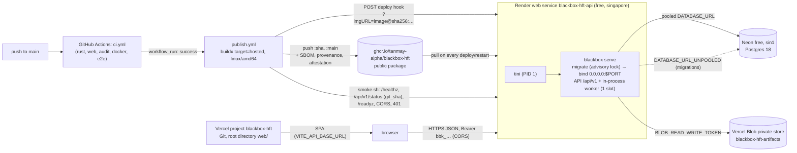

# Deployment: GHCR → Render, Vercel, Neon, Vercel Blob

Status: hosted stack implemented and deployed since 2026-11-14; see [PROJECT_STATE.md](PROJECT_STATE.md)
for observed release provenance. This guide describes source configuration and release procedures,
not proof that the latest source is deployed. §16 retains the original preparation-time validation;
[FINAL_AUDIT §7](FINAL_AUDIT.md#7-fixes-after-the-audit) records later source fixes and local checks.

Companion documents: [TARGET_ARCHITECTURE.md](TARGET_ARCHITECTURE.md) (runtime design; §12 shutdown, §13 cold
start, §14 health), [API_CONTRACT.md](API_CONTRACT.md) (§3 auth, §4 CORS), [DATABASE_DESIGN.md](DATABASE_DESIGN.md)
(§10 migrations, §11 backup, §12 connections), [PROJECT_STATE.md](PROJECT_STATE.md) (decisions, inventory). The
user-facing local/Docker guide is [../DEPLOYMENT.md](../DEPLOYMENT.md). Platform statements cite the sources at the
end; anything not read or observed is marked **[INFERENCE]**.

| File | Role |
|---|---|
| [`Dockerfile`](../../Dockerfile) | targets `hosted` (Render API image) and `local` (default; all-in-one simulator + console) |
| [`.dockerignore`](../../.dockerignore) | allowlist build context (keeps `data/secrets/` and machine-local toolchain files out) |
| [`.github/workflows/publish.yml`](../../.github/workflows/publish.yml) | CI-gated build → GHCR push → attest → Render deploy hook → smoke test |
| [`render.yaml`](../../render.yaml) | Render Blueprint: one free web service `blackbox-hft-api` (+ commented paid worker) |
| [`scripts/deploy/smoke.sh`](../../scripts/deploy/smoke.sh) | read-only smoke test (health, readiness, status, CORS, auth) |

---

## 1. Architecture of the deployment



Why this shape (decisions in PROJECT_STATE): the Rust image is compiled on GitHub's free runners for public
repositories [G3] and pushed to GHCR, free for public packages [G4]. Render only pulls it, so Render's 500 Hobby
pipeline minutes [R12] are not spent compiling Rust. Pipeline minutes are consumed by build and pre-deploy commands
[R1], and an image-backed service without a pre-deploy command runs neither **[INFERENCE from the definition]**.
Image-backed services never redeploy on their own when a tag moves [R10]: every deploy is an explicit deploy-hook
call that names a digest.

## 2. Flow of one release

1. A push to `main` runs `ci` (ci.yml, unchanged).
2. When `ci` completes, `publish` starts (`workflow_run` [G2]). Its `gate` job continues only if CI concluded
   `success` for a `push` to `main` of this repository, and it pins the commit to CI's `head_sha`.
3. `image` job: buildx builds `--target hosted` for `linux/amd64` (Render requires that platform [R10]). It pushes
   `ghcr.io/tanmay-alpha/blackbox-hft:<40-hex sha>` and `:main` with OCI labels and index annotations, a BuildKit
   SPDX SBOM and SLSA provenance (`mode=max`), and a Sigstore-signed GitHub artifact attestation pushed to the
   registry [G5].
4. `deploy` job, only when the repository secret `RENDER_DEPLOY_HOOK_URL` exists (the `gate` job exports whether it
   does as `deploy=true|false`): it calls the deploy hook with
   `imgURL=<url-encoded ghcr.io/tanmay-alpha/blackbox-hft@sha256:…>`. Render documents `imgURL` for image-backed
   services: the deploy uses that tag or digest instead of the one in the service settings, and every part except
   the tag/digest must match the service's image URL, otherwise the request is rejected with 400 [R9], [R10]. 200 =
   started, 202 = queued behind a deploy in progress [R9].
   Without the secret the `deploy` job is **skipped** and a `publish only (not deployed)` job runs instead: it posts a
   `Not deployed` notice and a step summary with the digest and the manual release command below. A green publish
   run therefore proves an image was published and attested, **not** that production changed; the deployed revision
   is whatever `/api/v1/status` reports as `git_sha`.
5. `smoke.sh` polls the service for up to 15 minutes, until `/api/v1/status` reports the new `git_sha`. Then it runs
   the CORS and auth checks (§12). Render switches traffic only after the new instance passes health checks and
   cancels a deploy that is not healthy within 15 minutes [R5]. The smoke budget matches that window.

**Manual digest release (no deploy hook configured).** The operator releases one published digest through the
Render API and verifies it; nothing here is automated or stored in the repository:

1. Take the digest from the publish run's summary (`publish only (not deployed)` job) or GHCR; never `:main`.
2. With a Render API key from the dashboard (Account Settings → API Keys, kept out of the repository and shell
   history) and the service id (`srv-…`, service Settings):

   ```
   curl -fsS -X POST "https://api.render.com/v1/services/$RENDER_SERVICE_ID/deploys" \
     -H "Authorization: Bearer $RENDER_API_KEY" -H 'Content-Type: application/json' \
     -d '{"imageUrl": "ghcr.io/tanmay-alpha/blackbox-hft@sha256:<digest>"}'
   ```

   The response is the deploy object (`id`, `status`); `imageUrl` must match the service's image URL except for the
   digest, as with `imgURL` above.
3. Poll `GET https://api.render.com/v1/services/$RENDER_SERVICE_ID/deploys/<deploy id>` until `status` is `live`
   (or `update_failed`/`canceled`: stop and investigate).
4. Verify: `BASE_URL=https://blackbox-hft-api.onrender.com EXPECT_GIT_SHA=<40-hex sha> bash scripts/deploy/smoke.sh`.
5. Record the released commit, digest and date in [PROJECT_STATE.md](PROJECT_STATE.md). Only then describe the commit
   as deployed.

**Why `workflow_run` and not `needs`.** `needs` works only between jobs of one workflow. Gating there would mean
copying ci.yml's jobs into publish.yml (a second definition of "tests pass" that can drift) or moving the publish
jobs into ci.yml (owned by other work and run on every pull request). `workflow_run` reuses CI's verdict for the
exact commit and keeps the Rust suite from running twice per push. Its properties [G2]: it runs from the workflow file on the
default branch, so a pull request cannot change the publish logic, and it has the repository's secrets. Hence the
explicit `event == 'push'`, `head_branch == 'main'` and `head_repository == github.repository` guard: a fork's PR
CI run can never publish. `workflow_dispatch` (manual) is accepted only on `main` and only if the GitHub API shows a
successful `ci` push run for that commit. Re-running CI re-publishes the same commit; that is harmless (same tags,
new index digest, another deploy).

**Permissions.** Workflow default `{}`. `gate`: `actions: read` (dispatch check). `image`: `contents: read`,
`packages: write` (push), `id-token: write` + `attestations: write` (Sigstore signing, attestation upload [G5]).
`create-storage-record: false`, because storage records exist only for organisation-owned repositories [G5]; so
`artifact-metadata: write` is not needed. `deploy`: `contents: read`. Actions are pinned to full commit SHAs read
with `gh api repos/<owner>/<repo>/git/ref/tags/<tag>` on 2026-11-14 (all lightweight tags → commit objects):

| Action | Tag | Commit |
|---|---|---|
| actions/checkout | v7.0.1 | `3d3c42e5aac5ba805825da76410c181273ba90b1` (same as ci.yml) |
| docker/setup-buildx-action | v4.4.1 | `f87e5991a6d7451dcb8d9637bfbc97413f497069` |
| docker/login-action | v4.8.0 | `8aa5831fb8d48d8f76594c7ddde61ae58019f550` |
| docker/build-push-action | v7.4.0 | `c3c9e263c25d99ce0380d002d59b67737d91b0dc` |
| actions/attest | v4.2.2 | `1e69f48acb82d1966a394da916b4c1698aa569d6` |

`actions/attest` is used rather than `actions/attest-build-provenance`, which since v4 is only a wrapper around it
[G5]. `docker/metadata-action` is not used: under `workflow_run` its default `sha`/`revision` would be the
default-branch head at trigger time, not CI's `head_sha`, so tags and labels are written explicitly from the gate's
output.

Verify a published image (anyone, no login):

```
gh attestation verify oci://ghcr.io/tanmay-alpha/blackbox-hft:main -R tanmay-alpha/BlackBox-HFT
docker buildx imagetools inspect ghcr.io/tanmay-alpha/blackbox-hft:main --format '{{ json .Provenance }}'
docker buildx imagetools inspect ghcr.io/tanmay-alpha/blackbox-hft:main --format '{{ json .SBOM }}'
```

## 3. Container image

Stages: `chef` (Rust + `cargo-chef` 0.1.78) → `planner` (`recipe.json` from manifests) → `rust-build` (`cargo chef
cook` = dependency layer, then `cargo build --release --locked --target x86_64-unknown-linux-gnu --bin blackbox`) →
`web-build` (Node, `npm ci && npm run build`) → `runtime` (Debian slim + `tini` + `ca-certificates`, user
`blackbox` uid/gid 10001) → `hosted` → `local` (last = default).

| | `hosted` | `local` (default) |
|---|---|---|
| Built by | publish.yml (`--target hosted`) | `docker build .` (CI `docker` job, users) |
| Web assets | none (the SPA is on Vercel) | `/app/web` |
| Command | `blackbox --data-dir /var/lib/blackbox serve` | `scripts/docker/local-start.sh`: `migrate`, `demo seed --wait`, first-start `keys mint`, then `serve --addr 0.0.0.0:8787 --web-dir /app/web` (data dir `/data`) |
| Data | `/var/lib/blackbox`, ephemeral scratch (synthetic datasets, verified-bundle cache) | volume `/data` |
| Env baked in | `PORT=8787` (Render overrides), `BB_GIT_SHA=<commit>`, `MALLOC_ARENA_MAX=2`, `MALLOC_MMAP_THRESHOLD_=131072` | `MALLOC_ARENA_MAX=2` |

The glibc arena cap limits allocator fragmentation. The hosted-only fixed 128 KiB mmap threshold
returns large freed read/job buffers directly to the kernel instead of letting glibc's adaptive
threshold retain them inside arenas. It disables dynamic threshold adjustment and can add
`mmap`/`munmap` calls: CPU time, simulation wall time and warm-read latency were measured before
keeping it (see `docs/rebuild/HOSTED_MEMORY.md`). Recheck those trade-offs if the workload changes.

- **Base images** are pinned as `tag@sha256:<index digest>`: `rust:1.100.0-trixie`, `node:22.23.5-trixie-slim`,
  `debian:trixie-20261104-slim`. Each digest was read on 2026-11-14 with an anonymous registry token and
  `HEAD https://registry-1.docker.io/v2/library/<repo>/manifests/<tag>` (`Accept: application/vnd.oci.image.index.v1+json`),
  header `Docker-Content-Digest`. It matched the `digest` in Docker Hub's tag API. The builder and the runtime are
  both Debian 13 (trixie), so the binary's glibc matches. Rust 1.100.0 is ≥ the workspace `rust-version`, which
  the persistence work raises to 1.94. Update: choose the new tag, read its digest the same way, and change both in
  the `ARG` line.
- **apt packages are not version-pinned** (`hadolint ignore=DL3008`, justified in the file). The base is
  digest-pinned, and `ca-certificates`/`tini` should pick up Debian security updates on rebuild. Pinning
  `ca-certificates=20250419` would already miss `20250419+deb13u1` from trixie-security (Debian archive, read
  2026-11-14).
- **Dependency caching:** `recipe.json` changes only with manifests or `Cargo.lock`, so a source-only commit reuses
  the `cook` layer. In CI the layers go to the GitHub Actions cache (`type=gha,scope=hosted,mode=max`; 10 GB of
  cache storage per repository [G6]). A cache miss only makes the build slower. BuildKit cache mounts are not used
  because they are not part of the exported layer cache **[INFERENCE: not re-read in Docker's docs]**.
- **Architecture:** Render runs `linux/amd64` only [R10]. The workflow builds that platform, and the Rust stage
  passes `--target x86_64-unknown-linux-gnu` explicitly, so a build on another architecture fails instead of
  producing an unusable image. The binary's platform class is therefore `linux-x86_64`, the canonical class
  (TARGET_ARCHITECTURE §9).
- **Build context** is an allowlist (`Cargo.toml`, `Cargo.lock`, `crates/`, `docs/LIMITATIONS.md`, `web/` minus
  build output). Only `docs/LIMITATIONS.md` is copied, because `crates/bb-app/src/report.rs` embeds it with
  `include_str!`; a new compile-time include of another file must be added to `.dockerignore` and the Dockerfile.
- **PID 1 and signals:** `ENTRYPOINT ["/usr/bin/tini", "--"]`. tini forwards `SIGTERM`/`SIGINT` to `blackbox` and
  reaps zombies. Without it the binary would be PID 1, and the kernel does not apply default signal actions to
  PID 1, so a missing handler would leave it running until Render's `SIGKILL`. The command is exec-form (no shell
  in between). Render sends `SIGTERM` 60 s after the new instance is live and `SIGKILL` after the shutdown delay,
  default 30 s [R2]. Render's validator rejects `maxShutdownDelaySeconds` on free services (§16), so 30 s is fixed.
- **No `HEALTHCHECK`:** Render's documented health check is the HTTP `healthCheckPath` [R5]. A Docker
  `HEALTHCHECK` would need `curl`/`wget` in the image, and Render's docs do not mention using it.

Local use of the hosted image (needs Postgres; `my-hosted.env` is your own git-ignored file holding the §5 variables,
inside a container the host's local cluster is `host.docker.internal:55432`, not `127.0.0.1`):

```
docker build --target hosted -t blackbox-hft:hosted .
docker run --rm -p 127.0.0.1:8787:8787 --env-file data/secrets/my-hosted.env blackbox-hft:hosted
```

## 4. Render service (`render.yaml`)

| Field | Value | Verified against |
|---|---|---|
| `type` / `runtime` | `web` / `image` | [R3] `runtime: image` = pull a prebuilt image |
| `image.url` | `ghcr.io/tanmay-alpha/blackbox-hft:main` (no `creds`: public package) | [R3] `image`; [R10] public images need no credential |
| `plan` | `free` (0.1 CPU, 512 MB) | [R3] plan table |
| `region` | `singapore` (same AWS region as Neon/Blob `sin1`) | [R3] region list; cannot be changed after creation |
| `healthCheckPath` | `/healthz` (process-local, never touches Postgres: TARGET_ARCHITECTURE §14) | [R3], [R5] |
| `preDeployCommand` | **absent**: "Available for paid web services, private services, and background workers" | [R3], [R2] |
| `maxShutdownDelaySeconds` | **absent**: rejected for free services by `render blueprints validate` | §16 |
| `dockerCommand` | absent → image `CMD` | [R3] |
| `autoDeployTrigger` | absent: "no effect for services that deploy a prebuilt Docker image" | [R3] |
| `envVars` | secrets `sync: false` (prompted at creation, ignored on later syncs); non-secrets inline | [R3] |
| optional worker | commented; `type: worker` has no free plan (smallest `0.5c-512mb`) | [R3]; validator answered `need_payment_info` |

**Start command and migrations.** No pre-deploy command exists on the free plan, so the hosted image's single
command `blackbox serve` does this with `BB_MIGRATE_ON_START=true`:

1. Run the embedded sqlx migrations over `DATABASE_URL_UNPOOLED`. sqlx's migrator holds a Postgres advisory lock,
   which needs a session, hence the direct URL; the pooler is PgBouncer transaction mode (DATABASE_DESIGN §10, §12,
   citing [N3]). With nothing pending this is one round trip. If it fails, exit non-zero without binding: the new
   instance never passes health checks, Render cancels the deploy after 15 minutes, and the old instance keeps
   serving [R5].
2. Then build the pooled `PgPool` (`DATABASE_URL`) and the Blob client, bind `0.0.0.0:$PORT`, and start the
   in-process worker.

This replaces the "`blackbox migrate` then `exec blackbox serve`" wording of TARGET_ARCHITECTURE §12–§13 with the
same steps inside one process. The image needs no shell and does not rely on how Render combines a
`dockerCommand` with the image `ENTRYPOINT` (not documented [R3]), and tini stays PID 1. `blackbox migrate` remains
the operator command for running migrations by hand (§10).

**Overlap during deploys.** The old instance keeps serving for 60 s after the new one is live [R2], so for that
minute two versions share the database. That is safe only because every migration is N−1 compatible
(DATABASE_DESIGN §10, expand → deploy → contract). The advisory lock serialises the case of two starting
instances.

**Paid upgrade path (not used).** Uncomment the worker block, set `BB_WORKER_SLOTS=0` on the web service (API only),
and move migrations to the worker's `preDeployCommand: blackbox migrate`. The worker's
`dockerCommand: blackbox --data-dir /var/lib/blackbox worker` is assumed to keep the image `ENTRYPOINT` (tini)
**[INFERENCE: [R3] says only that `dockerCommand` replaces the Dockerfile `CMD`]**.

## 5. Environment variable contract

`bb-app` is the only crate that reads the environment (TARGET_ARCHITECTURE §3 rule 5). Names use the `BB_` prefix
that TARGET_ARCHITECTURE and API_CONTRACT already use (`BB_CORS_ALLOWED_ORIGINS`, `BB_WORKER_SLOTS`, …); there is
no second `BLACKBOX_` convention.

| Name | Required (hosted) | Secret | Example | Set by | Consumer |
|---|---|---|---|---|---|
| `PORT` | yes | no | `10000` | render.yaml (Render's default is 10000 [R7], [R8]); image default `8787` | `serve`: listen on `0.0.0.0:$PORT` |
| `BB_ADDR` | no | no | `127.0.0.1:9000` | operator | `serve`: full listen address; precedence `--addr` > `BB_ADDR` > `0.0.0.0:$PORT` > `127.0.0.1:8787` |
| `BB_PROFILE` | yes | no | `hosted` (default `local`) | render.yaml | `ExecutionLimits::hosted()`, hosted quotas/rate limits, demo workspace read-only, JSON logs |
| `DATABASE_URL` | yes | **yes** | `postgres://u:p@ep-…-pooler.ap-southeast-1.aws.neon.tech/neondb?sslmode=verify-full` | Render secret | `PgPool` (pooled; DATABASE_DESIGN §12); hosted config validates the effective SQLx TLS mode |
| `DATABASE_URL_UNPOOLED` | yes | **yes** | same host without `-pooler`, also `sslmode=verify-full` | Render secret | migrations (advisory lock), `blackbox migrate`, `pg_dump` |
| `BB_MIGRATE_ON_START` | yes on Render | no | `true` (default `false`) | render.yaml | `serve`: migrate before binding (§4) |
| `BLOB_READ_WRITE_TOKEN` | yes | **yes** | `vercel_blob_rw_<storeId>_<secret>` | Render secret | `bb-artifacts` `VercelBlobStore` (store id is embedded in the token: PROJECT_STATE) |
| `BB_CORS_ALLOWED_ORIGINS` | yes | no | `https://blackbox-hft.vercel.app` (comma-separated, exact) | render.yaml | CORS allowlist and foreign-`Origin` refusal (API_CONTRACT §4) |
| `BB_ALLOWED_HOSTS` | no | no | `api.example.org` | operator (custom domains only) | `Host` allowlist (API_CONTRACT §4) |
| `RENDER_EXTERNAL_HOSTNAME` | provided | no | `blackbox-hft-api.onrender.com` | Render [R8] | `Host` allowlist |
| `RENDER_INSTANCE_ID` | provided | no | – | Render [R8] | worker id `RENDER_INSTANCE_ID:pid` (DATABASE_DESIGN §3, `worker_heartbeats`) |
| `BB_WORKER_SLOTS` | yes | no | `1` (`0` = API only) | render.yaml | in-process worker pool size |
| `BB_SHUTDOWN_GRACE_MS` | no | no | `25000` (default) | render.yaml | drain budget, inside Render's 30 s (TARGET_ARCHITECTURE §12) |
| `BB_ADMIN_BOOTSTRAP_KEY_SHA256` | no | **yes** | 64 lowercase hex = sha256 of a `bbk_…` key | Render secret (may stay empty) | startup: ensure one active `admin` key with this digest exists (§8 step 7) |
| `BB_API_KEY_PEPPER` | yes | **yes** | long random string | Render secret (not declared in `render.yaml`: add it on the Environment page) and the operator env file | HMAC pepper of the API key check tag; hosted startup fails without it; local profile falls back to a public development pepper. Changing it invalidates every key (OPERATOR_PRODUCTION §5) |
| `BB_GIT_SHA` | baked in | no | 40-hex commit | Dockerfile `ARG GIT_SHA` ← publish.yml | `/api/v1/status` `git_sha`; smoke test waits for it |
| `RUST_LOG` | no | no | `info` | render.yaml | `tracing-subscriber` filter |
| `BB_PARSED_RUN_CACHE_BYTES` | no | no | hosted `134217728` (128 MiB), local `67108864` (64 MiB); `0` disables retention | profile default | timeline parsed-run LRU (hosted: at most one run; local: two; decoded section-byte estimate); fits the measured largest admitted runs, concurrent misses still share one decode |
| `BB_RESPONSE_CACHE_BYTES` | no | no | `33554432` (32 MiB); `0` disables retention | default | anonymous response-body cache (at most 512 entries); expired bodies released during maintenance |
| `BB_ARTIFACT_DISK_CACHE_BYTES` | no | no | `268435456` (256 MiB) | default | verified bundle files on disk; Linux's reclaimable cgroup file cache is not a separately configured process page cache (there is no `BB_PAGE_CACHE_BYTES`) |
| `BB_MAX_RESPONSE_BYTES` | no | no | `4194304` (4 MiB; at least `65536`) | default | keyed response-body cap (anonymous: 1 MiB, fixed; API_CONTRACT §7) |
| `BB_COMPARISON_TIMEOUT_S` | no | no | `60` (1–600) | default | `POST /comparisons` timeout (API_CONTRACT §8.6) |
| `BB_HEARTBEAT_INTERVAL_MS`, `BB_LEASE_SECONDS` | no | no | `15000`, `60` (lease must exceed the heartbeat interval) | default | worker heartbeat and job lease |
| `BB_RESULT_PLATFORM` | no | no | `linux-x86_64+libm-53154a4e` (default: this build's class) | default | platform class recorded for submitted jobs |
| `BB_ARTIFACT_DIR` | no (local only) | no | default `<data-dir>/artifacts` | operator | filesystem artefact store when `BLOB_READ_WRITE_TOKEN` is unset (local profile; hosted requires Blob) |
| `BB_ALLOW_CLOUD_CREDENTIALS` | never on Render | no | `true` | set by `scripts/ops/prod-run.sh` for its child only | local profile: permit `BLOB_READ_WRITE_TOKEN` or a non-local database URL for one operator command; startup logs `cloud_credentials_override` |
| `MALLOC_ARENA_MAX` | baked in | no | `2` | Dockerfile `runtime` stage (both targets) | glibc: at most two malloc arenas (§3) |
| `MALLOC_MMAP_THRESHOLD_` | baked in | no | `131072` | Dockerfile `hosted` target | glibc: fixed 128 KiB mmap threshold (§3; costs about 15–20% CPU under concurrent load, `../rebuild/PHASE67_RELEASE.md`); can be overridden in the Render environment without a rebuild |

Outside the container:

| Name | Where | Secret | Example | Consumer |
|---|---|---|---|---|
| `RENDER_DEPLOY_HOOK_URL` | GitHub repository **secret** | **yes** (anyone holding it can deploy [R9]) | `https://api.render.com/deploy/srv-…?key=…` | publish.yml `deploy` |
| `RENDER_SERVICE_URL` | GitHub repository **variable** | no | `https://blackbox-hft-api.onrender.com` | publish.yml smoke test |
| `BB_SMOKE_ALLOWED_ORIGIN` | GitHub repository variable (optional) | no | `https://blackbox-hft.vercel.app` (default) | smoke test CORS check |
| `VITE_API_BASE_URL` | Vercel project env, Production | no: it is inlined into the public bundle [VT1] | `https://blackbox-hft-api.onrender.com/api/v1` | web API client; unset = same-origin `/api/v1` (local `serve`) |

## 6. Vercel frontend

The live SPA is a Git-built Vite app, not a static-data viewer:

1. **Build from Git with root directory `web`.** Vercel project `blackbox-hft` → Settings → Build and Deployment →
   Root Directory `web` [VC1]. `web/vercel.json` sets framework Vite, build `npm run build`, output `dist`.
2. **`VITE_API_BASE_URL`** = `https://blackbox-hft-api.onrender.com/api/v1`, for Production.
   Vite inlines `VITE_*` variables into client code at build time [VT1], so this is public and a change needs a rebuild.
3. **CSP.** `web/vercel.json` permits `connect-src 'self' https://blackbox-hft-api.onrender.com`.
   A custom API domain must be added explicitly. Other restrictions include `script-src 'self'`
   and `frame-ancestors 'none'`; do not add unsafe inline script or eval allowances.
4. **CORS pairing.** The API allows exactly the origins in `BB_CORS_ALLOWED_ORIGINS`. Vercel preview deployments
   (`blackbox-hft-<hash>-….vercel.app`) are therefore **not** allowed (API_CONTRACT §4): no wildcard or suffix
   patterns. Previews either run without an API (the UI shows the offline state), or a specific preview origin is
   added temporarily to the env var on Render, which is a config change and restarts the service.
5. **Reconnect the Git integration last**, after steps 1–3 are merged on `main` and a `vercel build` of `web/`
   succeeds locally.

**The 2026-11-13 incident and why it cannot recur this way.** The project was connected to the repository with the
default root (the repo root). A push to `main` built "nothing" successfully and promoted an empty production
deployment over the verified prebuilt one; the site served 404 until the lead re-promoted it and disconnected Git
(PROJECT_STATE, inventory). With root directory `web` and a real build command, a push builds the actual app, and a
broken build fails, and failed builds are never promoted. A build that silently produces an empty site is no
longer possible, because `vite build` writes `dist/index.html` or fails. Keep the Git integration disconnected
until step 5. The API deploy is independent of Vercel: a broken frontend deploy cannot take the API down, and the
reverse is also true.

## 7. Pipeline details

See §2 for the flow and §5 for secrets. Additional behaviour:

- `concurrency: publish-main`, `cancel-in-progress: false`: a newer commit waits for the running publish instead of
  cancelling a deploy halfway.
- The `:main` tag always moves to the newest published commit. Deploys never use it, because they pass a digest.
  Only Blueprint creation and a dashboard "Deploy latest reference" [R10] resolve `:main`.
- Without `RENDER_DEPLOY_HOOK_URL` the `deploy` job is skipped and the `publish only (not deployed)` job reports
  `Not deployed` (§2). Without `RENDER_SERVICE_URL` it deploys and warns that no smoke test ran.
- The smoke step runs `scripts/deploy/smoke.sh` from the same commit (sparse checkout).

## 8. First-time setup (operator)

1. **Merge to `main`.** Let `ci` pass. `publish` pushes the first image; `deploy` is skipped (no secrets).
2. **Make the package public.** A first-published package is private [G1]. On
   `https://github.com/users/tanmay-alpha/packages/container/blackbox-hft/settings` → Danger Zone → Change
   visibility → Public. The `org.opencontainers.image.source` label links it to the repository [G1]. Check an
   anonymous pull works:
   ```
   tok=$(curl -s "https://ghcr.io/token?scope=repository:tanmay-alpha/blackbox-hft:pull" | jq -r .token)
   curl -sI -H "Authorization: Bearer $tok" -H "Accept: application/vnd.oci.image.index.v1+json" \
     https://ghcr.io/v2/tanmay-alpha/blackbox-hft/manifests/main      # expect 200
   ```
3. **Validate the Blueprint** (read-only API call; needs `render login`):
   `~/.blackbox/bin/render-official.exe blueprints validate render.yaml -o text --confirm`. It must answer
   `"valid": true`. Before step 2 it fails with "could not be fetched" (§16).
4. **Create the service from the Blueprint.** The official CLI (v2.36.0) cannot create Blueprints: its
   `blueprints` command has only `validate` (`render blueprints --help`). Use Dashboard → New → Blueprint →
   repository `tanmay-alpha/BlackBox-HFT`, branch `main`. Render prompts for the `sync: false` secrets [R3]:
   - `DATABASE_URL`, `DATABASE_URL_UNPOOLED`: from `data/secrets/neon.env` (git-ignored).
   - `BLOB_READ_WRITE_TOKEN`: from `data/secrets/vercel-prod.env`.
   - `BB_ADMIN_BOOTSTRAP_KEY_SHA256`: see step 7, or leave empty.
   - `BB_API_KEY_PEPPER`: not in `render.yaml`, so Render does not prompt for it; add it on the service's
     Environment page before the first start (hosted startup refuses to run without it) and keep the same value in
     the operator env file.

   CLI alternative without a Blueprint (render.yaml then only documents and validates the config; it is not
   synced). The flags are from `render services create --help`; the value spellings `web_service` and `image` are
   **[INFERENCE]** and this was not executed:
   ```
   render services create --name blackbox-hft-api --type web_service --runtime image \
     --image ghcr.io/tanmay-alpha/blackbox-hft:main --plan free --region singapore \
     --health-check-path /healthz --env-var PORT=10000 --env-var BB_PROFILE=hosted \
     --env-var BB_MIGRATE_ON_START=true --env-var BB_CORS_ALLOWED_ORIGINS=https://blackbox-hft.vercel.app \
     --env-var BB_WORKER_SLOTS=1 --env-var BB_SHUTDOWN_GRACE_MS=25000 --env-var RUST_LOG=info -o json --confirm
   ```
   Then enter the secrets (including `BB_API_KEY_PEPPER`) in the service's Environment page. Do not pass them as `--env-var`, which leaves
   them in shell history.
5. **Record the service URL**: `gh variable set RENDER_SERVICE_URL --body https://<host>.onrender.com`. Render
   appends a suffix if the name is taken, so copy the URL from the dashboard. If the host differs from
   `blackbox-hft-api.onrender.com`, update the CSP and `VITE_API_BASE_URL` in §6 to match.
6. **Store the deploy hook**: service Settings → Deploy Hook → copy, then `gh secret set RENDER_DEPLOY_HOOK_URL`
   (paste at the prompt; nothing is echoed or stored in shell history).
7. **First admin key.** The free plan has no shell or one-off jobs [R1], so keys are minted from the operator
   machine against Neon with the direct URL, in an isolated child environment (the local profile refuses cloud
   credentials unless `BB_ALLOW_CLOUD_CREDENTIALS=true`; see [../OPERATOR_PRODUCTION.md](../OPERATOR_PRODUCTION.md)):
   `scripts/ops/prod-run.sh <operator env file> blackbox keys mint --workspace lab --scopes read,run,admin --label lead`,
   where the env file sets `DATABASE_URL` to the direct URL and `BB_API_KEY_PEPPER` to the service's pepper;
   `prod-run.sh` sets `BB_ALLOW_CLOUD_CREDENTIALS=true` for that one child. Admin keys expire after 30 days by
   default (`--expires-in`, at most 90 days).
   The local ISP resolver refuses `*.neon.tech` (PROJECT_STATE), so pin `hostaddr=<resolved IP>` in the URL.
   Fallback without local DB access: generate a key locally
   (`printf 'bbk_%s\n' "$(head -c 32 /dev/urandom | base64 | tr '+/' '-_' | tr -d '=')"`), store
   `printf %s "$KEY" | sha256sum` as `BB_ADMIN_BOOTSTRAP_KEY_SHA256`, and let the server create that key at startup.
   Clear the variable once real keys exist.
8. **Deploy**: Actions → publish → Run workflow (branch `main`), or the manual digest release (§2). Watch the smoke
   step, then seed the demo from the operator machine against Neon (isolated as in step 7):
   `scripts/ops/prod-run.sh <operator env file> blackbox demo seed --platform <the Linux worker's class from /api/v1/status result_platform>` queues the demo
   runs; the hosted worker computes them; a second `blackbox demo seed` (idempotent) then stores the curated
   comparisons and saved reports in the `demo` workspace and prints anything still pending. The curation reads the
   run bundles, so that second run needs the service's `BLOB_READ_WRITE_TOKEN` in its environment too.
9. **Vercel**: §6 steps 1–5.

## 9. Rollback

Application rollback never needs a schema change, because migrations are N−1 compatible and forward-only
(DATABASE_DESIGN §10).

| Situation | Action | Notes |
|---|---|---|
| Bad release, previous one or two deploys fine | Render Dashboard → Deploys → Rollback on the last good deploy | Free services can roll back to the **two** most recent previous deploys only [R1]. For image services the rollback reuses the target deploy's tag or digest and pulls it again [R11]. Every deploy here names a digest, so the rollback is exact |
| Older release | Redeploy its digest: `curl -fsS -X POST "$RENDER_DEPLOY_HOOK_URL&imgURL=$(jq -rn --arg v 'ghcr.io/tanmay-alpha/blackbox-hft@sha256:<digest>' '$v\|@uri')"`, or `render deploys create <srv-id> --image ghcr.io/tanmay-alpha/blackbox-hft@sha256:<digest> --wait` | Digests are in each publish run's summary and in the GHCR package versions. The `:<commit sha>` tag also works but is mutable in principle |
| Bad migration (data damaged) | Restore (§11), then deploy the last good digest | Never hand-write reverse data migrations (DATABASE_DESIGN §10) |

After a rollback, `:main` still points to the bad image. Fix forward with a new commit; avoid "Deploy latest
reference" until then. Never delete GHCR versions that might be rollback targets: Render pulls the image on every
deploy, restart and reschedule, and a rollback fails if the image is gone [R10], [R11].

## 10. Migrations policy

- Embedded in the binary (`sqlx::migrate!`), run at service start (§4) and by `blackbox migrate` (operator, CI
  Postgres service). Both use `DATABASE_URL_UNPOOLED` and sqlx's advisory lock.
- Forward-only in production, expand → deploy → contract, each migration in its own transaction,
  `CREATE INDEX CONCURRENTLY` with sqlx's no-transaction directive (DATABASE_DESIGN §10).
- Before a migration with a contract step: take the single Neon manual snapshot and a `pg_dump` (§11).
- A failing migration stops the new instance from binding; the old deploy keeps serving (§4). Fix forward.

## 11. Backup and restore (Neon Free)

Neon Free [N1], read 2026-11-14: instant restore **up to 6 hours** back, limited to **1 GB of change history**;
**1 manual snapshot**; 100 CU-hours per project per month; 1 GB storage; 5 GB public network transfer; scale to zero
after 5 minutes, which cannot be disabled. If CU-hours or transfer run out, the compute is suspended until the next
billing period and connections, `pg_dump` included, fail with SQLSTATE `53000` [N1].

| Mechanism | Use |
|---|---|
| Instant restore (≤ 6 h) | Bad deploy or delete noticed within hours; Neon Console → restore the root branch to a timestamp |
| Manual snapshot (1) | Before every contract migration (replaces the previous snapshot) |
| `pg_dump --format=custom --schema=bb "$DATABASE_URL_UNPOOLED"` | Weekly and before risky migrations, from the operator machine into `data/secrets/backups/` (git-ignored). Never a CI artefact, because the repository is public. Counts against the 5 GB transfer |
| Vercel Blob | Not backed up; bundles are reproducible from configs and verified against Postgres hashes |

Restore drill (not executed yet): `pg_restore` into the local cluster `blackbox_dev`, then integrity verification
(DATABASE_DESIGN §11).

## 12. Smoke tests

`scripts/deploy/smoke.sh` (bash + curl + grep; read-only):

| # | Check | Pass condition |
|---|---|---|
| 1 | `GET /healthz` | 200 JSON. Retried with backoff while the service wakes; a non-JSON body (Render's loading page) counts as not up |
| 2 | `GET /api/v1/status` | 200 JSON; with `EXPECT_GIT_SHA`, waits until `git_sha` matches (either side may be abbreviated, ≥ 7 hex) |
| 3 | `GET /readyz` | 200 (DB reachable, migrations current, Blob configured). Retried: it wakes Neon |
| 4 | `OPTIONS /api/v1/experiments` from `ALLOWED_ORIGIN` | 2xx and `Access-Control-Allow-Origin` equals that origin exactly |
| 5 | same preflight from `https://smoke-test.invalid` | no `Access-Control-Allow-Origin` header |
| 6 | `GET /api/v1/status` with the foreign `Origin` | 403 (API_CONTRACT §4, AT-11) |
| 7 | anonymous `POST /api/v1/experiments` `{}` | 401, `error.code = unauthorized`, `WWW-Authenticate: Bearer…` |
| 8 | `GET /api/v1/whoami` with `Bearer bbk_not-a-real-key` | 401 (no silent fallback to demo) |

Run manually: `BASE_URL=https://blackbox-hft-api.onrender.com bash scripts/deploy/smoke.sh`. Optional variables:
`ALLOWED_ORIGIN`, `FOREIGN_ORIGIN`, `EXPECT_GIT_SHA`, `WAIT_SECONDS` (default 180; publish.yml uses 900). On this
Windows workstation use Git Bash (`C:\Git\usr\bin\bash.exe`); `bash` on PATH is WSL without a distribution.

## 13. Cold start and idle behaviour

- Render spins a free web service down after 15 minutes without inbound traffic. The next request wakes it in
  about one minute, and browsers see Render's loading page meanwhile [R1]. Local files are lost on spin-down,
  restart and redeploy [R1]. Render may restart a free service at any time [R1].
- On wake: image pull if the host has no cached copy [R10], then tini → `serve` → migrations (one round trip;
  Neon wakes from scale-to-zero), bind, health check passes, then traffic. Queued jobs resume because the worker's
  startup reaper re-queues work orphaned by the previous instance (TARGET_ARCHITECTURE §13).
- Neither the service nor the pipeline keeps the service awake: no self-pings or cron keep-alives. The UI shows
  `WAKING` (UI_DESIGN_SPEC §10.1). An always-on free service would use 24 h × 30 d = 720 of the 750 workspace
  hours by itself [arithmetic].
- `/healthz` and `/api/v1/status` never touch Postgres, so Render's health probes "every few seconds" [R5] do not
  keep Neon awake (TARGET_ARCHITECTURE §14).

## 14. Cost and the free-tier limits that can break the demo

Every component costs **$0**. None has a payment method on file, so overages suspend service rather than bill.

| Component | Plan | Cost | Limit | What breaks when exceeded |
|---|---|---|---|---|
| Render web service | Free (Hobby workspace) | $0 | **750 free instance hours per month per workspace, shared with the 8 other free services** in "My Workspace" (PROJECT_STATE) [R1] | **All** free web services in the workspace are suspended until the next month [R1] |
| Render bandwidth | included amount | $0 | monthly included outbound bandwidth [R1] | without a payment method: all free services suspended for the rest of the month [R1] |
| Render pipeline minutes | Hobby: 500/month [R12] | $0 | image deploys use none (§1) | – |
| Render "service-initiated traffic" | Free | $0 | unpublished threshold on outbound traffic (DB, object storage) [R1] | service suspended until moved to a paid plan [R1] |
| Neon Postgres | Free | $0 | 100 CU-hours/project/month, 1 GB storage, 5 GB transfer [N1] | compute suspended (SQLSTATE 53000) or writes fail at the storage cap [N1]; the API answers 503 `database` |
| Vercel Blob | Hobby | $0 | 1 GB stored, 2,000 advanced ops, 10,000 simple ops per month [V1] | Blob access blocked for 30 days, never billed [V1]; admission returns 429 `quota_exceeded` before that (API_CONTRACT §5) |
| Vercel hosting (SPA) | Hobby | $0 | Hobby plan limits (not analysed here) | – |
| GitHub Actions | public repo, standard runners | $0 [G3] | cache 10 GB/repo [G6] | evicted cache → slower builds only |
| GHCR | public package | $0 [G4] | – | – |

Arithmetic for the CU-hours: Neon's 0.25 CU minimum running 400 h uses the whole 100 CU-hours [N1]. That is why
nothing polls the database while idle.

## 15. bb-app runtime integration

The deployment files use these implemented command/runtime interfaces; acceptance evidence is in TESTING and FINAL_AUDIT §7.

1. **Commands:** `blackbox --data-dir <dir> serve`, `blackbox worker`, `blackbox migrate`, `blackbox keys mint
   --workspace <slug> --scopes <list> --label <text>`, and `blackbox demo seed`. The global `--data-dir` stays.
   The `local` image runs `scripts/docker/local-start.sh` (`migrate`, `demo seed --wait`, first-start `keys mint`,
   `serve --addr 0.0.0.0:8787 --web-dir /app/web`) against the Postgres of `docker-compose.yml`; CI's docker job
   checks `/api/v1/status`, `/api/v1/datasets`, the curated comparisons/reports, the console and the printed key.
2. **Listen address:** `--addr` > `BB_ADDR` > `0.0.0.0:$PORT` (if `PORT` is set) > `127.0.0.1:8787`. Log the bound
   address.
3. **Env names in §5**, especially `BB_PROFILE`, `BB_MIGRATE_ON_START`, `DATABASE_URL`, `DATABASE_URL_UNPOOLED`,
   `BLOB_READ_WRITE_TOKEN`, `BB_API_KEY_PEPPER`, `BB_CORS_ALLOWED_ORIGINS`, `BB_ALLOWED_HOSTS`, `BB_WORKER_SLOTS`
   (0 disables the in-process worker), `BB_SHUTDOWN_GRACE_MS`, `BB_GIT_SHA`, `BB_ADMIN_BOOTSTRAP_KEY_SHA256`,
   `RUST_LOG`; Render's `RENDER_EXTERNAL_HOSTNAME` and `RENDER_INSTANCE_ID`. Missing required variables under
   `BB_PROFILE=hosted` must fail startup with a message naming the variable. Secret values are never logged.
4. **Migrations at start:** with `BB_MIGRATE_ON_START=true`, run the embedded migrations over
   `DATABASE_URL_UNPOOLED` (sqlx advisory lock) **before** binding. On error, exit non-zero.
5. **Signals:** handle `SIGTERM` and `SIGINT` (tokio `signal::unix`). The process is a child of tini, not PID 1.
   Drain per TARGET_ARCHITECTURE §12 and exit 0 within `BB_SHUTDOWN_GRACE_MS`.
6. **Endpoints:** `GET /healthz` → 200 `application/json`, no DB access, also during startup once bound.
   `GET /readyz` → 200 or 503. `GET /api/v1/status` → 200 JSON with `git_sha` from `BB_GIT_SHA` (full or ≥ 7
   chars), no DB access. `GET /api/v1/whoami`. `POST /api/v1/experiments`.
7. **Auth before validation:** an anonymous mutation returns 401 `unauthorized` with `WWW-Authenticate: Bearer`
   before the body is validated (`POST /api/v1/experiments` with `{}` must not answer 422). A malformed or unknown
   key returns 401 on reads too.
8. **CORS/Origin:** a preflight from an allowed origin answers 2xx with the exact origin echoed back. A preflight
   from another origin gets no `Access-Control-Allow-Origin`. A non-preflight request with a foreign `Origin` gets
   403. The `Host` allowlist must admit `RENDER_EXTERNAL_HOSTNAME`, the host Render's health checks use when no
   custom domain is verified [R5].
9. **Bootstrap key:** if `BB_ADMIN_BOOTSTRAP_KEY_SHA256` is set (64 lowercase hex), ensure an active `admin`-scope
   key with that digest exists at startup (idempotent; label `bootstrap`). Never accept the plaintext key via env.
10. **Writable paths:** only `--data-dir` (`/var/lib/blackbox` in the hosted image) and `/tmp`. Nothing durable is
    written locally.
11. **Image platform:** the hosted worker is built for `x86_64-unknown-linux-gnu`; result platform
    classes include the libm fingerprint (currently canonical `linux-x86_64+libm-53154a4e`).

## 16. Original preparation validation (2026-11-14, before the first deployment)

| Check | Command | Result |
|---|---|---|
| Workflow lint | actionlint 1.7.12 (official Windows release, sha256 checked against `actionlint_1.7.12_checksums.txt`) with ShellCheck 0.11.0: `actionlint -shellcheck shellcheck.exe .github/workflows/publish.yml .github/workflows/ci.yml` | publish.yml: no findings. ci.yml (not changed here): one pre-existing SC2034 (`i` unused, line 81) |
| Dockerfile lint | hadolint 2.15.1 (official Windows release, sha256 checked against `checksums.sha256`), config `failure-threshold: info` | no findings (exit 0). The same binary reports DL3006/DL3008/DL3014/DL3015 on a deliberately bad Dockerfile, so it was really linting |
| Shell lint | `shellcheck -s bash scripts/deploy/smoke.sh`; Git Bash `bash -n` | clean |
| Smoke script logic | throwaway Python mock API (outside the repo) implementing §15 items 6–8, and a broken variant | conforming mock: 8/8 PASS, exit 0. Broken mock (CORS echoes any origin, no 403, 422 instead of 401, bad key accepted): 4 FAIL, exit 1. Wrong `EXPECT_GIT_SHA` and unreachable host: FAIL after `WAIT_SECONDS`, exit 1 |
| render.yaml schema | PyYAML parse + `jsonschema` against `https://render.com/schema/render.yaml.json` (draft 2020-12), also with the worker block uncommented | 0 errors (a deliberately broken copy gives 2) |
| render.yaml, Render's validator | `render-official.exe blueprints validate render.yaml` (read-only API call) | First run: `maxShutdownDelaySeconds` "not supported for free tier services" → removed. Now the only error is "the provided URL (ghcr.io/tanmay-alpha/blackbox-hft:main) could not be fetched" (not published yet). The same file with the image URL swapped to an existing public image: `"valid": true`. With the worker uncommented: also `need_payment_info` (expected: paid) |
| Docker build | not run: Docker Desktop is stopped on this machine | CI's `docker` job builds the default `local` target on the next push. The `hosted` target is first built by publish.yml |

## Sources (read 2026-11-14)

- [R1] Render — Deploy for Free. https://render.com/docs/free
- [R2] Render — Deploying on Render (pre-deploy command on paid services only, zero-downtime sequence, SIGTERM → SIGKILL). https://render.com/docs/deploys
- [R3] Render — Blueprint YAML reference. https://render.com/docs/blueprint-spec
- [R5] Render — Health checks (every few seconds, 2xx/3xx within 5 s, 15-minute deploy window, Host header). https://render.com/docs/health-checks
- [R7] Render — Web services (bind `0.0.0.0`, `PORT` default 10000). https://render.com/docs/web-services
- [R8] Render — Environment variables (`PORT`, `RENDER_EXTERNAL_HOSTNAME`, `RENDER_INSTANCE_ID`). https://render.com/docs/environment-variables
- [R9] Render — Deploy hooks (`imgURL`, response codes). https://render.com/docs/deploy-hooks
- [R10] Render — Deploy a prebuilt Docker image (digests, `imgURL`, `linux/amd64`, pull on every deploy, rollback availability). https://render.com/docs/deploying-an-image
- [R11] Render — Rollbacks (image tag/digest reuse). https://render.com/docs/rollbacks
- [R12] Render — Build pipeline (Hobby: 500 pipeline minutes). https://render.com/docs/build-pipeline
- [R13] Render — CLI (`blueprints validate`, non-interactive mode). https://render.com/docs/cli
- [N1] Neon — Plans (Free: 100 CU-hours, 6 h instant restore ≤ 1 GB history, 1 snapshot, 5 GB transfer, suspension on exhaustion). https://neon.com/docs/introduction/plans
- [V1] Vercel — Blob usage and pricing (Hobby ops; blocked 30 days, not billed). https://vercel.com/docs/vercel-blob/usage-and-pricing
- [VC1] Vercel — Configure a build (Root Directory). https://vercel.com/docs/builds/configure-a-build
- [VT1] Vite — Env variables and modes (`VITE_` exposed to client code). https://vite.dev/guide/env-and-mode
- [G1] GitHub — Working with the Container registry (first publish is private; `org.opencontainers.image.source`; annotations). https://docs.github.com/en/packages/working-with-a-github-packages-registry/working-with-the-container-registry
- [G2] GitHub — Events that trigger workflows, `workflow_run` (runs from the default branch). https://docs.github.com/en/actions/reference/workflows-and-actions/events-that-trigger-workflows
- [G3] GitHub — Actions billing (standard runners free for public repositories). https://docs.github.com/en/billing/concepts/product-billing/github-actions
- [G4] GitHub — Packages billing (free for public packages). https://docs.github.com/en/billing/concepts/product-billing/github-packages
- [G5] actions/attest README (permissions, `push-to-registry`, storage records for organisation repositories only); actions/attest-build-provenance README (v4 wraps actions/attest). https://github.com/actions/attest
- [G6] GitHub — Actions limits (cache storage per repository). https://docs.github.com/en/actions/reference/limits
