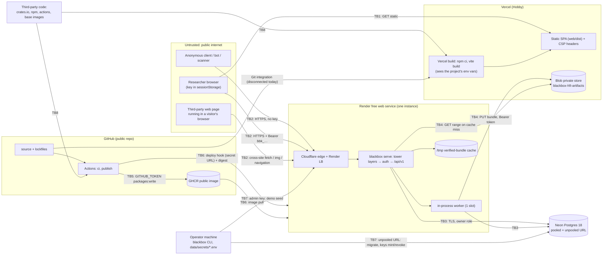

# Security review and threat model of the hosted target system

Status: Phase 0/2 design review, 2026-11-14. Owner: ThreatModel. Scope: the **target** system decided in
[PROJECT_STATE.md](PROJECT_STATE.md) and designed in [TARGET_ARCHITECTURE.md](TARGET_ARCHITECTURE.md),
[API_CONTRACT.md](API_CONTRACT.md) and [DATABASE_DESIGN.md](DATABASE_DESIGN.md), plus the parts of it that already
exist in code (`bb-db`, `bb-artifacts`, `bb_core::limits`). The local-tool review ([../SECURITY.md](../SECURITY.md))
and BASELINE_AUDIT §4.3 are carried forward in §17.

**Historical snapshot:** code findings and checklist statuses below are pinned to `ff5b2b8`,
not the delivered implementation. The hosted v1 API, auth and live console now exist; static
build instructions and old quota values below are historical, not current operating guidance.
Read [FINAL_AUDIT §3–§7](FINAL_AUDIT.md#3-acceptance-verdicts) for the independent re-check and
post-audit source fixes, [PROJECT_STATE](PROJECT_STATE.md) for release status, and
[../SECURITY.md](../SECURITY.md) for the current hosted/local distinction. An old `met` label
does not establish that its acceptance test or production verification passed.

Conventions:

- Current code is cited as `path:line` at `main` = **`ff5b2b8`** (after the merges of `p1-simcore` `1ff0d76`,
  `p2-persistence` `e9d7121`, `p4-ui-shell` `143b374`, `p3-deploy` `e992d36` and `p5-analytics`). The deploy files
  (`.github/workflows/publish.yml`, `render.yaml`, `Dockerfile`, [DEPLOYMENT.md](DEPLOYMENT.md)) are reviewed as
  current code.
- Design documents are cited by section and line. Platform statements cite a URL from the source list at the end
  ([S1]…); every source was read on 2026-11-14.
- **[INFERENCE]** marks anything not read or measured. **[arithmetic]** marks numbers derived from cited figures.
- Likelihood (L) and impact (I) are **H**igh, **M**edium or **L**ow for the hosted deployment as decided: public
  internet, $0 budget, synthetic data only.
- `SEC-n` ids are the security acceptance tests in §18. `AT-n` ids are BASELINE_AUDIT §8.
- Nothing was deployed and no Neon, Vercel or Render resource was touched. The checks that were run are in §19.

---

## 1. System summary

| Component | Role | Runs where | Holds |
|---|---|---|---|
| SPA | React app built from `web/` | Vercel static hosting (Hobby) | API key in `sessionStorage['bb.apiKey']` (UI_DESIGN_SPEC.md:1012-1013) |
| API | `blackbox serve`: axum `/api/v1`, `/healthz`, `/readyz`, `/metrics` (not implemented yet); image target `hosted` (`Dockerfile:88-95`), service `render.yaml:12-48` | Render free web service, `singapore`, 0.1 CPU / 512 MB [S1] | `DATABASE_URL`, `DATABASE_URL_UNPOOLED`, `BLOB_READ_WRITE_TOKEN`, `BB_ADMIN_BOOTSTRAP_KEY_SHA256` (env, `sync: false`, `render.yaml:26-33`) |
| Worker | In-process job worker; `blackbox worker` standalone | Same Render instance | Lease on one job at a time (TARGET_ARCHITECTURE §4) |
| Postgres | Schema `bb` (`crates/bb-db/migrations/0001…0005`) | Neon Free, `sin1`, PostgreSQL 18.7 | Trust root: every hash (TARGET_ARCHITECTURE §7) |
| Blob | One `.bbz` bundle per run | Vercel Blob private store | Bundles (untrusted, verified against Postgres) |
| Image | Release image of `blackbox`, target `hosted` (`Dockerfile:88-95`) | Built by `.github/workflows/publish.yml`, pushed to `ghcr.io/tanmay-alpha/blackbox-hft` (public once the operator flips visibility, DEPLOYMENT.md:282-290), pulled by Render | – |
| CI | `ci.yml` (tests), `publish.yml` (image, attestation, deploy, smoke) | GitHub-hosted runners | `GITHUB_TOKEN`; `RENDER_DEPLOY_HOOK_URL` (secret), `RENDER_SERVICE_URL` (variable) (`publish.yml:155-160`) |
| Admin CLI | `blackbox migrate`, `keys mint/revoke/list`, `demo seed` (TARGET_ARCHITECTURE §3, line 87; not implemented yet) | Operator machine | `data/secrets/neon.env`, `data/secrets/vercel-prod.env` (PROJECT_STATE.md:16-17), admin key |

---

## 2. Data-flow diagram and trust boundaries

| Boundary | From → to | Authentication | Primary controls (target) |
|---|---|---|---|
| TB1 | Internet → Vercel CDN | none | CSP and security headers (`web/vercel.json:12-29`), Vercel DDoS mitigation and WAF [S20] |
| TB2 | Internet → Render API | none (demo) or Bearer API key | Host/Origin/CORS, body limits, rate limits, quotas, budgets, workspace scoping (§5.2–§5.4) |
| TB3 | Render → Neon | Neon role password in `DATABASE_URL` | TLS `verify-full` [S13], bound parameters only, per-query timeouts |
| TB4 | Render → Vercel Blob | `BLOB_READ_WRITE_TOKEN` (store-wide read-write) | Fixed hosts, no redirects, ops budgets, verify-on-read |
| TB5 | GitHub Actions → GHCR | `GITHUB_TOKEN` | Per-job permissions, publish only from `main`, provenance attestation [S25] |
| TB6 | GHCR → Render | Deploy hook URL (a secret [S6]); public image pull | Deploy by digest, hook in a protected GitHub environment |
| TB7 | Operator → Neon / API | DB owner credential; admin key | Credentials in git-ignored `data/` (`.gitignore:15`), audit events |
| TB8 | Third-party code → build environments | none | Lockfiles, `--locked`/`npm ci`, cargo-deny, npm audit, SHA pins, digest pins |
| TB9 | Vercel project env → Vercel build | Vercel account | The SPA project must hold **no** backend secret (§14) |

---

## 3. Assets

| Id | Asset | Why it matters | Primary threats |
|---|---|---|---|
| A1 | Integrity of scientific results (runs, metrics, bundles, comparisons, reports) | A tampered result is a wrong research conclusion; BASELINE_AUDIT §5.2 reproduced exactly that locally | T-BLOB-2, T-DB-3, §16 |
| A2 | Confidentiality of a research workspace's metadata (configs, labels, experiments, sweeps, comparisons, saved reports) | Research ideas of one key holder must not leak to another. Low inherent sensitivity: hosted data is synthetic | T-DB-2, T-JOB-7 |
| A3 | API keys and the `admin` scope | Admin writes the public demo and reads `/system/*` | §5.3, §9 |
| A4 | Platform credentials: `DATABASE_URL*` (Neon owner role, DATABASE_DESIGN §5.3), `BLOB_READ_WRITE_TOKEN` (store-wide), `RENDER_DEPLOY_HOOK_URL`, `GITHUB_TOKEN` | Each is a full compromise of its system | §14 |
| A5 | Free-tier allowances: Render 750 instance hours and 5 GB egress per workspace; Neon 100 CU-hours, 1 GB, 5 GB egress; Blob 1 GB, 2,000 advanced / 10,000 simple ops, 10 GB transfer; Vercel 1 M CDN requests | Exceeding them suspends or blocks the service (for Render, also 8 unrelated services); with a payment method on file it would bill money | §6 |
| A6 | Availability of the API and the SPA | Public demo and research use | §5, §6 |
| A7 | Supply-chain integrity: source, `Cargo.lock`, `web/package-lock.json`, the GHCR image | A malicious build ships to Render with every secret | §13 |
| A8 | Audit trail | Accountability for key use and destructive actions | §15 |
| A9 | Licence compliance: no vendor data hosted (Tardis terms §9.2, PROJECT_STATE.md:19) | Legal exposure | T-CLI-4 |

---

## 4. Attacker profiles

| Id | Profile | Capabilities | Goals | Assumed out of reach |
|---|---|---|---|---|
| P1 | **Anonymous internet attacker** | Unlimited HTTP clients from many IPs (proxies, botnets); forges `X-Forwarded-For`; hosts web pages that run in other people's browsers (P1b) | Denial of service and denial of wallet against the free tiers; read other workspaces; write the demo; recon from errors | Platform internals of Cloudflare/Render/Vercel/Neon/GitHub |
| P2 | **Key holder of another workspace** | A valid `read` or `run` key for workspace B (minted by the operator); knows the open-source code and the public demo dataset hashes | Read, rename, cancel or delete workspace A's objects; escalate to `admin`; exhaust shared capacity (worker slot, Blob uploads); infer A's activity from shared, content-addressed science | DB or Blob credentials |
| P3 | **Compromised CI dependency** | Code execution at build time in a GitHub Actions job (crate `build.rs`/proc-macro, GitHub Action, base image) or in the Vercel build (npm lifecycle script, Vite plugin); at run time on Render through a compromised runtime crate | Steal secrets present in that environment; ship a backdoored image or SPA; tamper results | GitHub's, Vercel's and Render's own infrastructure |

Out of scope: compromise of the operator machine (the trust anchor that mints keys and holds the DB credential;
§5.10 limits the damage), malicious platform employees, side channels on shared hosts.

---

## 5. STRIDE per component and boundary

Columns: **S**poofing, **T**ampering, **R**epudiation, **I**nformation disclosure, **D**enial of service (including
denial of wallet), **E**levation of privilege. "Where" uses the module names of TARGET_ARCHITECTURE §3 (line 87).
"Verify" names the test in §18.

### 5.0 What already exists (at `ff5b2b8`)

| Area | Implemented | Gap relevant to this review |
|---|---|---|
| Key minting | 32 OS-random bytes → `bbk_` + base64url; only `sha256(plaintext)` and an 8-char prefix are stored (`crates/bb-db/src/repositories.rs:180-200`); `MintedKey` has no `Debug`/`Serialize` (`repositories.rs:36-40`) | No tag/pepper (SEC-31); no audit row (SEC-25) |
| Key lookup | Shape check, then `SELECT … WHERE key_sha256=$1 AND revoked_at IS NULL AND (expires_at …)`, then an hourly `last_used_at` update (`repositories.rs:201-218`) | Every well-formed key costs ≥ 1 query (T-AUTH-2) |
| Scopes | `admin ⊇ run ⊇ read` (`repositories.rs:26-35`) | Route matrix not built yet (SEC-1) |
| Scoped reads | `visible_run` and `visible_job` require an experiment in the caller's workspace or a public-read workspace (`repositories.rs:450-458`; `crates/bb-db/src/queue.rs:533-535`); research objects take `workspace` (`crates/bb-db/src/research.rs:93-222`); cancel is scoped (`queue.rs:473-475`); revoke is scoped (`repositories.rs:219-222`) | Unscoped `pub` reads live on the same `Database` type: `run` (`repositories.rs:440-446`), `config` (`:433-439`), `artifact` (`:459-465`), `job` (`queue.rs:526-532`) (SEC-2) |
| Quotas | Workspace row `FOR UPDATE`, key row `FOR UPDATE` (`queue.rs:212-227`); daily count over all experiment rows incl. sweep cells (`queue.rs:236-244`); global Blob cap 1,800 uploads / 900 MB (`queue.rs:254-259`); live jobs per workspace (`queue.rs:275-287`); sweeps per day (`research.rs:81-86`) | Defaults 100/5/50 (`0001_identity.sql:53-55`); FIFO claim (`queue.rs:316`) (T-JOB-4); no per-workspace upload share (T-JOB-5) |
| Blob client | Fixed hosts from the token's store id (`crates/bb-artifacts/src/store.rs:264-278`, `:305-316`); HTTPS only, HTTP only on loopback, no credentials/query in base URLs (`store.rs:283-297`); `redirect::Policy::none()` and a 120 s timeout (`store.rs:276`, `:337-340`); bearer marked sensitive (`store.rs:329-331`); `x-allow-overwrite: 0` (`store.rs:441`); the PUT response's `pathname`/`url` must equal the expected identity (`store.rs:455-461`); bounded response bodies (`store.rs:405-417`); no `list` in the trait (`store.rs:24-36`) | No ops/bytes budget in the client; retries on 429/5xx repeat billable ops (`store.rs:365-395`) (SEC-11) |
| Storage keys | `validate_key`: ≤ 1024 bytes, segments `[A-Za-z0-9._-]+`, no empty/`.`/`..`, no trailing `.`, no Windows device names (`store.rs:38-69`); `FsArtifactStore` rejects symlinks and non-directories on every component (`store.rs:84-147`) | – |
| Bundle reader | Compressed member length cap (`crates/bb-artifacts/src/bundle.rs:873-894`); per-member sha256 **before** inflating, inflate through `take(max + 1)`, trailing bytes refused (`bundle.rs:895-914`); whole-file sha256, byte totals and canonical result hash in `verify_file` (`bundle.rs:743-785`); page cap 4 MiB by default (`bundle.rs:166-172`) | `page_from_store` costs 3 range GETs (header, trailer, page) per uncached page (`bundle.rs:806-823`) (§6.3) |
| Disk cache | Byte-bounded; caches only bytes whose sha256 equals the expected digest; re-checks on hit (`crates/bb-artifacts/src/cache.rs:29-50`, `:60-128`) | – |
| DB config | `DatabaseConfig` has no `Debug` "because URLs contain credentials" (`crates/bb-db/src/lib.rs:57-64`); pool `min_connections(0)`, `max_connections ≤ 5` (`lib.rs:82-96`) | `sslmode` not enforced (SEC-27); `Error::Database` displays the sqlx error (`lib.rs:41-42`) (SEC-17) |
| Audit | `audit_events` append-only (`0001_identity.sql:93-109`); `Database::audit` inserts on the pool (`research.rs:244-257`) | Not in the action's transaction (SEC-25) |
| Hosted limits | `ExecutionLimits::hosted()`: 500,000 dataset rows, 150,000 ticks/equity samples/tape events, `max_output_bytes` 128 MiB (`crates/bb-core/src/limits.rs:94-103`) | 128 MiB is 16× the 8 MiB the Blob/egress planning assumed (TARGET_ARCHITECTURE:361, API_CONTRACT §9.1) (O-7) |
| Deploy pipeline | `publish.yml`: `permissions: {}` default (`:20`), gate on a successful same-repo CI push to `main` (`:37-42`), SHA-pinned actions, SBOM + provenance + Sigstore attestation (`:124-136`), deploy by digest (`:165-178`), smoke test (`:185-194`, `scripts/deploy/smoke.sh`); base images by digest (`Dockerfile:17-27`); secrets `sync: false` (`render.yaml:24-33`) | Hook is a repository secret (T-GHA-2); bootstrap admin key rules (T-AUTH-8); migrations at every start (§6.1) |
| HTTP v1, auth, CORS, rate limits, CLI `keys`/`serve` against Postgres | **not implemented**; `access.rs` and the legacy router are still the only HTTP layer (`crates/bb-app/src/access.rs`, `server.rs`) | All SEC items on `bb-app::http` |

### 5.1 Browser SPA on Vercel (TB1, TB9)

| Id | STRIDE | Threat (profile) | L/I | Required mitigation | Where | Verify |
|---|---|---|---|---|---|---|
| T-SPA-1 | I | A backend secret reaches the JS bundle via a `VITE_`-prefixed variable or a `define`. Vite inlines `VITE_*` values into client code at build time [S16]. Today the only one is `VITE_STATIC_DATA` (`web/vite.config.ts:17-18`, `web/src/api/client.ts:246`); DEPLOYMENT.md:235 adds `VITE_API_BASE_URL` (public by design) | M/H | Allow exactly one public variable, `VITE_API_BASE_URL`. Never change `envPrefix`, never `loadEnv(mode, dir, '')` into `define`. Scan `web/dist` in CI | `web/vite.config.ts`, `ci.yml` web job | SEC-19 |
| T-SPA-2 | I, E | **Build-time theft (P3).** Neon and Blob are connected to the Vercel project's production environment (PROJECT_STATE.md:27). Vercel exposes project env vars to code during the Build Step [S17], so any npm lifecycle script (`esbuild` and `fsevents` declare install scripts: `web/package-lock.json:1606`, `:1702`) or Vite plugin can read `DATABASE_URL` and `BLOB_READ_WRITE_TOKEN` | M/H | Remove every backend variable from the Vercel project before Git is reconnected (the SPA needs none; DEPLOYMENT.md §6 lists only `VITE_API_BASE_URL`). Pin `installCommand: "npm ci"` in `web/vercel.json` | operator; `web/vercel.json` | SEC-20 |
| T-SPA-3 | I, T | XSS steals the key from `sessionStorage` via a crafted label, report title or Markdown body (P2 within its own workspace; the demo is written only by `admin`) | L/M | Keep CSP `script-src 'self'` without `unsafe-inline`/`unsafe-eval` (`web/vercel.json:18`); Markdown rendered without raw HTML (UI_DESIGN_SPEC.md:1315-1316); no `dangerouslySetInnerHTML` (none, §19); label CHECKs (`0001_identity.sql:74` for keys; same rule for experiments/comparisons/reports) | `web/src`, `web/vercel.json`, `bb-app::http::v1` | SEC-29, SEC-7 |
| T-SPA-4 | S | Clickjacking of key entry or cancel buttons | L/L | Keep `frame-ancestors 'none'` and `X-Frame-Options: DENY` (`web/vercel.json:18`, `:26`) | `web/vercel.json` | SEC-29 |
| T-SPA-5 | I | Key leaks through URL or Referer | L/M | Keys only in `Authorization`, never URLs or cookies (API_CONTRACT §3, line 68); `Referrer-Policy: no-referrer` (`web/vercel.json:21`). Export downloads use `fetch` with the header and a blob URL | `web/src/api/client.ts` | SEC-1 |
| T-SPA-6 | D | Flood on the SPA exhausts 1,000,000 CDN requests or 100 GB Fast Data Transfer; Hobby usage limits pause for 30 days [S18] | L/M | Vercel DDoS mitigation, IP blocking and custom rules are free on all plans [S20]; Hobby gets one WAF rate-limit rule within 3 custom rules [S21]; immutable `/assets` caching (`web/vercel.json:30-33`) | operator | SEC-34 |

### 5.2 Public internet → Render API edge (TB2)

| Id | STRIDE | Threat (profile) | L/I | Required mitigation | Where | Verify |
|---|---|---|---|---|---|---|
| T-EDGE-1 | D | HTTP flood on a 0.1 CPU instance (P1). Cloudflare in front of Render fully mitigates L3/L4 and filters obvious L7 floods; targeted API abuse reaches the app, and Render advises application-level rate limiting [S5] | H/M | Per-IP GCRA for anonymous (120/min, burst 30) and per key (600/min) (API_CONTRACT §5); a **global** anonymous budget independent of IP; global in-flight cap with load shedding; timeouts | `bb-app::http` | SEC-9 |
| T-EDGE-2 | S | `X-Forwarded-For` forged to evade per-IP limits or falsify `audit_events.client_ip`. Render tells apps to read XFF [S5]; the left-most entry is client-supplied (OSS_TECHNOLOGY_EVALUATION.md:317-319) | H/L | Per-IP limits are best-effort; the global budget is the hard bound. On first deploy, determine which XFF position Render appends (send a forged XFF, log the raw chain) and key on it, never the left-most. Store the raw chain in audit `detail` as untrusted | `bb-app::http::client_ip` | SEC-9; O-2 |
| T-EDGE-3 | D | Oversized bodies/headers or slow bodies tie up memory or connections. axum's 2 MB `DefaultBodyLimit` applies only to extractors that use it; `RequestBodyLimit` applies to every request [S22] | M/M | `RequestBodyLimitLayer` 1 MiB on all routes (API_CONTRACT §1, line 19); header-size cap; body and handler timeouts (API_CONTRACT §5) | `bb-app::http` | SEC-5, SEC-9 |
| T-EDGE-4 | D | Egress exhaustion: 5 GB/month of Render outbound bandwidth per Hobby workspace, shared with 8 other services [S2] (PROJECT_STATE.md:28) | H/H | §6.2 | `bb-app::http::egress` | SEC-12 |
| T-EDGE-5 | D | Hot-linking (P1b): a third-party page embeds `/api/v1/runs/…/export">` or fires `no-cors` requests, so visitors' browsers download from the API. Such requests carry no `Origin` and pass an Origin check | M/M | Fetch-metadata resource isolation policy [S31] [S32]: refuse `Sec-Fetch-Site: cross-site` unless `Sec-Fetch-Mode: cors` from an allowed origin | `bb-app::http::guard` | SEC-32 |
| T-EDGE-6 | S | Requests addressed to a foreign `Host` (rebinding, misrouting) | L/L | `Host` ∈ `RENDER_EXTERNAL_HOSTNAME` [S4] ∪ `BB_ALLOWED_HOSTS`; Render health checks use a verified custom domain or the `onrender.com` host [S3]. Local mode keeps loopback names (`access.rs:46-53`) | `bb-app::http::guard` | SEC-4 |
| T-EDGE-7 | I | Keyed responses cached by a shared cache and served to another caller | L/M | `private` + `Vary: Authorization, Origin`; `no-store` on errors and job status (API_CONTRACT §6) | `bb-app::http` | SEC-28 |

### 5.3 Authentication, API keys and the demo workspace

| Id | STRIDE | Threat (profile) | L/I | Required mitigation | Where | Verify |
|---|---|---|---|---|---|---|
| T-AUTH-1 | S | Guessing a key (P1) | L/H | ≥ 192 random bits (§9.1); shape check before any work (exists: `repositories.rs:202-209`) | `bb-app::http::auth`, `bb-db` | SEC-1 |
| T-AUTH-2 | D | **Forged-key flood wakes Neon (P1).** Every well-formed `bbk_` string reaches `SELECT … WHERE key_sha256=$1` (`repositories.rs:210-212`), so one such request every < 5 min keeps Neon awake (§6.1) | H/H | A truncated HMAC tag under a server pepper inside the key, verified in memory (constant time) before any DB access (§9.1) | `bb-db` (`mint_key`, `authenticate`), `bb-app::http::auth` | SEC-31 |
| T-AUTH-3 | E | `run` key performs `admin` actions; any key writes the demo without `admin`; anonymous mutation | M/H | Scope per route from one table that is checked against the OpenAPI spec; anonymous mutation → 401; demo write without `admin` → 403 (API_CONTRACT §3, lines 72-88). `permits` exists (`repositories.rs:26-35`) | `bb-app::http::auth` | SEC-1 |
| T-AUTH-4 | E | Invalid key silently treated as anonymous (hides revocation) | L/M | Header present but invalid → 401 everywhere (API_CONTRACT §3, line 77) | `bb-app::http::auth` | SEC-1 |
| T-AUTH-5 | S | Revoked/expired key still accepted from a positive cache | M/M | No positive auth cache, or TTL ≤ 60 s with in-process invalidation on revoke. The DB check exists (`repositories.rs:211`) | `bb-app::http::auth` | SEC-26 |
| T-AUTH-6 | R | A key holder denies having cancelled or deleted something | M/L | Audit row with `api_key_id`, `request_id` and outcome in the action's transaction (§15) | `bb-db`, `bb-app::http::v1` | SEC-25 |
| T-AUTH-7 | I | Key material in logs, URLs, error bodies or DB dumps | M/H | Digest only (exists: `repositories.rs:195-198`, CHECK `0001_identity.sql:71`); logs carry `display_prefix` only (TARGET_ARCHITECTURE:483); `Authorization` marked sensitive before tracing [S23] | `bb-db`, `bb-app::telemetry` | SEC-3, SEC-18 |
| T-AUTH-8 | E, R | **Bootstrap admin key.** `BB_ADMIN_BOOTSTRAP_KEY_SHA256` (`render.yaml:32-33`) makes the server ensure an active `admin` key with that digest at every start (DEPLOYMENT.md:452-453). The documented fallback generates the key with `head -c 32 /dev/urandom` (DEPLOYMENT.md:322-325). As specified it has no expiry, is re-created after a revoke while the variable stays set, and would fail the tag check of SEC-31 | M/H | Create it only when no active `admin` key exists, with `expires_at = now() + 7 days`, and never re-activate a revoked digest; generate it with an offline `blackbox keys generate` that applies the tag; audit `key.bootstrap`; after real keys exist, clear the variable **and** revoke the row. Comparing digests needs no constant time (§9.2) | `bb-app` startup, `bb-db`, DEPLOYMENT.md §8 | SEC-26 |

### 5.4 Job submission and admission

| Id | STRIDE | Threat (profile) | L/I | Required mitigation | Where | Verify |
|---|---|---|---|---|---|---|
| T-JOB-1 | D | A legal config exhausts 512 MB or the CPU (P2). One legal near-cap run peaked at 2,281 MB locally (BASELINE_AUDIT §5.5) | H/H | `estimate_work` against `ExecutionLimits::hosted()` (`limits.rs:94-137`), runtime `RunBudget`, 600 s deadline (TARGET_ARCHITECTURE §8.1); CI runs the hosted peak-memory test (`ci.yml:38-40`, `:74-75`) | `bb-core`, `bb-sim`, `bb-app::admission` | SEC-6 (AT-5) |
| T-JOB-2 | D | **Unbounded scripted strategy.** `ScriptedParams.orders` is an uncapped `Vec` (`crates/bb-core/src/config.rs:228-230`); validation pushes one message per bad order and echoes its unbounded `label` (`config.rs:436-460`), so a 1 MiB body can produce a larger 422 body. (The hosted tape budget bounds the simulation itself, not validation) | M/L | Cap `orders` (hosted ≤ 1,000) and `label` (≤ 100 chars); return at most 50 problems plus a count | `bb-core::config`, `bb-app::http::v1` | SEC-7 |
| T-JOB-3 | D | Quota bypass by concurrent submissions | L/M | Exists: workspace and key rows locked `FOR UPDATE` before counting (`queue.rs:212-227`, `:239-243`) | `bb-db` | SEC-8 |
| T-JOB-4 | D | **Queue monopolisation (P2).** One worker slot; claim order is `priority DESC, queued_at, id` (`queue.rs:316`); default 50 live jobs per workspace (`0001_identity.sql:55`); 600 s deadline → one workspace can queue ≈ 8.3 h ahead of everyone [arithmetic] | M/M | Fair claim (oldest queued job of the workspace with the fewest jobs claimed in the last hour), hosted default `quota_active_jobs` = 5 | `bb-db::queue::claim`, migration | SEC-8 |
| T-JOB-5 | D | **Blob upload exhaustion by one key (P2).** 100 new experiments/day per key (sweep cells included, `queue.rs:239`) → up to 100 uploads/day; the global cap of 1,800 (`queue.rs:254-259`) is reached in 18 days, after which every workspace is refused [arithmetic] | M/M | Per-workspace monthly upload share (`quota_uploads_per_month`, default 300) beside the global cap | `bb-db` (submit), migration | SEC-8, SEC-11 |
| T-JOB-6 | T | Workspace B cancels or deletes A's work through the shared job (P2) | L/H | Exists: cancel requires the caller's experiment (`queue.rs:473-475`); the job is cancelled only when nothing else references it (TARGET_ARCHITECTURE §5.4) | `bb-db` | SEC-2 |
| T-JOB-7 | I | **Existence oracle (P2).** Run ids are content addresses over public constants, the public dataset `events_sha256` and the config (TARGET_ARCHITECTURE §5.1, line 224). B can compute A's likely run ids and probe them; `POST /experiments` answers `200` with an existing `RunSummary` when anyone has simulated the config (API_CONTRACT §8.3, line 194) | M/L | `GET` of an invisible run → 404 identical to nonexistent (`visible_run` already returns `NotFound` for both, `repositories.rs:450-458`). The POST disclosure is inherent to global de-duplication and **accepted** for synthetic data; documented in `docs/SECURITY.md` at cutover (AT-15) | `bb-db`, docs | SEC-2 |

### 5.5 Worker

| Id | STRIDE | Threat (profile) | L/I | Required mitigation | Where | Verify |
|---|---|---|---|---|---|---|
| T-WRK-1 | D | Runaway or stuck simulation | M/H | `RunControl.should_cancel` (deadline, cancel, drain); lease expiry recovers killed jobs (TARGET_ARCHITECTURE §4.3, §12; reaper `queue.rs:496-519`) | `bb-app::worker` | SEC-6 (AT-5, AT-6) |
| T-WRK-2 | T | A worker that lost its lease commits | L/H | Exists: lease predicate `lease_owner=$2 AND claim_count=$3 AND lease_expires_at>clock_timestamp()` (`queue.rs:184`) | `bb-db` | DB tests (AT-6) |
| T-WRK-3 | I | Panic text reaches clients: a simulation panic becomes `simulation_failed` carrying the panic message (`crates/bb-app/src/pipeline.rs:317-326`), and every non-`Internal` error body is the error's `Display` (`crates/bb-app/src/error.rs:83`, engine errors via `:125`) | M/L | Job `error.message` and HTTP bodies for panics/engine errors are generic plus the job id; detail in logs only | `bb-app::worker`, `bb-app::http::error` | SEC-17 |
| T-WRK-4 | E | Code execution through a strategy | L/H | None possible by construction (§16) | `bb-core`, `deny.toml` | SEC-24 |
| T-WRK-5 | D | `/tmp` exhaustion | L/M | Exists: byte-bounded cache (`cache.rs:29-50`, `:130-145`); hosted capacity 256 MiB (TARGET_ARCHITECTURE:518) | `bb-artifacts` | SEC-14 |
| T-WRK-6 | T | A regenerated synthetic dataset differs from its version | L/H | Regenerated events are checked against `dataset_versions.events_sha256` (DATABASE_DESIGN §3, line 79) | `bb-app` dataset registry | SEC-13 |

### 5.6 Neon Postgres (TB3)

| Id | STRIDE | Threat (profile) | L/I | Required mitigation | Where | Verify |
|---|---|---|---|---|---|---|
| T-DB-1 | T, I | SQL injection | L/H | All SQL in `bb-db` (TARGET_ARCHITECTURE §3 rule 3); every statement is a literal with `.bind()` (as in all of `repositories.rs`, `queue.rs`, `research.rs`); no SQL from `format!` | `bb-db` | SEC-30 |
| T-DB-2 | I, T | **IDOR** across workspaces (P2) | M/H | Scoped functions for the HTTP layer only (§8) | `bb-db`, `bb-app::http::v1` | SEC-2 |
| T-DB-3 | T | The single owner role can `ALTER TABLE … DISABLE TRIGGER` and rewrite results (DATABASE_DESIGN §5.3, lines 142-154) | L/H | Accepted while one role exists: the DB credential is a full-compromise secret (§14). DDL only through reviewed migrations. Separate role when available (SEC-37) | migrations, operator | SEC-37 |
| T-DB-4 | I, T | Man-in-the-middle on Render → Neon | L/H | `sslmode=verify-full`, which Neon recommends over `require` [S13]; `connect()` passes the URL through unchanged today (`lib.rs:82-95`) | `bb-db` | SEC-27 |
| T-DB-5 | D | CU-hour exhaustion (100/month) suspends the compute until the next period [S11] | H/H | §6.1 | `bb-app`, `bb-db` | SEC-10, SEC-31, SEC-33 |
| T-DB-6 | D | Storage exhaustion (1 GB) makes writes fail [S11] | L/M | Retention (DATABASE_DESIGN §8); audit rows only for state changes and keyed denials; length CHECKs | `bb-db` | SEC-25 |
| T-DB-7 | D | Neon egress (5 GB/project/month [S11]) drained by DB-backed list pages | M/M | Demo served from memory (SEC-10); keyed rate limits; pages ≤ 100 items (API_CONTRACT §8.3, line 202) | `bb-app::http` | SEC-9, SEC-10 |
| T-DB-8 | D | Pool starvation (`max_connections ≤ 5`, `lib.rs:83-91`) | M/M | Global in-flight cap and load shedding before DB-backed routes; 503 `busy` | `bb-app::http` | SEC-9 |
| T-DB-9 | I | Connection string or SQL text in logs/errors. `DatabaseConfig` has no `Debug` (`lib.rs:57-58`), but `Error::Database` prints the sqlx error (`lib.rs:41-42`) | L/H | Map `bb_db::Error` to stable codes; log the detail under the request id only | `bb-app::http::error` | SEC-17, SEC-18 |

### 5.7 Vercel Blob (TB4)

| Id | STRIDE | Threat (profile) | L/I | Required mitigation | Where | Verify |
|---|---|---|---|---|---|---|
| T-BLOB-1 | D | **Ops exhaustion.** Hobby includes 2,000 advanced and 10,000 simple ops; exceeding blocks Blob for 30 days [S7]. Uncached reads and metadata retrieval are simple ops; uploads and lists are advanced; dashboard browsing counts as advanced ops [S7] | H/H | §6.3 | `bb-artifacts`, `bb-db`, `bb-app::admission` | SEC-11 |
| T-BLOB-2 | T | Object replaced or corrupted (token holder, platform fault) | L/H | Exists: per-member and whole-file hashes from the trusted DB index (`bundle.rs:743-785`, `:895-914`); `x-allow-overwrite: 0` (`store.rs:441`). Required: quarantine on mismatch (`quarantine_run` exists, `repositories.rs:466-472`) wired into every read path | `bb-app` | SEC-13 (AT-3) |
| T-BLOB-3 | I | SSRF or token sent to another host | L/H | Exists (§11.1): fixed hosts, HTTPS, no redirects, PUT identity check | `bb-artifacts` | SEC-16 |
| T-BLOB-4 | T | Path traversal / key injection | L/H | Exists: `validate_key` + symlink-safe `FsArtifactStore` (§11.2) | `bb-artifacts` | SEC-15 |
| T-BLOB-5 | D | Decompression bomb in a replaced object | L/M | Exists: hash before inflate, inflate cap (§7.2) | `bb-artifacts` | SEC-14 |
| T-BLOB-6 | I | Anonymous public read of bundles | L/M | Private store: anonymous GET → 403, verified with raw HTTP (PROJECT_STATE.md:31); private stores require authentication for reads and writes [S8] | platform | SEC-16 (manual) |
| T-BLOB-7 | E | The read-write token is store-wide: its holder can delete every bundle | L/H | Token only in Render env and `data/secrets/vercel-prod.env`; removed from the Vercel project (SEC-20); bundles are reproducible by re-simulation (DATABASE_DESIGN §11, line 358) | operator | SEC-20 |

### 5.8 GHCR image and supply chain (TB5, TB6, TB8)

| Id | STRIDE | Threat (profile) | L/I | Required mitigation | Where | Verify |
|---|---|---|---|---|---|---|
| T-SC-1 | T, E | Malicious crate (`build.rs`, proc-macro) runs in the image build and pushes a backdoored image (P3) | L/H | Exists: `--locked` everywhere (`ci.yml:36`, `:40`; `Dockerfile:36`, `:48`, `:54`); the image job alone holds `packages`/`id-token`/`attestations: write` with workflow default `permissions: {}` (`publish.yml:20`, `:73-77`); BuildKit SBOM + SLSA provenance and a Sigstore attestation pushed to the registry (`publish.yml:124-125`, `:130-136`) [S25]. Required: cargo-deny (advisories, bans, sources = crates.io only, licences) [S27] | `deny.toml`, `ci.yml` | SEC-21, SEC-22 |
| T-SC-2 | T, I | Compromised npm package in the Vercel build injects script into the SPA (key theft) or reads the build env (T-SPA-2). The UI merge added `@fontsource/*`, `@tanstack/*`, `lucide-react`, `react-resizable-panels`, `vitest` (`web/package.json`) | L/H | `npm ci` from the lockfile; `npm audit --omit=dev` and `npm audit signatures` [S28] in CI; no backend secret in the Vercel project | `ci.yml` web job, `web/vercel.json`, operator | SEC-21, SEC-20 |
| T-SC-3 | T | A retargeted action tag | L/H | Exists: every action pinned to a full SHA (`ci.yml:32-34`, `:63`, `:71`, `:83-84`, `:100-101`, `:118`, `:134-137`, `:155`; `publish.yml:82`, `:89-90`, `:97`, `:130`, `:179`), as GitHub recommends [S26]. Required: a CI check that keeps it so | `.github/workflows/*` | SEC-21 |
| T-SC-4 | T | A moved base-image tag | L/H | Exists: `FROM` images pinned to index digests (`Dockerfile:17-27`); `cargo-chef` pinned with `--locked` (`Dockerfile:34-37`); the `hosted` target has no web stage (`Dockerfile:88-95`). Residual: Debian packages unpinned by design (`Dockerfile:67-79`); CI service image `postgres:18` is tag-only (test only) | `Dockerfile` | SEC-21 |
| T-SC-5 | T | Render deploys a mutable tag that was re-pushed | L/H | Exists: the deploy job passes `imgURL=<image>@<digest>` (`publish.yml:165-178`); the hook accepts a tag or digest and image-backed services do not redeploy on push by themselves [S6]. `render.yaml:16` names `:main`, used only at Blueprint creation (DEPLOYMENT.md:273-274) | publish workflow | SEC-22 |
| T-SC-6 | I | A compromised runtime crate on Render reads every env secret | L/H | Inherent; minimise runtime dependencies (cargo-deny `bans`); non-root user `10001` and `tini` (`Dockerfile:71-81`, `:93`); scoped secrets (§14) | `deny.toml`, `Dockerfile` | SEC-21 |

### 5.9 GitHub Actions and its secrets (TB5, TB6)

| Id | STRIDE | Threat (profile) | L/I | Required mitigation | Where | Verify |
|---|---|---|---|---|---|---|
| T-GHA-1 | I, E | Untrusted code runs with secrets or a write token. Secrets other than `GITHUB_TOKEN` are not passed to workflows triggered from forks, and that token is read-only there [S29] [S30]. `workflow_run` is a privileged trigger that must not run untrusted code [S26]; `publish.yml` uses it (`publish.yml:13-17`) | L/H | Exists: the gate admits only a successful CI `push` run on `main` of this repository (`publish.yml:37-42`), validates the SHA (`:67`), checks out exactly that SHA without persisted credentials (`:82-85`). Keep these conditions; never `pull_request_target`. (The CI Postgres password `blackbox-local`, `ci.yml:19`, is a throwaway test credential) | `.github/workflows/*` | SEC-23 |
| T-GHA-2 | E | **Deploy-hook URL leak = code execution on Render.** Whoever holds the hook URL can deploy an arbitrary `imgURL` [S6], which then runs with `DATABASE_URL` and the Blob token. Today it is planned as a **repository** secret (`publish.yml:149-150`, `:156`; DEPLOYMENT.md:316-317), readable by any workflow file pushed to any branch | L/H | Move it to a GitHub environment `production` with a `main`-only branch policy, referenced only by the deploy job; rotate if exposed | GitHub settings, `publish.yml` | SEC-23 |
| T-GHA-3 | E | Over-privileged `GITHUB_TOKEN` | L/M | Exists: `ci.yml` default `contents: read` (`ci.yml:8-9`; `audit` widens to `checks`/`issues: write`, `:95-98`); `publish.yml` default `{}` and per-job grants (`publish.yml:20`, `:33-34`, `:73-77`, `:153-154`) | `.github/workflows/*` | SEC-23 |
| T-GHA-4 | T | Cache poisoning of the image build. `publish.yml:126-127` reads and writes the BuildKit `type=gha,scope=hosted` cache, which holds the compiled third-party crates (`Dockerfile:29-32`) | L/M | Only `publish` (main context) may write `scope=hosted`; no PR-triggered workflow uses that scope. GitHub scopes caches by ref, so PR runs cannot write the default branch's cache **[INFERENCE: GitHub cache-isolation doc not read for this review]** | `.github/workflows/*` | SEC-23 |
| T-GHA-5 | E | Script injection via `${{ … }}` in `run:` [S26] | L/H | Exists: `publish.yml` passes event values through `env:` (`publish.yml:46-53`, `:138-140`); the one direct interpolation is the job-local `$GITHUB_OUTPUT` file path. Keep the rule for new steps | `.github/workflows/*` | SEC-23 |

### 5.10 Admin CLI and operator machine (TB7)

| Id | STRIDE | Threat (profile) | L/I | Required mitigation | Where | Verify |
|---|---|---|---|---|---|---|
| T-CLI-1 | I | DB credential or Blob token committed | L/H | `data/` is git-ignored (`.gitignore:15`); nothing under `data/` is tracked (§19); CI secret scan | `.gitignore`, `ci.yml` | SEC-19 |
| T-CLI-2 | I | Minted key leaks through logs or shell history | M/M | `keys mint` prints the key once to stdout; the admin key for `demo seed` comes from `BB_API_KEY`, never argv (visible in process lists) | `bb-app` CLI | SEC-26 |
| T-CLI-3 | T | Destructive operation against production by mistake | L/H | Forward-only production migrations; down scripts never run on Neon (DATABASE_DESIGN §10, line 344); no CLI command deletes hosted science except GC | `bb-app` CLI | review |
| T-CLI-4 | I | Licence breach: vendor data seeded into the hosted DB/Blob | L/H | `data_sources.hostable` exists (seeded for synthetic, `0005_operations.sql:51-54`); in the hosted profile `register_version` must refuse a non-hostable source | `bb-db`, CLI | SEC-35 |
| T-CLI-5 | R | Keys minted or revoked without a trace | L/M | CLI writes `key.mint`/`key.revoke` audit rows with `detail.actor = "cli"` | CLI, `bb-db` | SEC-25 |

---

## 6. Free-tier resource exhaustion: denial of service and denial of wallet

The deployment costs $0 only while every allowance holds. On Neon, Vercel Hobby and Render without a payment method
the failure mode is suspension, not a bill. DEPLOYMENT.md:406 states that no component has a payment method on file;
if one were added to the Render workspace, egress overage would be billed at $0.15/GB [S2] and denial of service would
become denial of wallet (O-1).

### 6.1 Budget table: what a cheap attack costs

| Allowance | Limit and consequence | Cheapest attack (profile) | Without controls [arithmetic] | Control | Verify |
|---|---|---|---|---|---|
| Render instance hours | 750/month **per workspace**; exhausting them suspends **all** free web services of the workspace until month start; spun-down services consume none [S1] | Keep-awake: one request every < 15 min [S1] (P1) | 720 h (30 days) / 744 h (31 days) for BlackBox alone, plus 8 other services on the same 750 h (PROJECT_STATE.md:28) → suspension late in the month | Not preventable in the app: any inbound request counts [S1]. Give BlackBox its own Hobby workspace (744 h < 750 h) **[INFERENCE: a second Hobby workspace is free; verify]** | SEC-34 |
| Render outbound bandwidth | 5 GB/month per Hobby workspace (shared); without a payment method all free services are suspended for the rest of the month [S1] [S2] | Repeated 4 MiB responses without `Accept-Encoding` (P1) | 5 GiB / 4 MiB ≈ 1,280 responses ≈ 11 min at 120/min from one IP | §6.2 | SEC-12 |
| Neon compute | 100 CU-hours/project/month; scale to zero after 5 min, fixed on Free [S12]; exhausting suspends the compute until the next period [S11] | One DB-touching request every < 5 min: `GET /readyz` (API_CONTRACT §8.1, line 162; the smoke test calls it anonymously, `scripts/deploy/smoke.sh:108`), or a random `bbk_` key (T-AUTH-2) | 0.25 CU × 720 h = 180 CU-h > 100 → suspended after ≈ 16.7 days | Anonymous, health and forged-key paths never query the DB after warm-up (SEC-10, SEC-31). `/readyz` answers from the state of the last DB operation (the start-up migration proves reachability for the smoke test) and runs its own probe only for `admin` | SEC-10, SEC-31 |
| Neon compute (spin cycle) | as above | Request, wait for spin-down (15 min idle + ~1 min start [S1]), repeat (P1) | ≤ 90 cycles/day; each start runs migrations before binding (`render.yaml:39-40`, DEPLOYMENT.md:438-439) and wakes Neon for ≥ 5 min: 7.5 h/day ≈ 56 CU-h/month at 0.25 CU | **Decision needed (SEC-33).** Lazy initialisation removes it but a failing migration would then surface as 503s after the deploy went live instead of failing the deploy. Until decided: accepted residual risk, watched through Neon usage | SEC-33, SEC-34 |
| Neon egress | 5 GB/project/month; exhausting suspends the compute [S11] | Paging DB-backed lists (P1 for demo, P2 keyed) | 100-item experiment page ≈ 90 KB (DATABASE_DESIGN §9: 855 B/row) → ≈ 58,000 pages ≈ 8 h at 120/min from one IP | Demo from memory (SEC-10); keyed rate limit; ETag/304 (API_CONTRACT §6) | SEC-9, SEC-10 |
| Neon storage | 1 GB; writes fail until space is freed [S11] | Audit or label spam (P2) | bounded by quotas and CHECKs | No audit rows for anonymous traffic; retention (DATABASE_DESIGN §8) | SEC-25 |
| Blob simple ops | 10,000/month; exceeding blocks the store 30 days [S7] | Spin cycle + read K distinct demo pages per start (`/tmp` cache is lost at spin-down [S1]); each uncached page via `page_from_store` costs 3 GETs (`bundle.rs:818-821`); retries on 429/5xx repeat ops (`store.rs:365-395`) (P1) | K = 10 pages: 30 ops per start, 90 starts/day → 2,700/day → blocked after < 4 days | Persisted read-op budget checked before every attempt (fail closed); whole-bundle fetch into the verified disk cache (TARGET_ARCHITECTURE §7) instead of per-page range reads; demo bundles in the image (SEC-36) | SEC-11 |
| Blob advanced ops | 2,000/month; uploads, lists, TTLs and dashboard browsing count [S7] | One `run` key at default quotas (T-JOB-5) (P2); operator browsing the store | 100 uploads/day/key | Global 1,800 (exists, `queue.rs:254-259`) + per-workspace share; GC never lists (`store.rs:34`); no dashboard browsing | SEC-8, SEC-11 |
| Blob data transfer | 10 GB/month [S7] | Uncached reads of large bundles | Hosted `max_output_bytes` is 128 MiB of serialized result (`limits.rs:100`); compressed worst case not measured (O-7) | Byte budget (≤ 9 GB/month) next to the op budget, charged with `run_artifacts.size_bytes` | SEC-11 |
| Blob storage | 1 GB [S7] | Many unique runs (P2) | – | 900 MB admission cap (exists, `queue.rs:256-258`), retention GC | SEC-11 |
| Vercel CDN | 1 M CDN requests, 100 GB Fast Data Transfer; Hobby limits pause 30 days [S18] | Flood on the SPA (P1) | 1 M requests | Vercel DDoS mitigation (free), one WAF rate-limit rule on Hobby [S20] [S21] | SEC-34 |
| GitHub Actions / GHCR | Standard runners free for public repos [S33]; public packages free [S34] | – | – | – | – |

### 6.2 Egress budget (Render 5 GB)

1. **Byte accounting.** Count response-body bytes written (after compression) per class, anonymous and keyed.
   Daily budgets: anonymous ≤ 60 MB, keyed ≤ 90 MB, i.e. ≤ 4.5 GB/month [arithmetic]; revisit after O-3.
2. **Persistence.** In-memory counters reset at each spin-down, which a spin-cycle attacker exploits. Flush to
   Postgres (`bb.egress_usage_daily`) every 5 MB of egress, so writes scale with traffic and never happen while idle;
   read today's value once on the first heavy response after start.
3. **Enforcement.** When a class budget is spent: 503 `unavailable` (`reason: "busy"`, `Retry-After` = seconds to UTC
   midnight) for responses above 64 KiB; small responses continue.
4. **Shape.** Anonymous responses ≤ 1 MiB (cursor pages end with `truncated_by: "bytes"`, API_CONTRACT §7).
   `GET /runs/{id}/export` requires a key, demo included. Gzip when accepted (API_CONTRACT §1, line 19).
5. **Hot-linking.** SEC-32 closes the browser-amplified path.

### 6.3 Blob budget (simple ops, advanced ops, bytes)

- `bb.storage_usage_monthly` has `uploads`, `reads`, `bytes_uploaded` (`0003_science.sql:144-151`); add
  `read_bytes`. Today `record_storage_read` increments `reads` unconditionally (`repositories.rs:496-500`). Replace it
  with a guarded statement run **before** every HTTP attempt (retries included) and every `head` (metadata
  retrieval is a simple op [S7]): `UPDATE … SET reads = reads + 1, read_bytes = read_bytes + $n WHERE month = $m AND
  reads < $cap AND read_bytes + $n <= $bytes_cap RETURNING reads`; 0 rows → fail closed (503 `storage`).
- Daily pacing: reads on a UTC day ≤ (9,000 − reads this month) / days left. Anonymous-triggered misses get at most
  half of the daily share.
- Read path: fetch the whole bundle once into the verified disk cache (one GET) rather than `page_from_store` (three
  GETs per page, `bundle.rs:806-823`); `page_from_store` stays for bundles above `BB_ARTIFACT_WHOLE_FETCH_MAX`
  (TARGET_ARCHITECTURE §7, line 333).
- Uploads: global 1,800 at admission (exists) plus `quota_uploads_per_month` per workspace.
- `VercelBlobStore` is constructed only with a budget handle, so no unmetered GET/HEAD/PUT exists. `list` stays
  unimplemented (`store.rs:34`).

---

## 7. Request size limits and decompression bombs

### 7.1 Inbound

| Surface | Limit | Mechanism |
|---|---|---|
| Request body, all routes | 1 MiB (API_CONTRACT §1) → 413 `invalid_request` | `RequestBodyLimitLayer` (every request, unlike axum's default [S22]) |
| Request headers | total ≤ 16 KiB; `Authorization` ≤ 128 bytes and `^Bearer bbk_[A-Za-z0-9_-]{43}$` | server header limit; regex before hashing |
| `Content-Encoding` on requests | **refused** (415): no request-decompression layer, so a 1 MiB gzip body cannot inflate | absence of the layer + explicit check |
| JSON shape | `deny_unknown_fields` on bb-core types (`crates/bb-core/src/config.rs:12`, `:26`, `:52`, …) | serde |
| Labels, titles | ≤ 100 chars (as `0001_identity.sql:74`), no control characters | CHECK + handler validation |
| Scripted orders | ≤ 1,000 hosted (T-JOB-2) | `RunConfig::validate` |
| Query parameters | `limit` caps per route (API_CONTRACT §8); cursor ≤ 512 bytes (decoded by `Cursor::decode`, `repositories.rs:53-63`) | handler |
| Sweep | ≤ 25 cells hosted; CHECK `x_len·y_len ≤ 100` (DATABASE_DESIGN §5.4) | admission + CHECK |

### 7.2 Decompression surfaces

| Surface | State at `ff5b2b8` | Requirement |
|---|---|---|
| Tardis CSV ingest (`.csv.gz`) | CLI only; `MultiGzDecoder` (`crates/bb-data/src/tardis.rs:29`, `:157`) with a 4,096-byte line cap (`tardis.rs:133`, `:194-207`); no total byte/row budget (`docs/SECURITY.md:185-187`) | Never reachable from the hosted API (API_CONTRACT §8.2 has no upload); the hosted profile refuses non-hostable sources (SEC-35) |
| Dataset uploads | none | None in v1. If ever added: `admin` scope, compressed size cap, streaming decompressed-byte cap, row cap, line cap, licence flag |
| Synthetic regeneration | generator cap 20,000,000 events (`crates/bb-data/src/synthetic.rs:66`); hosted admission caps dataset rows at 500,000 (`limits.rs:96`) | Admin dataset creation in the hosted profile applies the same 500,000-row cap |
| `.bbz` bundles from Blob or `/tmp` | Compressed member ≤ cap + 1 % + 1 KiB (`bundle.rs:879-883`); member sha256 from the trusted index checked before `GzDecoder` is built; inflate through `take(max + 1)`; trailing bytes refused (`bundle.rs:895-914`); totals and result hash in `verify_file` (`bundle.rs:743-785`) | Keep; add the hosted `BundleLimits` (`max_output_bytes` = compressed cap actually stored; the default is 1 GiB, `bundle.rs:166-172`) |
| `blackbox verify-bundle <file>` | not implemented | No trusted index for a foreign file: apply the same member/page caps and a total inflated-byte cap before anything else |
| zip (engine `.npz`) | engine opens archives with `ZipArchive::new` + `by_name`; no extraction API (`docs/SECURITY.md:118-125`) | Unchanged: hosted `.npz` files are written by the server (synthetic regenerate) |

---

## 8. IDOR and the row-level security decision

### 8.1 Scoping rule

Every route that takes an id is exposed to P2. The rule is enforced in `bb-db`:

- The HTTP layer receives a `ScopedDb` (name illustrative) that exposes only workspace-taking functions:
  `visible_run`, `visible_job`, `experiment(workspace, id)`, `sweep(workspace, id)`, `comparison(workspace, id)`,
  `report(workspace, id)`, `request_cancel(workspace, id)`, `revoke_key(workspace, id)`, … (all exist). The unscoped
  `run`, `config`, `artifact`, `job` (`repositories.rs:433-465`, `queue.rs:526-532`) move behind a worker/admin type
  that `bb-app::http` cannot construct.
- Reads use `workspace_id = $own OR workspace is public-read` (as `visible_run`, `repositories.rs:456`); writes use
  `workspace_id = $own`, except `admin` with `?workspace=demo` (API_CONTRACT §3, line 74).
- Invisible and nonexistent resources give byte-identical 404 bodies except `request_id` (API_CONTRACT §2, line 51);
  `?workspace=<other slug>` gives the same 404 whether or not the slug exists.
- Cross-object references are checked: `POST /comparisons` (both runs visible), `POST /reports` (subject visible),
  sweep cells (`queue.rs:229-235` already checks sweep ownership).

### 8.2 Row-level security: **no**, with justification

1. **One role.** App and migrations use the single owner role of the Vercel-managed Neon project (DATABASE_DESIGN
   §5.3, lines 144-147, marked [INFERENCE] there). Table owners bypass RLS unless the table is set to `FORCE ROW LEVEL
   SECURITY`, and superusers and `BYPASSRLS` roles always bypass it [S15]. Even forced, the owner can switch it off
   with one `ALTER TABLE`, so RLS gives nothing against whoever holds the credential (P3 at run time), which is the
   case that matters most.
2. **Per-request context does not fit the pooler cheaply.** Policies need the caller's workspace per statement.
   Neon's pooler is PgBouncer in transaction mode, where session `SET` is not supported [S14]. A transaction-local
   setting (`set_config(…, true)` inside `BEGIN … COMMIT`) would work **[INFERENCE]**, but turns every autocommit read
   into an explicit transaction (extra round trips on a link where Neon may be waking) and is a convention every query
   must follow, which is what the repository `workspace` argument already is.
3. **The visibility rule is relational.** Runs and jobs are global and shared (TARGET_ARCHITECTURE §5.4); visibility
   is "an experiment in W or a public-read workspace references this config" (`repositories.rs:456`). As policies
   these become correlated subqueries on hot paths, for a check the repository layer does in one join.
4. **What RLS would buy** is defence against a handler that forgets the scope. SEC-2 covers that directly by
   enumerating every `{id}` route from the OpenAPI document (complete because of AT-14) and calling it with a foreign
   key, and the type split above makes the unscoped functions unreachable from handlers.

Revisit when a least-privilege role exists (SEC-37): then `FORCE ROW LEVEL SECURITY` on workspace-owned tables with a
transaction-local workspace setting becomes real defence in depth.

---

## 9. API key lifecycle

### 9.1 Format and verification

- Today: 32 random bytes, `bbk_` + base64url (43 chars), digest = `sha256(plaintext)` (`repositories.rs:190-198`).
- Required: `bbk_` + base64url(24 random bytes ‖ first 8 bytes of HMAC-SHA256(`BB_API_KEY_PEPPER`, the 24 bytes)).
  Still 32 bytes → 43 characters, so API_CONTRACT §3's regex and the `display_prefix` CHECK (`0001_identity.sql:73`)
  are unchanged; 192 bits of entropy.
- Verification order: shape → decode → HMAC tag with a constant-time comparison (`hmac` crate `verify_truncated_left`)
  → digest lookup (`repositories.rs:210-212`) → scopes. A forged or random key fails at the tag without DB access
  (T-AUTH-2). The pepper lives in Render env and on the operator machine (needed by `keys mint`). Rotating the pepper
  invalidates every key: the emergency "revoke all".

### 9.2 Why constant-time comparison is not needed for the digest lookup

The server never compares a secret with attacker input byte by byte. It hashes the presented key and asks the B-tree
index for an equal 32-byte digest. A timing difference could at most reveal how many leading bytes of the *digest*
matched a stored one. Exploiting that means choosing keys whose sha256 digests share a growing chosen prefix with the
target digest, a partial-preimage search whose cost multiplies by 256 per byte. Even a fully known digest is useless:
authenticating needs a key that hashes to it, i.e. a preimage of a 192-bit random value. Jitter through Cloudflare
and Render's load balancer [S5] also dwarfs a memcmp difference **[INFERENCE]**. The OSS evaluation's suggestion of
`subtle` for this path (OSS_TECHNOLOGY_EVALUATION.md:579) is therefore unnecessary. Constant time **is** required
where a secret meets attacker input directly: the HMAC tag (§9.1). The bootstrap key (T-AUTH-8) is an ordinary key
row whose digest is supplied by the operator, so the same lookup argument applies; no shared password or plaintext
token may exist. A fast hash is correct here: keys are high-entropy random values, not passwords, and a
slow KDF would only burn the 0.1 CPU.

### 9.3 Lifecycle

| Step | Mechanism | Audit |
|---|---|---|
| Mint | `blackbox keys mint --workspace <slug> --scopes read,run --label … [--expires-in 90d]` over the unpooled URL (`mint_key`, `repositories.rs:180-200`); prints the key once. `admin` keys default to 30 days and accept at most 90 | `key.mint` |
| Use | §9.1; `last_used_at` at most hourly (exists, `repositories.rs:213-216`) | `auth.denied` only for keyed denials (revoked, expired, scope); never for anonymous traffic or failed tag checks (stdout, sampled) |
| Rotate | Mint new, switch client, revoke old. No in-place rotation | `key.mint`, `key.revoke` |
| Revoke | `blackbox keys revoke <id>` or `POST /api/v1/system/api-keys/{id}/revoke` (API_CONTRACT §8.9) → `revoke_key` (`repositories.rs:219-222`); effective on the next request | `key.revoke` |
| Expire | `expires_at` checked per request (exists, `repositories.rs:211`); revoked/expired rows deleted after 365 days (DATABASE_DESIGN §8, line 308) | – |
| Leak response | Revoke; if the pepper or DB leaked, rotate the pepper (all keys) and the Neon password | `key.revoke` |

---

## 10. CORS, CSP and browser-facing headers

**CORS is not the authentication boundary.** The key is a header held in the SPA's own `sessionStorage`; there are no
cookies or ambient credentials, so a foreign page cannot make a visitor's browser send the visitor's key. CORS
protects (a) against foreign pages reading responses (nothing to gain without a key) and (b) the egress budget,
because API_CONTRACT §4 (line 100) refuses non-preflight requests with an unlisted `Origin` with a small 403.
Requirements (API_CONTRACT §4 is normative):

- `Access-Control-Allow-Origin` exact match against `BB_CORS_ALLOWED_ORIGINS`; no wildcard or suffix match; no
  `Access-Control-Allow-Credentials`; `Vary: Origin` on every response.
- `https://` origins in the hosted profile. Today's policy derives `http://` origins only (`access.rs:57`) and never
  emits CORS headers (`access.rs:14-15`); both are replaced at cutover (TARGET_ARCHITECTURE §3, line 124).
- Fetch metadata (SEC-32) closes the `no-cors`/``/navigation path CORS cannot see.

**SPA CSP** (`web/vercel.json:18`): keep `default-src 'self'; script-src 'self'; object-src 'none'; base-uri 'self';
frame-ancestors 'none'`; change `connect-src 'self'` to `connect-src 'self' https://<render-host>` (exact origin).
The UI merge added `@fontsource/*` packages, which Vite bundles as same-origin assets, so `font-src 'self'` still
holds **[INFERENCE: not built here]**. Remove the `static-data` rewrite and headers (`web/vercel.json:8`, `:34-41`) and
`buildCommand: npm run build:static` (`web/vercel.json:4`) with the static viewer (TARGET_ARCHITECTURE §3, line 123).

**API response headers:** `X-Content-Type-Options: nosniff`; `Content-Security-Policy: default-src 'none';
frame-ancestors 'none'` (JSON and Markdown must never render as HTML); `Cache-Control` per API_CONTRACT §6;
`Content-Disposition: attachment` on export with a filename built only from validated hex and the platform enum.

---

## 11. SSRF and path traversal in artefact keys

### 11.1 Blob client hosts (SSRF): implemented

The wire protocol was verified with raw HTTP (PROJECT_STATE.md:31). `VercelBlobStore` already:

- derives the only two hosts from constants and the token's store id, which must be ASCII alphanumeric
  (`store.rs:264-278`, `:305-316`);
- refuses non-HTTPS base URLs except loopback test servers, and URLs carrying credentials, query or fragment
  (`store.rs:283-297`);
- disables redirects (reqwest otherwise follows up to 10 hops [S24]) and sets a 120 s timeout (`store.rs:337-340`);
- marks the bearer header sensitive (`store.rs:329-331`) and never exposes the token in `Debug` (`store.rs:299-306`
  derives only `Clone`);
- rejects a PUT response whose `pathname` or `url` differs from the expected object (`store.rs:455-461`);
- caps every response body it reads (`store.rs:405-417`).

Remaining requirements: the loopback exception must be unreachable from hosted configuration (only `VercelBlobStore::new`
from the token is used in `bb-app`); no other outbound HTTP client exists in the binary (no webhooks, no
user-supplied URLs).

### 11.2 Artefact keys (path traversal): implemented

- `validate_key` (`store.rs:38-69`) runs before every read URL is built (`store.rs:353-359`), before PUT
  (`store.rs:426`) and before `FsArtifactStore` builds a path (`store.rs:117-118`). Segments are
  `[A-Za-z0-9._-]+`, never empty, `.`, `..`, ending in `.`, or a Windows device name; `\`, `:` and `%` are not in
  the allowed set.
- `FsArtifactStore` canonicalises its root, rejects a symlinked root, and rejects symlinks or wrong file types on every
  component (`store.rs:93-107`, `:117-147`).
- Keys are generated by the worker as `runs/<fingerprint>/<platform>/<run uuid>.bbz` (TARGET_ARCHITECTURE §6.2, line
  304); no request value ever becomes a key. The disk cache is keyed by sha256 (`cache.rs:60-94`).
- Local stores keep their own checks: dataset ids `[a-z0-9_-]+` before `root.join` (`crates/bb-data/src/store.rs:29-36`),
  run ids 16 lowercase hex (`crates/bb-app/src/store.rs:70-78`).

---

## 12. Error leakage and log redaction

**Errors.** The v1 envelope (API_CONTRACT §2) keeps today's rule that `internal` carries a generic message
(`crates/bb-app/src/error.rs:77-84`). Gaps: engine and panic text flows to clients as `simulation_failed`
(`error.rs:83`, `:125`; `pipeline.rs:317-326`); `bb_db::Error::Database` and `Migration` display sqlx text
(`crates/bb-db/src/lib.rs:41-44`); `ArtifactError` from reqwest can carry URLs. All must map to stable codes with
generic messages. `invalid_config` and `budget_exceeded` keep specific messages: they describe the caller's input and
public limits. `/api/v1/status` exposes version and git SHA (API_CONTRACT §9.1), acceptable for an open-source repo.

**Logs** (JSON to stdout, TARGET_ARCHITECTURE §15):

- `SetSensitiveRequestHeadersLayer` marks `Authorization` (and `Cookie`) sensitive and is applied before
  `TraceLayer`, as tower-http requires [S23]; `DefaultMakeSpan::include_headers` stays off [S23].
- Credentials (`DATABASE_URL*`, `BLOB_READ_WRITE_TOKEN`, `BB_API_KEY_PEPPER`) live in types without `Debug` or with a
  redacting one, following `DatabaseConfig` (`lib.rs:57-58`) and `VercelBlobStore` (`store.rs:299-306`).
- Identity in logs is `key_prefix` (`bbk_` + 4) and key id; `route` is the template, not the raw path
  (TARGET_ARCHITECTURE §15, line 482).
- Client `X-Request-Id` only if it matches `^[A-Za-z0-9-]{8,64}$` (API_CONTRACT §1), preventing log injection.
- `RUST_BACKTRACE` unset in the hosted image; panic payloads go to logs, not responses.

---

## 13. Dependency and supply-chain controls

| Control | At `ff5b2b8` | Required |
|---|---|---|
| Rust lockfile | `--locked` in CI and Docker (`ci.yml:36`, `:40`, `:73`, `:143`; `Dockerfile:36`, `:48`, `:54`) | unchanged |
| RustSec advisories | `rustsec/audit-check` with 5 justified ignores (`ci.yml:92-112`) | Replace with `cargo deny check` (advisories, bans, licenses, sources) [S27]; move the ignore list and justifications into `deny.toml` so one advisory configuration exists. `sources`: crates.io only. `bans`: `openssl-sys` (the workspace uses rustls: `Cargo.toml` `reqwest` `rustls-no-provider`, `sqlx` `tls-rustls`), `libloading`, script/plugin runtimes (§16) |
| npm | `npm ci` (`ci.yml:89`); `npm audit --omit=dev` run manually on 2026-11-14 (`docs/SECURITY.md:103`) | CI: `npm audit --omit=dev --audit-level=high` and `npm audit signatures` [S28]; Vercel `installCommand: "npm ci"` |
| Actions | all SHA-pinned (T-SC-3) [S26] | CI step failing on any `uses:` without a 40-hex SHA |
| Base images | pinned by index digest (`Dockerfile:17-27`) | keep; CI service image `postgres:18` may stay a tag (test only) |
| Image provenance | BuildKit SBOM + SLSA provenance (`publish.yml:124-125`); Sigstore attestation pushed to GHCR (`publish.yml:130-136`); verification command documented (`publish.yml:128-129`, DEPLOYMENT.md:101) | Optional: run `gh attestation verify oci://…@<digest> -R tanmay-alpha/BlackBox-HFT` in the deploy job before the hook [S25]; the operator runs it before any manual dashboard deploy |
| Deploy | by digest through the hook (`publish.yml:165-178`); secrets `sync: false` (`render.yaml:24-33`) [S9] | Hook in a protected environment (T-GHA-2) |
| Engine features | `hftbacktest` `default-features = false, features = ["backtest"]` (`Cargo.toml` workspace dependency) | CI asserts no `live` (`cargo tree -e features -i hftbacktest`) |

The `zip` 6.x advisories remain unreachable for the reasons in `docs/SECURITY.md:118-125`: bundles are gzip members
(TARGET_ARCHITECTURE §6.1), and `bb-artifacts` imports only `flate2` for them (`bundle.rs:17`).

---

## 14. Secret handling

| Secret | Lives in | Must never be in | Blast radius | Rotation |
|---|---|---|---|---|
| `DATABASE_URL`, `DATABASE_URL_UNPOOLED` (owner role) | Render env (`sync: false` [S9]); `data/secrets/neon.env` (PROJECT_STATE.md:16); read only by `DatabaseConfig::from_env` (`lib.rs:74-81`) | the Vercel project (connected today: PROJECT_STATE.md:27), GitHub secrets, logs, the image | Full read/write; can disable triggers (T-DB-3) | Reset the role password in Neon; update Render env |
| `BLOB_READ_WRITE_TOKEN` (store-wide, long-lived [S10]) | Render env; `data/secrets/vercel-prod.env` | the Vercel project, GitHub, logs | Read/write/delete every bundle; burn Blob ops | Regenerate in Vercel **[INFERENCE: procedure not read]**; update Render env |
| `BB_API_KEY_PEPPER` (new) | Render env; operator machine | elsewhere | Forge tag-valid keys (still need a stored digest to authenticate) | Rotation = revoke all keys |
| API keys (plaintext) | holders (browser `sessionStorage`; operator `BB_API_KEY`) | URLs, logs, DB (digest only) | Workspace scope; `admin` = demo + system | §9.3 |
| `RENDER_DEPLOY_HOOK_URL` | GitHub **environment** `production` secret (today planned as a repository secret, `publish.yml:149-150`) | logs, PR jobs, other workflows | Deploy any image (T-GHA-2) | Regenerate in Render **[INFERENCE: procedure not read]** |
| `BB_ADMIN_BOOTSTRAP_KEY_SHA256` | Render env (`render.yaml:32-33`), empty once real keys exist | – (a digest, not a key; still treated as configuration of a privileged path) | Re-creates an `admin` key at start (T-AUTH-8) | Clear and revoke the row |
| `GITHUB_TOKEN` | per job | – | job permissions | automatic |

**Browser bundle.** The SPA needs one build-time value, `VITE_API_BASE_URL`, which is public. Vite exposes only
`VITE_*` variables to client code and warns that their values are bundled [S16]. The tree reads only
`VITE_STATIC_DATA` (§19), and a scan of the present `web/dist` found no secret pattern (§19). The real risk is the
**build environment** (T-SPA-2): Vercel makes project variables available during the Build Step [S17], and Neon and
Blob are connected to production. SEC-20: before Git is reconnected (PROJECT_STATE.md:32), remove the Neon and Blob
variables from the Vercel project; Render is their only runtime consumer, and the operator keeps copies in
`data/secrets/`.

---

## 15. Audit events

`bb.audit_events` is append-only with no FKs (`0001_identity.sql:93-109`) and retained 365 days (DATABASE_DESIGN §8).
`Database::audit` inserts on the pool (`research.rs:244-257`); SEC-25 needs a variant that takes the caller's
transaction so the action and its row commit together.

| `action` | Written by | `outcome` | When |
|---|---|---|---|
| `key.mint`, `key.revoke` | CLI / admin API | `ok` | always |
| `auth.denied` | auth layer | `denied` | keyed request with revoked/expired key or missing scope; ≤ 1 row per key per minute |
| `experiment.create`, `experiment.rename`, `experiment.delete` | v1 handlers | `ok`/`denied` | in the change's transaction |
| `job.cancel`, `sweep.create`, `sweep.rename`, `sweep.cancel`, `sweep.delete` | v1 handlers | `ok`/`denied` | same |
| `comparison.create`, `comparison.delete`, `report.create`, `report.delete` | v1 handlers | `ok` | same |
| `demo.write` | any write with `?workspace=demo` | `ok` | same |
| `quota.exceeded`, `storage.budget_exceeded` | admission | `denied` | keyed submissions only |
| `dataset.create` | CLI / admin | `ok`/`denied` (licence gate) | always |

Not audited in the DB (stdout only, sampled): anonymous traffic, rate-limit hits, failed tag checks; writing them would
let P1 spend Neon CU-hours and storage (§6). `integrity_failed` (already written by `quarantine_run`,
`repositories.rs:466-472`), `nondeterminism_detected`, lease reclaims and migrations go to `bb.system_events`
(TARGET_ARCHITECTURE §15, line 494). `client_ip` is the untrusted XFF-derived address (T-EDGE-2).

---

## 16. No arbitrary code execution

- Strategies are a closed, tagged enum of four built-ins (`crates/bb-core/src/config.rs:163-172`) with
  `deny_unknown_fields`; `Scripted` is data (a list of orders, `config.rs:228-249`), not code.
- No interpreter, plugin loader or process spawn in non-test code: `grep -rn "Command::new|process::Command|libloading|dlopen"
  crates` matches only `crates/bb-app/tests/integration.rs:1542` (§19).
- The engine is built without its `live` feature (workspace `Cargo.toml`; `docs/SECURITY.md:12-14`): nothing can trade.
- SEC-24: cargo-deny `bans` lists `libloading`, `wasmtime`, `wasmer`, `pyo3`, `rhai`, `mlua`, `deno_core`; a CI grep
  forbids `std::process::Command` outside `tests/`; `RunConfig` stays `deny_unknown_fields`.

---

## 17. Carry-forward of earlier findings

### 17.1 The eight findings of `docs/SECURITY.md` (independent review, 2026-11-14)

| # | Finding (`docs/SECURITY.md:156-163`) | Status at `ff5b2b8` | Target status | Requirement |
|---|---|---|---|---|
| 1 | CORS `allow_origin(Any)` let any page read, run and delete | Fixed: no CORS, Origin allowlist (`access.rs:89-97`) | `access.rs` removed at cutover (TARGET_ARCHITECTURE:124); replaced by exact-origin CORS + Origin refusal + auth. Public deletion of runs is gone (`DELETE /experiments` detaches) | SEC-1, SEC-4 |
| 2 | No Host check (DNS rebinding) | Fixed: Host allowlist (`access.rs:73-88`) | Hosted: Host ∈ `RENDER_EXTERNAL_HOSTNAME` ∪ custom domains. **Local `blackbox serve` keeps the loopback Host allowlist**: rebinding stays its main threat | SEC-4 |
| 3 | `interval_ns: 1`, no budgets, no cancellation | Fixed by `p1-simcore`: `ExecutionLimits` (`limits.rs:75-137`), `RunControl` (`crates/bb-sim/src/control.rs`), budget/cancel errors (`error.rs:115-127`); tests `crates/bb-app/tests/budgets.rs`, `hosted_peak_memory.rs`, `crates/bb-sim/tests/run_control.rs` | Hosted profile + deadline + job cancel (AT-5, AT-6). Semaphores removed at cutover | SEC-6 |
| 4 | `i64::MAX` interval wraps the engine clock | Fixed by config bounds | Bounds stay; `integration.rs::degenerate_intervals_are_refused_before_simulation` stays | SEC-6 |
| 5 | Grid validation visits 10¹⁰ cells | Fixed: early exit at 100 cells | Sweeps ≤ 25 hosted; DB CHECK ≤ 100; keep the fail-fast test | SEC-6 |
| 6 | Unbounded gzip line in ingestion | Line cap (`tardis.rs:133`); no total budget | Ingestion stays CLI-only (§7.2); the new decompression surface (bundles) is bounded (`bundle.rs:873-914`) | SEC-14, SEC-35 |
| 7 | Replay frame-count overflow | Fixed (`server.rs:169`) | Replay moves to `/datasets/{id}/versions/{v}/replay` with the same caps and the 4 MiB byte cap (API_CONTRACT §8.2) | SEC-5, AT-10 |
| 8 | Actions referenced by mutable tags | Fixed: SHA pins, `contents: read` | Extended: `publish.yml` SHA-pinned with `permissions: {}`; base images by digest; provenance attestation; deploy by digest (§13). Open: CI enforcement of pins | SEC-21, SEC-22, SEC-23 |
| – | Internal errors leaked paths and panic detail | Fixed for `internal` (`error.rs:77-84`); **open for `simulation_failed`** (`error.rs:83`, `:125`; `pipeline.rs:317-326`) | Generic messages for every 5xx and job panic | SEC-17 |

Residual risks of `docs/SECURITY.md:174-188`, re-evaluated: *no authentication* → API keys + demo (SEC-1); *no
cancellation* → fixed in the simulator, job cancel is AT-6; *response size proportional to run size* → paged with a
4 MiB cap (AT-10) and the egress budget (SEC-12); *run cache bounded by count* → byte-bounded caches (exists,
`cache.rs`); *ingestion bounded per line* → not hosted; *advisories rely on CI* → cargo-deny + npm audit (SEC-21).

### 17.2 BASELINE_AUDIT §4.3

| §4.3 item | Target answer | Requirement |
|---|---|---|
| No authentication or authorisation | Hashed scoped keys (minting exists), read-only demo, scope matrix | SEC-1, SEC-3, SEC-26, SEC-31 |
| Unauthenticated, global `DELETE /api/runs/{id}` | Legacy router never deployed (TARGET_ARCHITECTURE §11, line 424); v1 delete is a workspace-scoped detach (`queue.rs:586`) | SEC-2 |
| One anonymous request can OOM 512 MB | Anonymous cannot submit; keyed work bounded by hosted limits (measured, CI), quotas, fair queue | SEC-6, SEC-8 |
| Artefacts trusted without verification | Verify-on-read exists in `bb-artifacts`; wiring + quarantine on every read path | SEC-13 (AT-3) |
| `zip` 6 advisories accepted | Still unreachable; ignore list moves to `deny.toml` | SEC-21 |
| Loopback-only CORS/Origin model | Exact-origin CORS for the Vercel origin + fetch metadata | SEC-4, SEC-32 |

---

## 18. Prioritised mitigation checklist and acceptance tests

**P0** = before the first public Render deploy (Phase 3 gate). **P1** = before a key is issued to anyone but the
operator. **P2** = hardening. Status: **met** (code exists; the test is still required), **partial**, **open**.
Automated tests run in CI; "manual" items are checked by the operator and recorded in PROJECT_STATE.

| Pri | Id | Requirement | Owner | Status | Acceptance test | AT |
|---|---|---|---|---|---|---|
| P0 | SEC-1 | Auth and scope matrix | `bb-app::http::auth` | open | Table-driven over every route of `openapi.json`: no key + mutation → 401 `unauthorized` with `WWW-Authenticate: Bearer` before body validation (DEPLOYMENT.md:445-447); malformed/unknown/revoked/expired key → 401 on reads too; `read` + mutation → 403; `run` on `/system/*`, `/metrics`, `/readyz?probe=1` → 403; `run` writing demo → 403; `?api_key=` in the query is ignored (anonymous). The deploy smoke test already checks the anonymous-POST and fake-key cases (`scripts/deploy/smoke.sh`, DEPLOYMENT.md:383-384) | AT-11 |
| P0 | SEC-2 | Workspace scoping (IDOR) | `bb-db` (type split), `bb-app::http::v1` | partial | Fixture A, B, demo. For every `{id}` route in `openapi.json`, B's `run` key on A's object → 404 equal to a random id's 404 except `request_id`; lists with B's key never contain A's ids; `?workspace=<A>` and `?workspace=<random>` give identical 404s; B cancelling a job shared with A detaches only B (job still `running`); `POST /comparisons` with an A run → 404. CI fails when a route lacks a case. Compile-time: `bb-app::http` cannot name the unscoped functions | AT-11, AT-14 |
| P0 | SEC-3 | Keys stored hashed | `bb-db`, CLI | met (`repositories.rs:190-198`) | Mint a key; `pg_dump --schema=bb` of the test DB and the captured logs contain no plaintext key | AT-11 |
| P0 | SEC-4 | CORS, Origin, Host | `bb-app::http::guard` | open | Preflight from `https://blackbox-hft.vercel.app` → 204, exact ACAO, no `Allow-Credentials`; from `https://evil.example` → no ACAO; GET with `Origin: https://evil.example` → 403; `Host: evil.example` → 403 (hosted); local profile keeps `dns_rebinding_host_is_refused` semantics; every response has `Vary: Origin` | AT-11 |
| P0 | SEC-5 | Request size limits | `bb-app::http` | open | 1 MiB + 1 byte body → 413 on every POST/PATCH route; 20 KiB of headers → 431; `Content-Encoding: gzip` request → 415 without invoking the handler | – |
| P0 | SEC-6 | Work budgets and sweep admission | SimCore, `bb-app::admission` | partial (limits, run control and tests exist) | AT-5 as written (1800 s / 1 ms → 422 `budget_exceeded`; mid-run budget abort stores nothing; Linux `VmHWM` < 300 MB, `ci.yml:38-40`); 26-cell sweep → 422; existing degenerate-interval and oversized-grid tests pass | AT-5, AT-6 |
| P0 | SEC-7 | Scripted orders, labels, problem lists bounded | `bb-core::config`, `bb-app::http::v1` | open | 1,001 scripted orders → 422 naming the cap; 10,000 invalid orders in < 1 MiB → 422 body ≤ 16 KiB with ≤ 50 problems plus a count; 101-char label or one with `\u0000`/`\u001b` → 422 | – |
| P0 | SEC-8 | Quotas atomic and fair | `bb-db` (submit, claim), migration | partial (locks and counts exist) | 16 concurrent distinct submissions with `experiments_per_day = 5` → exactly 5 accepted, 11 × 429; a 25-cell sweep consumes 25; with A holding 5 queued jobs and B submitting 1 later, B is claimed second; hosted default `quota_active_jobs` = 5; per-workspace upload share enforced | AT-4 |
| P0 | SEC-9 | Rate limits, global anonymous budget, in-flight cap, timeouts | `bb-app::http` | open | 121st anonymous request in a minute from one IP → 429 with `Retry-After`; 1,000 requests rotating forged XFF values still hit the global cap; with the in-flight cap saturated the next request → 503 `busy` within 2 s; a body trickled at 1 byte/s is cut off by the body timeout | – |
| P0 | SEC-10 | Anonymous, health, status and readiness paths do not query the DB after warm-up | `bb-app::http`, demo snapshot cache | met in source (`v1::snapshot`; `api_v1` fixed routes, `hardening::warm_anonymous_demo_reads_with_varied_queries_use_no_database`); exceptions: one egress-counter write per 5 MB of anonymous responses (`egress_flushes_total`), snapshot rebuilds after a change or 1 h, anonymous detail and `/sweeps` reads on an anonymous-cache miss | Instrument the pool (`db_queries_total`). After one warm-up request, 1,000 anonymous GETs over demo routes plus `/healthz`, `/api/v1/status` and `/readyz` add 0 queries; `/readyz` still answers 200 right after a start whose migration succeeded (`scripts/deploy/smoke.sh:108`); `/readyz?probe=1` → 403 without `admin` | – |
| P0 | SEC-11 | Blob ops and byte budgets, fail closed | `bb-artifacts`, `bb-db`, `bb-app::admission` | partial (global upload cap, `reads` column) | With a counting fake store: at the read cap an uncached read → 503 `storage` and the fake sees 0 requests; a retried GET is charged per attempt; `head` is charged; daily pacing refuses read 301 on day 1 of a 30-day month with cap 9,000; uploads at 1,800 → 429 `storage`; the whole-bundle path costs 1 GET per bundle | – |
| P0 | SEC-12 | Egress budget and anonymous response caps | `bb-app::http::egress`, `bb-db` | open | After the anonymous daily budget, a > 64 KiB anonymous response → 503 `busy` with `Retry-After`; counters survive restart (5 MB flush); anonymous page > 1 MiB ends with `truncated_by: "bytes"`; anonymous `/export` → 401 | AT-10 |
| P0 | SEC-13 | Integrity on read incl. demo and regenerated datasets | `bb-app`, `bb-artifacts` | partial (verification exists in `bb-artifacts`; not wired) | AT-3 as written (flip one byte of a fill price in the stored bundle → every read endpoint 500 `integrity_failed`, run quarantined via `quarantine_run`, the next identical submission re-simulates; tampered `metrics.net_pnl` in the row caught by `summary_sha256`); corrupted `/tmp` copy detected; non-canonical result never served as canonical (AT-7) | AT-3, AT-7 |
| P0 | SEC-14 | Decompression and cache bounds | `bb-artifacts` | met (`bundle.rs:873-914`, `cache.rs`) | Mismatching member sha256 → error before inflating; with the hash check bypassed in a unit test, a member inflating to 64 MiB is refused after ≤ 4 MiB + 1 byte; `verify-bundle` on that file fails with the cap error; disk cache never exceeds capacity | AT-3 |
| P0 | SEC-15 | Storage-key validation | `bb-artifacts` | met (`store.rs:38-69`, `:117-147`) | Keys `../x`, `runs/../../etc/passwd`, `/abs`, `runs\x`, `C:x`, `runs/%2e%2e/x`, `CON`, `x.` → rejected by PUT, GET, DELETE and `FsArtifactStore` without filesystem or network access; a symlinked component is refused | – |
| P0 | SEC-16 | Blob client SSRF hardening | `bb-artifacts` | met (`store.rs:264-346`, `:455-461`) | Against a loopback mock: 302 to another host → error, the second host gets no request and no `Authorization`; PUT response with a foreign `url` → error; `http://` non-loopback base URL refused. Manual (operator, dev store): anonymous GET of a stored key → 403 | – |
| P0 | SEC-17 | Error leakage | `bb-app::http::error`, `bb-app::worker` | partial (`internal` only) | Force each class (sqlx, migration, reqwest/artefact, I/O, engine error, panic in `simulate`): HTTP body and job `error.message` contain none of `panicked`, `.rs:`, `SELECT`, `bb.`, `/tmp`, `https://`; `request_id` present | – |
| P0 | SEC-18 | Log redaction | `bb-app::telemetry`, `bb-app::config` | partial (`DatabaseConfig`, `VercelBlobStore` have no `Debug`) | Start with sentinel values for every secret and a sentinel API key; run the SEC-1 and SEC-17 suites; captured stdout/stderr contains no sentinel (`bbk_` + 4-char prefix allowed) | – |
| P0 | SEC-19 | No secrets in the bundle or the repository | `ci.yml` | open | After `npm run build`, `grep -rE 'vercel_blob_rw_\|postgres(ql)?://\|npg_\|bbk_[A-Za-z0-9_-]{43}\|BLOB_READ_WRITE\|DATABASE_URL' web/dist` finds nothing; `grep -rhoE 'import\.meta\.env\.VITE_[A-Z_]+' web/src` ⊆ {`VITE_API_BASE_URL`}; the same secret patterns over `git ls-files` find nothing | – |
| P0 | SEC-20 | No backend secrets in the Vercel project | operator | open | Manual: `vercel env ls` for `blackbox-hft` lists no `DATABASE_URL*`, `POSTGRES_*`, `PG*`, `BLOB_READ_WRITE_TOKEN`, before Git is reconnected; recorded in PROJECT_STATE | – |
| P0 | SEC-21 | Supply-chain checks in CI | `deny.toml`, `.github/workflows/*` | partial (SHA pins, RustSec, base-image digests) | `cargo deny check` passes (migrated ignore list, bans incl. §16 list and `openssl-sys`, licences, sources = crates.io); `npm audit --omit=dev --audit-level=high` and `npm audit signatures` pass; a step fails on any `uses:` without a 40-hex SHA or any `Dockerfile` `ARG *_IMAGE=` without `@sha256:`; `cargo tree -e features -i hftbacktest` shows no `live` | – |
| P0 | SEC-22 | Image provenance and deploy by digest | `publish.yml`, `render.yaml` | met (`publish.yml:124-136`, `:165-178`) | A publish run produces SBOM, provenance and an attestation; `gh attestation verify oci://ghcr.io/tanmay-alpha/blackbox-hft@<digest> -R tanmay-alpha/BlackBox-HFT` succeeds; the Render deploy event shows the digest, not `:main` | – |
| P0 | SEC-23 | Workflow hardening and deploy-hook protection | `.github/workflows/*`, GitHub settings | partial (`permissions` defaults, gate, `env:` passing) | Lint: no `pull_request_target`; `workflow_run` only with the `publish.yml:37-42` conditions; no `${{ github.event.` inside `run:`; every job declares `permissions`; only `publish` writes BuildKit `scope=hosted`. Manual: `RENDER_DEPLOY_HOOK_URL` exists only as a `production` environment secret with a `main` branch policy, not as a repository secret | – |
| P0 | SEC-24 | No code execution paths | `deny.toml`, CI | partial (by construction) | cargo-deny bans (§16) pass; grep forbids `std::process::Command` outside `tests/`; unknown strategy `type` → 422 | – |
| P0 | SEC-25 | Audit events | `bb-db`, `bb-app`, CLI | partial (table, insert fn) | Each §15 action writes exactly one row with `request_id`, key id and outcome, in the action's transaction (a forced rollback leaves neither); 1,000 anonymous and 1,000 forged-key requests write 0 rows; CLI mint/revoke write rows | – |
| P0 | SEC-26 | Key lifecycle incl. bootstrap | CLI, `bb-app::http::auth`, `bb-app` startup | partial (`mint_key`, `revoke_key`, expiry check) | `keys mint` prints the key once (logs hold only the prefix); a revoked key fails on the next request (in-process revoke) and within 60 s (CLI revoke from another process); expired key → 401; `admin` key without `--expires-in` gets 30 days; `demo seed` reads `BB_API_KEY` only. Bootstrap: with `BB_ADMIN_BOOTSTRAP_KEY_SHA256` set and an active admin key present, start-up creates nothing; with none present it creates one expiring in 7 days and writes `key.bootstrap`; a revoked bootstrap digest is not re-activated on restart | AT-11 |
| P0 | SEC-27 | Neon TLS | `bb-db` | open | Hosted profile refuses a `DATABASE_URL` whose `sslmode` is not `verify-full`; against the local cluster with a self-signed certificate, `verify-full` fails to connect | – |
| P0 | SEC-28 | API response headers and caching | `bb-app::http` | open | Every response: `X-Content-Type-Options: nosniff`, `Content-Security-Policy: default-src 'none'; frame-ancestors 'none'`; keyed 200s `Cache-Control: private…` and `Vary: Authorization, Origin`; errors and job status `no-store`; export filename matches `^run-[0-9a-f]{16}-[a-z0-9_-]+\.bbz$` | – |
| P0 | SEC-29 | SPA CSP and sanitised rendering | `web/vercel.json`, `web/src` | partial (CSP exists) | `curl -I` of the deployment shows the §10 CSP with the exact Render origin in `connect-src` and no `unsafe-inline`/`unsafe-eval`; Playwright run reports no CSP violations; a label and report containing `` render as text | AT-8 |
| P0 | SEC-30 | SQL only from literals | `bb-db`, CI | met (convention in all bb-db modules) | CI grep: no `query(`/`query_as(`/`query_scalar(` argument built with `format!`, `concat!` or `+`; all bb-db tests pass against Postgres 18 | – |
| P0 | SEC-31 | Key tag (pepper) before DB | `bb-db::mint_key`/`authenticate`, `bb-app::http::auth` | open | 10,000 random well-formed `bbk_` keys → 401 with 0 DB queries; a tag-valid key with unknown digest → 401 after exactly one query; tag comparison uses the `hmac` verify API (review) | AT-11 |
| P0 | SEC-34 | Platform guardrails | operator | open | Manual, recorded in PROJECT_STATE: decision on a dedicated Render workspace (O-3); Render payment-method status (O-1); one Vercel WAF rate-limit rule on the SPA, logged first, then enforced [S21]; usage e-mails on; nobody browses the Blob store in the dashboard | – |
| P1 | SEC-32 | Fetch-metadata resource isolation | `bb-app::http::guard` | open | `Sec-Fetch-Site: cross-site` + `Sec-Fetch-Mode: no-cors` or `navigate` → 403 without handler work; `cross-site` + `cors` from the allowed origin → allowed; no `Sec-Fetch-*` (curl, CLI) → allowed | – |
| P1 | SEC-35 | Hostable-licence gate | `bb-db::register_version`, CLI | open (`hostable` column exists) | With `BB_PROFILE=hosted`, registering a version whose `data_source.hostable = false` fails with a stable error and a `dataset.create` `denied` audit row | – |
| P2 | SEC-36 | Demo bundles shipped in the image | publish workflow, `bb-artifacts` (read-only FS tier) | open | CI regenerates the demo bundles on `ubuntu` (canonical `linux-x86_64`); the server serves them after checking their sha256 against `run_artifacts`, falling back to Blob on mismatch; demo reads cost 0 Blob ops | AT-7 |
| P2 | SEC-33 | Decide: lazy DB initialisation on cold start | `bb-app` startup, DEPLOYMENT.md §15 | decision | If adopted: 100 anonymous demo requests and `/healthz` after a start open 0 DB connections; the first DB-needing request runs the migration check and reaper exactly once, also under concurrent first requests; a failing migration turns every DB route into 503 `database` and raises an alert. If rejected: record the ≤ 56 CU-h/month spin-cycle exposure as accepted in PROJECT_STATE | AT-6 |
| P2 | SEC-37 | Least-privilege DB role | migrations, operator | open | When a second role exists: the app role has no DDL/`TRUNCATE`; migrations use the owner over the unpooled URL; then evaluate `FORCE ROW LEVEL SECURITY` (§8.2) | – |
| P2 | SEC-38 | Independent re-verification of demo results | CI | open | Scheduled job re-simulates the demo configs on `ubuntu` and compares `result_sha256` with values the operator exports from the hosted DB | AT-13 |
| P2 | SEC-39 | Audit IP minimisation | `bb-db` | open | `client_ip` stored truncated (/24 IPv4, /48 IPv6) | – |
| – | – | Rewrite `docs/SECURITY.md` at cutover for the hosted model, link here, list accepted residual risks (T-DB-3, T-JOB-7, T-SC-6) | docs | open | AT-15 checklist | AT-15 |

---

## 19. Checks performed for this review

All on 2026-11-14 in `D:/black box`. No Rust build, no test run, no `cargo audit`, no `npm audit`.

| Command | Result |
|---|---|
| `git log -1 --format='%h %ci %s'` | `ff5b2b8 … Merge p5-analytics: …` (`e992d36` p3-deploy, `143b374` p4-ui-shell, `e9d7121` p2-persistence before it). This review was started at `2a4a4d2` and re-anchored twice as merges landed |
| `grep -rn "VITE_\|import.meta.env\|envPrefix" web/src web/vite.config.ts` | only `VITE_STATIC_DATA` (`web/src/api/client.ts:246`; `web/vite.config.ts:18`); no `envPrefix` |
| `grep -rlE "vercel_blob_rw_\|postgres(ql)?://\|npg_\|bbk_[A-Za-z0-9_-]{43}\|DATABASE_URL\|BLOB_READ_WRITE" web/dist` | no match (the `web/dist` present was built 2026-11-14 02:42 +0530; its mode is unknown) |
| `git ls-files data \| wc -l` | 0 |
| `git log --all --oneline -S vercel_blob_rw_` | 1 commit (`4ac54f3`), whose only match is the protocol text at `PROJECT_STATE.md:31`; `git grep -E "vercel_blob_rw_[A-Za-z0-9]{8,}" $(git rev-list --all)` → no match; `git log --all -S npg_` → 0 commits |
| `grep -n -B8 '"hasInstallScript": true' web/package-lock.json` | `esbuild` (`:1606`), `fsevents` (`:1702`) only |
| `grep -rn "Command::new\|process::Command\|libloading\|dlopen" crates` | only `crates/bb-app/tests/integration.rs:1542` |
| `grep -rn "localStorage\|sessionStorage\|dangerouslySetInnerHTML\|innerHTML" web/src` | `localStorage` for layout preferences only (`SplitPane.tsx`, `Shell.tsx`, `Workspace.tsx`, `settings.tsx`); no `sessionStorage` yet; no HTML sinks |
| Reading `bb-db`, `bb-artifacts`, `bb_core::limits`, `publish.yml`, `render.yaml`, `Dockerfile`, `scripts/deploy/smoke.sh`, DEPLOYMENT.md | §5.0, §5.8–§5.9, §13 |
| Platform pages [S1]–[S34] | read with `curl`/the reader; quoted in the rows that cite them |

## 20. Open items

| Id | Item | Who |
|---|---|---|
| O-1 | DEPLOYMENT.md:406 states no payment method is on file anywhere. Keep it so on Render: with one, egress overage is billed [S2]; without, the failure mode is suspension [S1] | operator |
| O-2 | Which `X-Forwarded-For` position Render appends (no Render document found that states it; check on first deploy) | Deploy |
| O-3 | Move BlackBox to its own Render Hobby workspace to isolate the 750 h and 5 GB allowances from the 8 other services **[INFERENCE: free to create; not verified]** | operator |
| O-4 | Procedures to regenerate the Blob read-write token and the Render deploy hook were not read | operator |
| O-5 | Whether Neon Free allows a second, least-privilege role in the Vercel-managed project (DATABASE_DESIGN §5.3 marks the single-role layout as inference) | Persistence |
| O-6 | API_CONTRACT changes implied here: `/readyz` answers from cached state and probes only for `admin`; anonymous `/export` → 401; `quota_uploads_per_month`; hosted `quota_active_jobs` = 5; key tag semantics (wire format unchanged); bootstrap-key rules (T-AUTH-8, also DEPLOYMENT.md §8 step 7 and §15 item 9); 415 for compressed requests | Architect / API implementer / Deploy |
| O-7 | Hosted `max_output_bytes` is 128 MiB of serialized result (`limits.rs:100`) while TARGET_ARCHITECTURE:361 and API_CONTRACT §9.1 plan with 8 MiB. Measure the compressed worst-case bundle and redo the Blob storage (≥ 112 runs), Blob transfer and egress arithmetic, or lower the hosted limit | SimCore / Architect |

## Sources (read 2026-11-14)

- [S1] Render — Deploy for Free (spin-down after 15 min, ~1 min spin-up, 750 instance hours per workspace and suspension, bandwidth, service-initiated traffic, ephemeral files). https://render.com/docs/free
- [S2] Render — Outbound bandwidth (Hobby 5 GB included; overage $0.15/GB). https://render.com/docs/outbound-bandwidth
- [S3] Render — Health checks (Host header of health checks; 5 s; restart after 60 s). https://render.com/docs/health-checks
- [S4] Render — Default environment variables (`RENDER_EXTERNAL_HOSTNAME`). https://render.com/docs/environment-variables
- [S5] Render — How Render handles DDoS attacks (Cloudflare edge; L7 API abuse reaches the app; read `x-forwarded-for`; add rate limiting). https://render.com/articles/how-render-handles-ddos-attacks
- [S6] Render — Deploy hooks (the hook URL is a secret; `imgURL` with a tag or digest for image-backed services, which do not redeploy on push). https://render.com/docs/deploy-hooks
- [S7] Vercel — Blob pricing (Hobby: 1 GB, 10,000 simple, 2,000 advanced ops, 10 GB transfer; blocked 30 days when exceeded; metadata retrieval is a simple op; dashboard interactions are advanced ops). https://vercel.com/docs/vercel-blob/usage-and-pricing
- [S8] Vercel — Blob private storage (authentication required for all reads and writes). https://vercel.com/docs/vercel-blob/private-storage
- [S9] Render — Blueprint YAML reference (`sync: false` for prompted secrets). https://render.com/docs/blueprint-spec
- [S10] Vercel — Blob overview (`BLOB_READ_WRITE_TOKEN` is a long-lived static token). https://vercel.com/docs/vercel-blob
- [S11] Neon — Plans (Free: 100 CU-hours, 1 GB, 5 GB egress; compute suspended when CU-hours or transfer run out; storage cap makes writes fail). https://neon.com/docs/introduction/plans
- [S12] Neon — Scale to zero (5 minutes, fixed on Free). https://neon.com/docs/introduction/scale-to-zero
- [S13] Neon — Connect securely (`verify-full` recommended; `channel_binding=require`). https://neon.com/docs/connect/connect-securely
- [S14] Neon — Connection pooling (PgBouncer transaction mode; `SET` unsupported on pooled connections). https://neon.com/docs/connect/connection-pooling
- [S15] PostgreSQL — Row security policies (owners bypass unless `FORCE ROW LEVEL SECURITY`; superusers and `BYPASSRLS` always bypass). https://www.postgresql.org/docs/current/ddl-rowsecurity.html
- [S16] Vite — Env variables and modes (`VITE_*` exposed to client code; no secrets in them). https://vite.dev/guide/env-and-mode
- [S17] Vercel — Environment variables (readable during the Build Step and in Functions; integration-added variables). https://vercel.com/docs/environment-variables
- [S18] Vercel — Hobby plan (1 M CDN requests, 100 GB Fast Data Transfer; exceeding pauses for 30 days). https://vercel.com/docs/plans/hobby
- [S20] Vercel — WAF usage and pricing (DDoS mitigation, IP blocking and custom rules free on all plans). https://vercel.com/docs/vercel-firewall/vercel-waf/usage-and-pricing
- [S21] Vercel — WAF rate limiting (all plans; Hobby: 1 rate-limit rule within 3 custom rules). https://vercel.com/docs/vercel-firewall/vercel-waf/rate-limiting
- [S22] axum — `DefaultBodyLimit` (2 MB default only for extractors that use it; `RequestBodyLimit` applies to all requests). https://docs.rs/axum/latest/axum/extract/struct.DefaultBodyLimit.html
- [S23] tower-http — `sensitive_headers` (apply before `TraceLayer`) and `DefaultMakeSpan::include_headers`. https://docs.rs/tower-http/latest/tower_http/sensitive_headers/index.html, https://docs.rs/tower-http/latest/tower_http/trace/struct.DefaultMakeSpan.html
- [S24] reqwest — redirect policy (follows up to 10 redirects by default). https://docs.rs/reqwest/latest/reqwest/redirect/index.html
- [S25] GitHub — Using artifact attestations (`id-token`/`attestations`/`packages: write`, `push-to-registry`, `subject-digest`, `gh attestation verify`). https://docs.github.com/en/actions/how-tos/secure-your-work/use-artifact-attestations/use-artifact-attestations
- [S26] GitHub — Secure use reference (pin actions to full commit SHAs; `pull_request_target`/`workflow_run` risks; script injection). https://docs.github.com/en/actions/reference/security/secure-use
- [S27] cargo-deny — checks: advisories, bans, licenses, sources. https://embarkstudios.github.io/cargo-deny/checks/index.html
- [S28] npm — `npm audit` (incl. `npm audit signatures`). https://docs.npmjs.com/cli/v11/commands/npm-audit
- [S29] GitHub — Using secrets in GitHub Actions (secrets not passed to workflows from forks). https://docs.github.com/en/actions/how-tos/write-workflows/choose-what-workflows-do/use-secrets
- [S30] GitHub — Events that trigger workflows (fork PRs get a read-only `GITHUB_TOKEN`). https://docs.github.com/en/actions/reference/workflows-and-actions/events-that-trigger-workflows
- [S31] MDN — `Sec-Fetch-Site`. https://developer.mozilla.org/en-US/docs/Web/HTTP/Reference/Headers/Sec-Fetch-Site
- [S32] web.dev — Fetch Metadata resource isolation policy. https://web.dev/articles/fetch-metadata
- [S33] GitHub — GitHub Actions billing (standard runners free in public repositories). https://docs.github.com/en/billing/concepts/product-billing/github-actions
- [S34] GitHub — GitHub Packages billing (free for public packages). https://docs.github.com/en/billing/concepts/product-billing/github-packages
