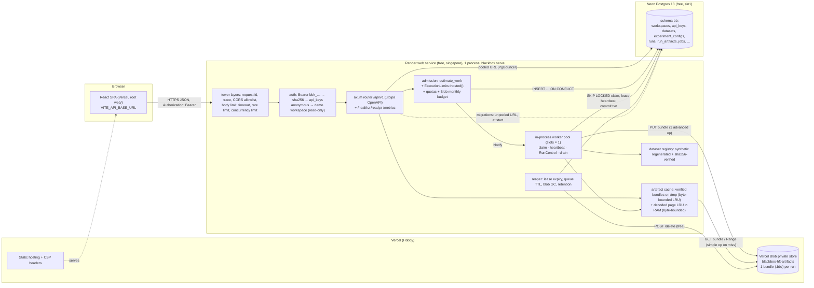
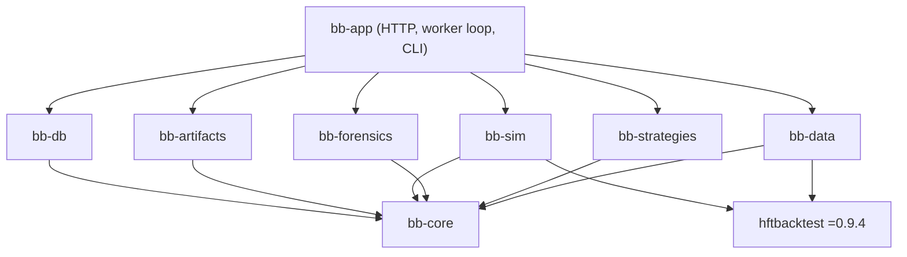
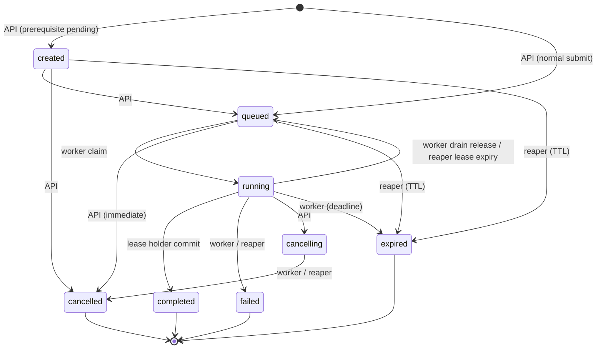

# Target architecture

Status: Phase 0 design, 2026-11-14. Owner: Architect. Companion documents:
[DATABASE_DESIGN.md](DATABASE_DESIGN.md) (schema, validated DDL in [schema_draft.sql](schema_draft.sql)),
[API_CONTRACT.md](API_CONTRACT.md) (`/api/v1`), and [DEPLOYMENT.md](DEPLOYMENT.md) (GHCR → Render, Vercel).

This document assumes the decisions in [PROJECT_STATE.md](PROJECT_STATE.md), the defects and acceptance tests in
[BASELINE_AUDIT.md](BASELINE_AUDIT.md) (§7 backlog, §8 AT-1…AT-15), and the stack chosen in
[../research/OSS_TECHNOLOGY_EVALUATION.md](../research/OSS_TECHNOLOGY_EVALUATION.md) §7. It does not repeat
them. Statements about external platforms cite a source listed at the end ([R1]…). Anything not read or measured is
marked **[INFERENCE]**.

---

## 1. Constraints that shape the design

| Constraint | Consequence in this design | Source |
|---|---|---|
| Render Free web service: 0.1 CPU / 512 MB, one instance, may be restarted at any time | One process runs API and worker. Worker concurrency is 1. Every job must survive a kill: leases, not in-memory state | [R1] |
| Spins down after 15 min without inbound traffic; spin-up takes about one minute; local files are lost on spin-down/redeploy | No local system of record. Startup recovers queued and orphaned work. The per-attempt job deadline (10 min) is below the idle window | [R1] |
| Pre-deploy command is only available on paid services | Migrations run in the start command before the server binds (§13) | [R2], [R3] |
| SIGTERM on redeploy: sent 60 s after the new instance is live, then SIGKILL after the shutdown delay (default 30 s, max 300 s) | Drain budget of 25 s (§12) | [R2], [R3] |
| Health checks every few seconds; 2xx/3xx within 5 s; a running instance failing for 60 s is restarted | `/healthz` is process-local and never touches Postgres (§13, §14) | [R5] |
| Neon Free: 1 GB storage/project, 100 CU-hours/month, scale to zero after 5 min (cannot be disabled), wakes in "a few hundred milliseconds" | No DB traffic while idle: no polling, no heartbeats, no health-check queries when there is no work | [N1], [N2] |
| Neon pooler is PgBouncer transaction mode: no session `SET`, `LISTEN/NOTIFY`, temp tables or session advisory locks | Queue statements are single autocommit statements or short transactions; wake-up via in-process `tokio::sync::Notify`; migrations over the unpooled URL | [N3] |
| Vercel Blob Hobby: 1 GB, 2,000 advanced ops (uploads) and 10,000 simple ops (uncached reads) per month; exceeding blocks the store for 30 days | One upload per run. Usage counters in Postgres, checked at admission. Verified bundles are cached on local disk, so a run is read from Blob about once per instance lifetime | [V1] |

---

## 2. Components



The worker is the same code as `blackbox worker` (standalone process). The `render.yaml` in
[DEPLOYMENT.md](DEPLOYMENT.md) §4 declares a paid private worker only as a commented upgrade path.

---

## 3. Crate layout and dependency rules

| Crate | Responsibility | Depends on (workspace) | New external deps |
|---|---|---|---|
| `bb-core` | Type contract (unchanged role) + `ExecutionLimits`, `WorkEstimate`, `RunConfig::estimate_work` (SimCore contract) + `utoipa::ToSchema` derives behind feature `openapi` | – | `utoipa` (optional) |
| `bb-data`, `bb-strategies`, `bb-forensics` | Unchanged roles | as today | – |
| `bb-sim` | `simulate()` gains `&dyn RunControl` + `RunBudget` (SimCore contract) | `bb-core`, `hftbacktest` | – |
| **`bb-artifacts`** (new) | Bundle format v1 (writer/reader, gzip member per page, page index, trailer), integrity hashing (`result_sha256`, `summary_sha256`, per-page and bundle sha256), `ArtifactStore` trait with `FsStore` and `VercelBlobStore` (reqwest, `x-api-version` pinned, retries on 5xx/429, Range GET), verified-bundle disk cache | `bb-core` | `reqwest` (rustls), `flate2`, `sha2`, `tokio` |
| **`bb-db`** (new) | `PgPool` construction (pooled URL, `min_connections = 0`), embedded `sqlx::migrate!` (unpooled URL), repositories (workspaces/keys, datasets, experiments, runs, comparisons, sweeps, reports, events), the job queue (submit, claim, heartbeat, release, complete, cancel, reaper), SQLSTATE → domain error mapping (`BB001`, `BB002`, 23505) | `bb-core` | `sqlx` 0.9 (`postgres`, `tls-rustls`, `macros`, `migrate`, `uuid`, `chrono` or `time`) |
| `bb-app` | Composition root: HTTP (`http::v1` routers, auth, CORS, limits, OpenAPI), worker loop (`worker::{pool, control, reaper, drain}`), admission, CLI (`serve`, `worker`, `migrate`, `keys mint/revoke/list`, `demo seed`, `run` offline, `verify-bundle`, `openapi`) | everything | `tower-http` 0.7, `tower_governor`, `tracing-subscriber` (json) |



Rules (checked by `cargo tree -e normal -i <crate>` in CI **[INFERENCE: check to be written]**):

1. Only `bb-sim` and `bb-data` link `hftbacktest` (unchanged rule).
2. `bb-db` and `bb-artifacts` depend on `bb-core` only. They never see the engine, the simulator or forensics. They
   persist and verify bytes and rows; they do not compute science.
3. All SQL lives in `bb-db`; all object-storage HTTP lives in `bb-artifacts`. `bb-app` never builds SQL strings or
   Blob URLs.
4. `bb-db` and `bb-artifacts` do not depend on each other. The completion protocol (§6) that spans both is
   orchestrated in `bb-app::worker`.
5. `bb-app` is the only crate that reads environment variables.
6. `sqlx` query macros are checked offline (`.sqlx/` committed, `SQLX_OFFLINE=true` in builds,
   `cargo sqlx prepare --check --workspace` in CI against a throwaway Postgres). This requires the workspace
   `rust-version` ≥ 1.94 and the Dockerfile builder image ≥ 1.94 (OSS evaluation §3.5).

**Removed at cutover** (clean cutover, no shims): `bb-app::store` (`RunStore`/`FsRunStore` and its 16-entry cache),
`export_static.rs` and `blackbox export-static`, `npm run build:static` and the static client mode, the legacy
`/api` router in `server.rs`, `access.rs` (replaced by auth + CORS + Host allowlist), the `RUN_SLOTS`/`GRID_SLOTS`
semaphores and `grid_threads`. Local `blackbox serve` uses Postgres (local cluster) plus `FsStore`. `blackbox run`
stays a DB-free offline command that writes a bundle to a directory.

---

## 4. Job lifecycle

### 4.1 States and transitions



The edge list is data in `bb.job_transitions` and is enforced by a trigger (`SQLSTATE BB002`); the validation in
[DATABASE_DESIGN.md](DATABASE_DESIGN.md) §13 shows `queued → completed`, `completed → running` and
`cancelling → completed` rejected.

| # | From → To | Trigger (actor) | Guard (SQL predicate) | Effects |
|---|---|---|---|---|
| 1 | ∅ → `queued` | `POST /experiments`, `POST /sweeps` (API) | admission passed; `INSERT … ON CONFLICT ON jobs_single_flight DO NOTHING` | `queued_at = now()`; in-process `Notify` |
| 2 | ∅ → `created` | API, when a prerequisite is not ready (dataset version not materialised for a `blob` dataset) | same | none until #3 |
| 3 | `created` → `queued` | API / dataset loader | prerequisite ready | `Notify` |
| 4 | `queued` → `running` | worker claim | `state='queued' AND platform=$my_platform AND run_after<=now()`, `FOR UPDATE SKIP LOCKED` | `claim_count+1`, lease owner + expiry (60 s), `job_attempts` row |
| 5 | `running` → `completed` | lease holder only | `state='running' AND lease_owner=$me` in the commit transaction (§6) | `run_id` set, lease cleared, attempt `completed` |
| 6 | `running` → `failed` | worker | deterministic error (`invalid_config`, `budget_exceeded`, `simulation_failed`, `integrity_failed` at commit) or `storage_failed` after 3 upload retries | lease cleared, `error_{category,code,message}` |
| 7 | `running` → `failed` | reaper | `lease_expires_at < now()` and `lease_losses + 1 >= max_attempts` | `error_category = 'lease_expired'` |
| 8 | `running` → `queued` | reaper | `lease_expires_at < now()` and attempts remain | `lease_losses+1`, `run_after = now() + 30 s × lease_losses`, progress reset |
| 9 | `running` → `queued` | worker, on SIGTERM drain | lease holder | `lease_losses` unchanged (a graceful release is not a failed attempt), `run_after = now()` |
| 10 | `running` → `cancelling` | API cancel | no remaining non-cancelled experiment references the job (§5.4) | `cancel_requested_at`; in-process cancel flag set immediately |
| 11 | `cancelling` → `cancelled` | worker at next checkpoint; reaper if the lease expires first | lease holder / expired lease | lease cleared; temp files deleted; any uploaded object deleted |
| 12 | `queued`/`created` → `cancelled` | API cancel | as #10 | immediate, no worker involvement |
| 13 | `queued`/`created` → `expired` | reaper | `expires_at < now()` (default 24 h after submission) | `expired_reason` (verbatim to UI) |
| 14 | `running` → `expired` | worker at a checkpoint | attempt wall time > `deadline_ms` (hosted 600 s) | `expired_reason = "exceeded the 600 s per-attempt deadline"` |

**Note for the UI spec ([UI_DESIGN_SPEC.md](UI_DESIGN_SPEC.md) §10.4):** edges 8 and 9 (`running → queued`) are
legitimate and must not be discarded as "out-of-order". The job resource carries `attempt` and `lease_losses`, so the UI
can label it "re-queued after worker restart".

### 4.2 Invariants

| Invariant | Enforced by |
|---|---|
| I1. Only the lease holder can move `running`/`cancelling` forward (complete, fail, release, cancel). | Every worker statement has `AND lease_owner = $me AND state IN (…)`; a 0-row result means the lease was lost and the worker abandons the attempt |
| I2. `completed` ⇔ a committed run row exists. | `CHECK ((state='completed') = (run_id IS NOT NULL))`, FK `jobs.run_id → runs` |
| I3. Completion only after the artefact was uploaded and its hashes verified. | Protocol §6: the run, artefact and job rows are written in one transaction that runs only after steps 1–5 |
| I4. A lease exists iff the state is `running` or `cancelling`. | `CHECK` on `lease_owner`/`lease_expires_at` |
| I5. At most one live job per (experiment, platform). | partial unique index `jobs_single_flight` |
| I6. Lease expiry re-queues at most `max_attempts − 1` times, then fails with `lease_expired`. | reaper statement (#7/#8); `CHECK (lease_losses <= max_attempts)` |
| I7. A cancelled job leaves no run row and no stored object. | #11 effects; `cancelling → completed` is not an edge |
| I8. Terminal ⇔ `finished_at` set; terminal states have no outgoing edges. | `CHECK`; transition table |
| I9. A worker only executes jobs of its own platform class. | claim predicate `platform = $my_platform` (index `jobs_claim` leads with `platform`) |

### 4.3 Worker loop

```
startup:   upsert worker_heartbeats(state=starting); reaper pass; wake_at := next_wake()
loop:
  if draining → break
  job := claim()                                   -- one UPDATE … WHERE id = (SELECT … SKIP LOCKED LIMIT 1)
  if none:
      wake_at := next_wake()                       -- min(run_after of queued, lease_expires_at of running,
                                                   --     expires_at of queued) for my platform; NULL if none
      heartbeat row → idle (one write), then sleep until Notify | wake_at | shutdown
      continue                                     -- no timer when wake_at is NULL: zero DB traffic when idle
  if a canonical, unquarantined run already exists for (config, platform):
      complete the job against that run (claim-time de-duplication) and continue
  execute(job) with RunControl { progress → atomics; should_cancel → cancel flag | drain flag | deadline }
  heartbeat task every 15 s: extend lease to now()+60 s, write ticks_done/tape_events, read back state
      (state = 'cancelling' sets the cancel flag; 0 rows ⇒ lease lost ⇒ abort without commit)
```

In-process, the API sets the cancel flag directly, so cancellation takes effect within one progress interval
(AT-6). A standalone `blackbox worker` learns of it at its next heartbeat (≤ 15 s). The API serves `progress` for a
job held by its own worker from memory, so progress is fresh without extra DB writes. Heartbeats run only while busy.

---

## 5. Single-flight and idempotency

### 5.1 Identity

- **Experiment identity** = `fingerprint` = sha256 of (`CONTRACT_VERSION`, `SIMULATION_REVISION`, engine name, engine
  version, dataset `events_sha256`, `RunConfig`), exactly today's `pipeline::run_identity`
  (`crates/bb-app/src/pipeline.rs:56-71`). Stored once in `bb.experiment_configs` (`UNIQUE (fingerprint)`).
- **Run identity** = (fingerprint, platform class). `bb.runs` has `UNIQUE (experiment_config_id, platform) WHERE
  quarantined_at IS NULL`.
- The 16-hex `run_id` used today remains the public run id and a lookup alias (`short_id UNIQUE`). A prefix collision
  becomes an insert error answered with 409 `conflict` instead of FsRunStore's silent overwrite (BASELINE_AUDIT §4.2).
  The API also accepts the full 64-hex fingerprint wherever a run id is accepted.

### 5.2 Submission algorithm (`POST /api/v1/experiments`)

All statements are autocommit or short transactions on the pooled connection:

1. Validate the config (`invalid_config`, 422). Resolve `dataset_id` to its current dataset version. Compute the
   fingerprint and `estimate_work`. Check `ExecutionLimits::hosted()` (`budget_exceeded`, 422, naming the limit).
2. Lock the key row (`SELECT … FROM bb.api_keys WHERE id=$k FOR UPDATE`), then count today's submissions
   (`quota_exceeded`, 429). Check the Blob monthly counters (`quota_exceeded`, 429, `scope: "storage"`).
3. `INSERT INTO bb.experiment_configs … ON CONFLICT (fingerprint) DO NOTHING`, then `SELECT id`.
4. If a live run exists for (config, platform): no job. Upsert the workspace experiment and return `200` with the run.
5. Otherwise `INSERT INTO bb.jobs … ON CONFLICT (experiment_config_id, platform) WHERE state IN (live) DO NOTHING
   RETURNING id`. If no row came back, read the live job in a *new statement*: a fresh READ COMMITTED snapshot sees
   the winner's committed row. If that read finds nothing because the winner completed in between, go back to step 4
   (at most 3 iterations).
6. `INSERT INTO bb.experiments … ON CONFLICT ON CONSTRAINT experiments_idempotency DO UPDATE SET job_id = …,
   cancel_requested_at = NULL RETURNING (xmax = 0) AS created`. Answer `202` with the job and `created`.

Measured on the local cluster: 8 concurrent sessions that submitted the same experiment at the same instant produced
exactly 1 config row, 1 job and 1 experiment. All 8 sessions got the same job id, and exactly one got `created = true`
(transcript in [DATABASE_DESIGN.md](DATABASE_DESIGN.md) §13.3). The worker side of AT-4 ("exactly 1 simulation")
follows from I5 plus claim-time de-duplication, and is asserted by the `simulations_started_total` metric.

### 5.3 Label policy (AT-4)

**First label wins** per workspace experiment. A repeat submission returns `created: false` with the stored label.
Renaming is explicit: `PATCH /experiments/{id}` with `If-Match` (optimistic concurrency on `version`).

### 5.4 Shared jobs and cancellation

Jobs and runs are global: workspace B submitting A's experiment reuses A's job or run. Visibility stays per workspace
through `bb.experiments`. A cancel request marks the caller's experiment `cancel_requested_at`. The job itself is
cancelled only when no other experiment still wants it. So one workspace can never cancel another's work.

### 5.5 Sweeps

A sweep is admitted as one unit and fans out into N experiment rows (`sweep_id`, `x`, `y`), each going through steps
3–6 with priority 50. Cells that already have runs are complete immediately. Idempotency: `UNIQUE (workspace_id,
spec_fingerprint)`. There is no separate grid executor and no grid thread pool.

---

## 6. Persistence protocol on completion

### 6.1 Bundle format v1 (`.bbz`)

One object per run: a concatenation of gzip members (RFC 1952 §2.2), so the whole object decompresses as one NDJSON
stream (OSS evaluation §4).

| Member | Content |
|---|---|
| 0 header | `{"format":"blackbox-bundle","format_version":1,"fingerprint":…,"platform":…,"sections":[…]}` |
| pages | Sections `orders`, `fills`, `equity`, `tape`. Each page holds at most 5,000 rows of the bb-core serde JSON of that type, one per line |
| last: trailer | `RunManifest`, `Metrics`, `EngineStateCheck`, counts, `result_sha256`, `summary_sha256`, and the page index |

The page index lists, for each page: `{section, first_row, rows, offset, len, sha256, ts_min, ts_max}` (per-clock
`ts` ranges for `tape`; `ts` ranges for `equity`/`fills`). It is also stored in `bb.run_artifacts.page_index`
together with `page_index_sha256`.

### 6.2 Steps

```mermaid
sequenceDiagram
  participant W as worker (lease holder)
  participant T as /tmp
  participant B as Vercel Blob
  participant P as Postgres
  W->>W: simulate() with RunControl + RunBudget (aborts on budget/cancel/deadline)
  W->>T: 1. stream sections into temp .bbz (page members), hashing as it writes
  W->>W: 2. hash: result_sha256 (canonical JSON of tape, fills, equity), summary_sha256, per-page + bundle sha256
  W->>T: 3. validate: re-read temp file, decompress every member, recompute all hashes and counts, check size ≤ max_output_bytes
  W->>P: 4a. INSERT bb.blob_gc (upload_intent, not_before = now()+1h)  [own txn]
  W->>B: 4b. PUT runs/<fingerprint>/<platform>/<run uuid>.bbz (x-allow-overwrite: 0)
  W->>B: 4c. read back trailer by Range GET and compare sha256 (1 simple op)
  W->>P: 5. BEGIN; INSERT runs (ON CONFLICT identity DO NOTHING); INSERT run_artifacts; DELETE blob_gc intent; UPDATE jobs SET state='completed' WHERE lease_owner=$me AND state='running'; UPDATE job_attempts; bump storage_usage_monthly; COMMIT
  W->>T: 6. move temp file into the verified-bundle cache
```

Failure handling:

- Steps 1–3 fail → no external side effect. Budget or cancel → `failed{budget_exceeded}` / `cancelled`, and the temp
  file is deleted (AT-5: "writes no artefact").
- Step 4 fails → retry with backoff (3 tries, honouring 429). The intent row guarantees that a partial or orphaned
  object is deleted by the GC after `not_before`. Exhausted retries → `failed{storage_failed}` (retryable by resubmit).
- Step 5 updates 0 job rows (lease lost or cancelling) → `ROLLBACK`. The intent row survives, so the object is
  GC'd. The job belongs to whoever holds it now.
- Step 5 `ON CONFLICT` on the run identity (another attempt already committed) → compare `result_sha256`. Equal:
  complete the job against the existing run and leave the new object to GC. Different: record a `system_events` row
  `nondeterminism_detected` (error) and fail the job with `internal`. This is a scientific alarm, not a retry case.

---

## 7. Integrity on read

Trust root: Postgres rows. They are protected by immutability triggers (DATABASE_DESIGN §5.3) and hold every hash.
Blob objects and local caches are outside the trust boundary and are always verified against those rows.

| Read | Verification | On mismatch |
|---|---|---|
| Run summary/metrics (DB only) | recompute `summary_sha256` over the canonical JSON of `metrics`, `engine_check` and counts | `integrity_failed` |
| First use of a bundle on this instance | stream the whole object to `/tmp`, compare sha256 with `run_artifacts.sha256`, compare the trailer's `result_sha256`/`summary_sha256` with the run row | `integrity_failed` |
| Range read (bundle above `BB_ARTIFACT_WHOLE_FETCH_MAX`, default 16 MiB, never hit under hosted limits) | page sha256 from the DB page index | `integrity_failed` |
| Export (`/export`) | serves the verified cached file | – |

`integrity_failed` answers HTTP 500 with the stable code and the run id. It sets `runs.quarantined_at` (the only
mutable column besides its reason) and writes a `system_events` row. A quarantined run no longer satisfies the
identity, so the next identical submission re-simulates (AT-3). This was validated: after quarantine a new run row for
the same identity inserts (DATABASE_DESIGN §13.2).

---

## 8. Resource budgeting

### 8.1 One admission path

Runs and sweep cells pass the same admission function, enter the same `bb.jobs` queue and run on the same worker slot.
There is no second executor.

| Check | When | Error |
|---|---|---|
| `RunConfig::validate()` | submit | 422 `invalid_config` |
| `estimate_work(manifest)` vs `ExecutionLimits` (`max_ticks`, `max_tape_events`, `max_output_bytes`) | submit, per config | 422 `budget_exceeded` (`details.limit`, `details.value`, `details.what`) |
| Sweep: cells ≤ `max_sweep_cells` (hosted 25, local 100 = `MAX_GRID_CELLS`); Σ estimates ≤ sweep budget | submit | 422 `budget_exceeded` |
| Workspace/key quotas (`quota_experiments_per_day`, `quota_sweeps_per_day`, `quota_active_jobs`) | submit, in the transaction that inserts | 429 `quota_exceeded` |
| Blob month: uploads + projected ≤ 1,800 of 2,000; bytes stored + `est_output_bytes_upper` ≤ 900 MB of 1 GB | submit | 429 `quota_exceeded` (`scope: "storage"`) |
| Runtime `RunBudget` (`max_tape_events`, `max_equity_samples`) | during `simulate()` | job `failed{budget_exceeded}` |
| Deadline (`deadline_ms`, hosted 600,000) | `should_cancel()` checkpoint | job `expired` |

`ExecutionLimits::hosted()` values are owned by SimCore. The architectural requirement is the AT-5 test: on Linux,
peak RSS (`VmHWM`) of the largest admitted synthetic job is ≤ 300 MB. With `max_output_bytes` ≤ 8 MiB, the 1 GB Blob
store holds at least 112 worst-case runs. The measured synthetic runs are about 0.7 MB (OSS evaluation §4), so it holds
about 1,400 typical runs.

### 8.2 Memory budget of the 512 MB instance [INFERENCE: planning figures, to be replaced by measurements]

| Consumer | Budget | Bound by |
|---|---:|---|
| One running job (simulation + streaming bundle writer) | 300 MB | `ExecutionLimits::hosted()` (AT-5) |
| Dataset registry (synthetic events + BBO series) | 32 MB | hosted datasets are synthetic, ~63k rows each |
| Decoded page cache (RAM) | 48 MB | `BB_PAGE_CACHE_BYTES`, LRU by bytes |
| HTTP: at most 4 concurrent heavy reads × ≤ 4 MiB response + decode | 32 MB | `ConcurrencyLimitLayer(4)` on artefact routes; 4 MiB page cap |
| Runtime, pools, TLS, allocator slack | 60 MB | – |
| **Total** | **472 MB** | headroom ≈ 40 MB |

Worker slots = 1 on the hosted profile (`BB_WORKER_SLOTS=1`). During a zero-downtime deploy, the old and new
instances overlap for about 60 s [R2]. Each instance has its own 512 MB, and `SKIP LOCKED` keeps their claims
disjoint.

---

## 9. Platform policy

- Platform class = `<os>-<arch>` of the worker binary (`linux-x86_64`, `windows-x86_64`, …), fixed at compile time.
- Results are keyed by (fingerprint, platform). **Canonical = `linux-x86_64`** (`runs.is_canonical` is a generated
  column). The hosted deployment only runs Linux workers, so every hosted result is canonical.
- The API sets each job's platform to the deployment's result platform (`BB_RESULT_PLATFORM`, default = own build
  platform). A worker claims only jobs of its own platform (I9). A Windows development machine against a local DB
  therefore produces `windows-x86_64` rows and can never publish a canonical one (AT-7).
- `GET /runs/{id}` returns the canonical run. `?platform=` selects another class explicitly, and every run payload
  carries `platform` and `canonical`. The demo workspace is seeded by `blackbox demo seed` against the hosted API, so
  its runs are canonical.

## 10. Timestamp and integer policy

- Every nanosecond quantity on the wire is a JSON **string** holding a decimal i64: relative ns, absolute epoch ns,
  durations and latencies (`*_ns`), plus the wall-clock instants of the job resource (`created_at_ns`, …). This also
  applies to `seed` (u64) and `generator.origin_ns` (the AT-9 hazards).
- Other integers (counts, `order_id`, `seq`, `tick_no`) stay JSON numbers. The server asserts they are ≤ 2^53 − 1
  before serialising, and `dataset_versions` CHECKs that a span is below 2^53 ns.
- The encoding is changed **in the bb-core serde types** (single source of truth, so the generated TS types follow).
  That changes the canonical JSON that `config_sha256`/`result_sha256` hash, so this change bumps `CONTRACT_VERSION`
  to 2 and re-pins the golden hashes in the same commit. The commit message records that only the encoding changed
  (old and new decoded values compared equal). Hosted data starts empty, so there is nothing to migrate.

## 11. API versioning and legacy cutover

| Legacy (`/api`, `server.rs:76-111`) | v1 ([API_CONTRACT.md](API_CONTRACT.md)) |
|---|---|
| `GET /health` | `GET /healthz` (liveness), `GET /readyz` (readiness), `GET /api/v1/status` (UI status bar) |
| `GET /datasets`, `/datasets/{id}` | `GET /api/v1/datasets`, `/datasets/{id}`, `/datasets/{id}/versions[/{v}[/quality]]` |
| `GET /datasets/{id}/replay` | `GET /api/v1/datasets/{id}/versions/{v}/replay` (+ `…/{id}/replay` = current version) |
| `GET /presets`, `GET /demos` | `GET /api/v1/presets`, `GET /api/v1/demos` |
| `POST /runs` (synchronous) | `POST /api/v1/experiments` → 202 job (or 200 existing run) |
| `GET /runs` (unpaginated) | `GET /api/v1/experiments` (cursor, filters), `GET /api/v1/runs` (completed, sortable) |
| `GET/DELETE /runs/{id}` | `GET /api/v1/runs/{run_id}`; `DELETE /api/v1/experiments/{id}` (detach; GC frees the run) |
| `/runs/{id}/orders`, `/orders/{oid}`, `/fills`, `/equity`, `/tape`, `/timeline`, `/engine-check`, `/report`, `/export` | same sub-paths under `/api/v1/runs/{run_id}/…`, all paged and byte-bounded |
| `POST /compare` | `POST /api/v1/comparisons` (eligibility + metrics), `GET …/{id}/pairs` |
| `POST /grids` (synchronous) | `POST /api/v1/sweeps` → 202, cells are queued experiments |
| – | `/api/v1/jobs…`, `/api/v1/whoami`, `/api/v1/reports…`, `/api/v1/system/…`, `/api/v1/openapi.json` |

**Removal rule:** release *N* ships `/api/v1` alongside the legacy router. Release *N+1* removes `/api` together with
the old web client, in the commit that switches `web/` to the generated v1 client. That is one cutover with no
compatibility layer. The legacy router is never deployed to Render, because hosted deployment starts at *N+1*, so the
unauthenticated legacy `DELETE /api/runs/{id}` never becomes public.

## 12. Graceful shutdown (SIGTERM)

Render sends `SIGTERM` to the old instance 60 s after the new one is live. If the process has not exited after the
shutdown delay (default **30 s**, configurable 1–300 s via `maxShutdownDelaySeconds`), it sends `SIGKILL` [R2], [R3].
Render's docs do not say whether a Free instance gets `SIGTERM` on idle spin-down [R1]. The design does not depend on
it: leases recover any job that is killed.

Shutdown sequence (`BB_SHUTDOWN_GRACE_MS = 25000`, inside the 30 s default; we do not rely on raising the delay):

| t (s) | Action |
|---|---|
| 0 | `SIGTERM` caught (tokio `signal::unix`). `/readyz` → 503 `draining`. Worker stops claiming. `worker_heartbeats.state = draining` |
| 0 | axum `with_graceful_shutdown`: stop accepting connections; in-flight requests get ≤ 10 s |
| 0 | Drain flag set → `RunControl::should_cancel()` returns true at the next checkpoint (every `progress_every_ticks`, ≈ 100 ms of work under hosted limits) |
| ≤ 1 | Simulation stopped → **release**: `UPDATE bb.jobs SET state='queued', lease_owner=NULL, lease_expires_at=NULL, run_after=now(), queued_at=now() WHERE id=$j AND lease_owner=$me AND state='running'`. Attempt outcome `released`. Temp files deleted |
| – | If the job is already in steps 4–5 of §6 and ≥ 10 s of grace remain, finish the commit. Otherwise abandon: the intent row GCs the object, and the lease expires and re-queues (edge #8) |
| ≤ 25 | `worker_heartbeats.state = stopped`. Close the pool. Exit 0 |

The process is started with `exec` (DEPLOYMENT.md §4), so it is PID 1 and receives the signal itself.

## 13. Cold start

1. A request arrives at a spun-down service. Render starts an instance (about one minute) and shows browsers a loading
   page [R1]. The UI treats non-JSON or slow responses as `WAKING` (UI_DESIGN_SPEC §10.1).
2. `blackbox migrate` runs over `DATABASE_URL_UNPOOLED`. sqlx takes its advisory lock, which needs a session, hence the
   direct URL [N3]. If Neon is suspended, it wakes in a few hundred ms [N2]. Without pending migrations this is one
   round trip. The process then `exec`s `blackbox serve`.
3. `serve`: tracing init, config, pooled `PgPool` (`min_connections 0`, `max_connections 5`, `idle_timeout` 240 s,
   below Neon's 5-min idle close), Blob client, then bind `0.0.0.0:$PORT` [R7]. Synthetic datasets are regenerated
   lazily on first use and checked against `events_sha256`.
4. The worker starts: heartbeat row `starting → idle`, a reaper pass (expired leases from the killed instance re-queue
   or fail per I6; queue TTL expiry), one claim. Queued work therefore resumes on every wake.
5. With no work: no timers and no DB traffic. Neon suspends after 5 min [N2], and Render spins the service down after
   15 min without inbound traffic [R1].

Consequence: work queued when the service spins down waits for the next inbound request. A sweep progresses only
while something (normally the polling UI) keeps the service awake. The design does not ping itself to stay awake: free
instance hours are shared with 8 other services in the workspace (PROJECT_STATE), and UI_DESIGN_SPEC §10.1 forbids
keep-alives.

## 14. Health and readiness

| Path | Purpose | Touches DB | Used by |
|---|---|---|---|
| `GET /healthz` | process alive, router responsive | **no** | Render `healthCheckPath` |
| `GET /readyz` | migrations at expected version, a pooled `SELECT 1` within 2 s, Blob token configured, not draining | yes | smoke tests, operators |
| `GET /api/v1/status` | UI status bar: worker state, last heartbeat age, heartbeat interval, queue depth (from the worker's last poll), server time | no (memory) | UI every 30 s |

Render probes the health path "every few seconds" [R5]. If that path queried Postgres, Neon could never reach its
5-minute idle suspend while the Render instance is up. At 0.25 CU for 24 h × 30 days, that would be 180 CU-hours, above
the 100 CU-hour allowance [N1] [arithmetic]. The same reasoning keeps `/api/v1/status` memory-only.

## 15. Observability

- **Logs:** `tracing` + `tracing-subscriber` JSON to stdout, collected by Render's log stream. Fields: `ts`, `level`,
  `target`, `msg`, `request_id`, `route` (template, not raw path), `status`, `latency_ms`, `workspace`, `key_prefix`
  (never the key), `job_id`, `attempt`, `run_id`, `fingerprint` (16 hex).
- **Request ids:** tower-http `SetRequestId` accepts a client `X-Request-Id` matching `^[A-Za-z0-9-]{8,64}$`,
  otherwise generates a UUIDv7. `PropagateRequestId` returns it, and every error envelope contains it.
- **Spans:** `http.request` → handler; `job{job_id, attempt, fingerprint}` → `simulate`, `bundle.write`,
  `bundle.validate`, `blob.put`, `db.commit`; `reaper.pass`; `blob.get{run_id, bytes, cache}`.
- **Metrics:** `GET /metrics` (Prometheus text format, `admin` scope; hand-rolled atomics, no extra crate):
  `http_requests_total{route,status}`, `http_request_duration_seconds` (histogram), `jobs_submitted_total`,
  `jobs_deduplicated_total`, `simulations_started_total` (AT-4), `jobs_finished_total{state,category}`,
  `lease_reclaims_total`, `queue_depth`, `worker_busy`, `integrity_failures_total`, `nondeterminism_total`,
  `blob_ops_total{op}`, `artifact_cache_{hits,misses}_total`, `artifact_cache_bytes`,
  `process_resident_bytes`/`process_peak_resident_bytes` (Linux `/proc/self/status` `VmRSS`/`VmHWM`).
- **Durable events:** `bb.system_events` (lease reclaimed, integrity failed, nondeterminism, budget exceeded,
  startup/shutdown, migration applied) and `bb.audit_events` (key use denied, experiment created, cancel, delete, key
  revoke), both readable through `/api/v1/system/events` (admin).

## 16. Security summary

API keys are `bbk_` + 43 base64url characters (32 random bytes). Only sha256 digests are stored; lookup is by
digest. Scopes are `read` ⊂ `run` ⊂ `admin`. Keys are minted only by the CLI (`blackbox keys mint`). Anonymous
requests are read-only on the demo workspace; anonymous mutations get 401, and keys without the needed scope get 403.
CORS uses an exact-origin allowlist from env, with no credentials mode because the key is a header, not a cookie. The
Host allowlist comes from `RENDER_EXTERNAL_HOSTNAME` plus custom domains [R8], [R5]. `BLOB_READ_WRITE_TOKEN` and the
database URLs exist only in Render's environment, and artefacts reach browsers only through the API, which enforces
workspace scope. Details: [API_CONTRACT.md](API_CONTRACT.md) §3–§6.

## 17. Risks and open items

| Item | Status |
|---|---|
| Vercel Blob object API is unofficial (read from SDK source; PROJECT_STATE verified it with raw HTTP) | Integration test against a dev store run by a human; failures leave jobs `failed{storage_failed}`, resubmittable |
| Whether ranged reads of private blobs are CDN-cacheable (affects simple-op counting) | Avoided by whole-bundle fetch + disk cache; counters assume every GET is a miss |
| Render "service-initiated traffic threshold" may suspend a Free service with uncommonly high outbound traffic, citing external databases and object storage as examples [R1] | Our outbound volume is bounded by the Blob budget (≤ 2,000 uploads ≤ 8 MiB each per month) **[INFERENCE: below any threshold; Render publishes no number]** |
| Free instance hours (750/month) are shared with 8 unrelated services | Operational: monitor in Render billing; the design adds no keep-alives |
| SIGTERM on idle spin-down is undocumented | Design does not depend on it (leases) |
| `ExecutionLimits::hosted()` numbers and peak-RSS evidence | SimCore + AT-5 Linux CI test |
| Ephemeral disk size on Render Free is not documented | Disk cache bounded at 256 MiB (`BB_ARTIFACT_DISK_CACHE_BYTES`) **[INFERENCE: fits]** |

## Sources (read 2026-11-14)

- [R1] Render — Deploy for Free. https://render.com/docs/free
- [R2] Render — Deploying on Render (deploy steps, pre-deploy command, zero-downtime sequence, graceful shutdown). https://render.com/docs/deploys
- [R3] Render — Blueprint YAML reference (`preDeployCommand`, `maxShutdownDelaySeconds`, `runtime: image`, `region`). https://render.com/docs/blueprint-spec
- [R5] Render — Health Checks. https://render.com/docs/health-checks
- [R7] Render — Web Services (port binding). https://render.com/docs/web-services
- [R8] Render — Environment variables (`RENDER_EXTERNAL_HOSTNAME`, `RENDER_INSTANCE_ID`). https://render.com/docs/environment-variables
- [N1] Neon — Plans. https://neon.com/docs/introduction/plans
- [N2] Neon — Scale to zero. https://neon.com/docs/introduction/scale-to-zero
- [N3] Neon — Connection pooling. https://neon.com/docs/connect/connection-pooling
- [V1] Vercel — Blob usage and pricing. https://vercel.com/docs/vercel-blob/usage-and-pricing
